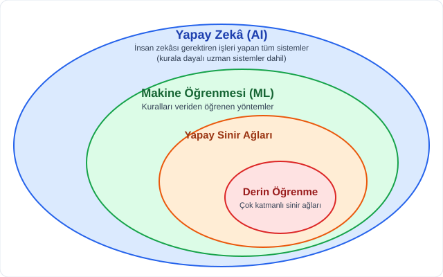
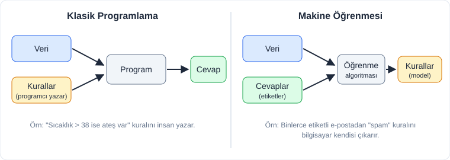
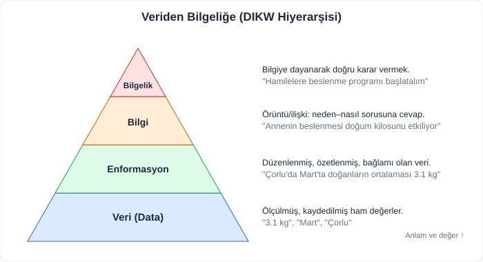

# 1. Temel Kavramlar

## 1.1 Yapay Zekâ, Makine Öğrenmesi ve Derin Öğrenme

**Yapay Zekâ** (İng. *Artificial Intelligence – AI*; Lat. *artificialis*: "beceriyle yapılmış", *intelligentia*: "kavrama, anlama yetisi"), normalde insan zekâsı gerektiren işleri (görme, anlama, karar verme, planlama…) bilgisayarların yapabilmesini amaçlayan bilim dalının en genel adıdır. İnsanların **bilgi, deneyim ve uzmanlığını** bilgisayarlara aktarmanın yollarını inceler.

**Makine Öğrenmesi** (İng. *Machine Learning – ML*; "makine" Lat. *machina*: "düzenek, araç"), yapay zekânın bir **alt dalıdır**. Kuralları bir insanın tek tek yazması yerine, bilgisayarın bu kuralları **veriden kendisinin öğrenmesini** sağlayan yöntemleri kapsar.

**Yapay Sinir Ağları** (İng. *Artificial Neural Networks*; "nöron" Yun. *neuron*: "sinir") makine öğrenmesinin bir yöntem ailesidir; **Derin Öğrenme** (İng. *Deep Learning*) ise çok katmanlı sinir ağlarıyla yapılan öğrenmedir.

> **Tanım (Tom Mitchell, 1997):** "Bir bilgisayar programı, **T** görevindeki başarısı **P** ölçütüyle ölçüldüğünde, **E** deneyimiyle artıyorsa, o program E deneyiminden öğreniyor demektir."
> Örneğin bir spam filtresi için: **T** = e-postaları spam/normal diye ayırmak, **P** = doğru sınıflandırılan e-postaların oranı, **E** = kullanıcının daha önce "spam" diye işaretlediği e-postalar.

## 1.2 Klasik Programlama ile Makine Öğrenmesinin Farkı

Bilgisayarlar talimatları **dijital (sayısal)** bir dille, yani 0 ve 1'lerle işler. Klasik programlamada, bir problemi çözmek için gereken kuralları **programcı** bu dile çevirir. Makine öğrenmesinde ise bilgisayara **veri ve doğru cevaplar** verilir, kuralları **öğrenme algoritması** (İng. *learning algorithm*; "algoritma", 9. yüzyıl matematikçisi el-Hârizmî'nin adının Latince yazılışı *Algoritmi*'den gelir) kendisi çıkarır.

Bu yaklaşımın en büyük **avantajı**, kuralları açıkça yazmanın çok zor veya imkânsız olduğu problemlerde (bir fotoğrafta kedi olup olmadığını anlamak, bir sesin kime ait olduğunu bulmak gibi) insan uzmanlığının **veri aracılığıyla** bilgisayara aktarılabilmesidir.

**Karşılaştırma**

| Ölçüt | Klasik programlama | Makine öğrenmesi |
| :--- | :--- | :--- |
| **Kuralları kim yazar?** | Programcı, kuralları tek tek kodlar. | Öğrenme algoritması, kuralları veriden çıkarır. |
| **Girdi → çıktı** | Veri + kurallar → cevap | Veri + cevaplar → kurallar (model) |
| **Ne gerekir?** | Problemi çözen adımların açıkça bilinmesi | Çok sayıda ve kaliteli örnek veri |
| **Sonucun niteliği** | Kurallar doğru yazılmışsa sonuç **kesindir**: KDV hesabının bir "olasılığı" yoktur. | Sonuç istatistiksel bir **tahmindir**: "%97 olasılıkla spam" gibi; doğru kurulmuş bir model de bazen yanılır. |
| **Açıklanabilirlik** | Her karar, koddaki satıra kadar izlenebilir. | Modele göre değişir; karar ağacı okunabilir, derin ağlar "kara kutu"dur. |
| **Değişime uyum** | Koşullar değişince programcı kodu elle günceller. | Yeni veriyle yeniden eğitilir; kod değişmeden davranış değişir. |
| **Hata nereden gelir?** | Yanlış veya eksik yazılmış kural (yazılım hatası) | Yetersiz, hatalı veya önyargılı veri; aşırı öğrenme |
| **Nasıl sınanır?** | Birim testleriyle: beklenen çıktı biliniyor mu, verildi mi? | Daha önce görmediği test verisinde ölçülen başarıyla ([Bölüm 8](08-model-degerlendirme.md)) |

**Hangisi ne zaman uygundur?**

| Klasik programlama uygundur, eğer... | Makine öğrenmesi uygundur, eğer... |
| :--- | :--- |
| Kurallar açık ve az sayıdaysa. *Örnek:* KDV hesabı, not ortalaması hesaplama | Kurallar yazılamayacak kadar karmaşıksa. *Örnek:* yüz tanıma, konuşmayı yazıya çevirme |
| Sonucun **her zaman** doğru olması gerekiyorsa. *Örnek:* banka hesabındaki para transferi, maaş bordrosu | Küçük bir hata payı kabul edilebiliyorsa. *Örnek:* film önerisi, spam filtresi |
| Yeterli veri yoksa. *Örnek:* yeni açılan bir işletmenin stok takibi | Bol miktarda geçmiş veri varsa. *Örnek:* yılların satış kayıtlarından talep tahmini |
| Kurallar yasa veya yönetmelikle belirlenmişse. *Örnek:* vergi dilimleri, burs başvurusu koşulları | Kurallar zamanla kendiliğinden değişiyorsa. *Örnek:* sürekli yöntem değiştiren dolandırıcılar |
| Kararın gerekçesi adım adım gösterilmek zorundaysa. *Örnek:* resmî bir başvurunun reddedilme nedeni | Amaç veride gizli örüntü bulmaksa. *Örnek:* benzer müşteri gruplarını keşfetmek |

> **Dikkat:** İkisi birbirinin rakibi değildir. Gerçek sistemlerin çoğu ikisini birlikte kullanır: Bir bankada şüpheli işlemi makine öğrenmesi modeli **işaretler**, ama "günlük transfer limiti 50 000 TL'dir" gibi kesin kuralları klasik kod **uygular**. Makine öğrenmesi modelinin kendisi de sonuçta klasik programlamayla yazılmış bir yazılımın içinde çalışır.

## 1.3 Ham Veriden Wisdom'a: Veri Hiyerarşisi

**Datum** Latince kökenli bir kelimedir ve "verilen şey" anlamına gelir. İngilizcedeki **data** kelimesi bunun çoğuludur: tek bir ölçüm *datum*, ölçümlerin bütünü *data*dır.

**Veri** (İng. *data*; Lat. *datum*), bir nesne, varlık, olay veya durum hakkındaki nitel (kategorik) ya da nicel (sayısal) gözlemlerin belirli bir sisteme göre **kayıt altına alınmış** hâlidir.

Veri, işlendikçe değer kazanır ve şu basamaklardan geçer:

<b>Ham Veri → Veri → Bilgi (Information) → Knowledge → Wisdom</b>

| Seviye | Açıklama | Yeni doğan bebek örneği |
| :--- | :--- | :--- |
| **Ham Veri (Raw Data)** | Henüz ölçülmemiş, kaydedilmemiş gerçeklik. | Yeni doğan bir bebeğin ağırlığı: Bir ağırlığı vardır ama henüz bilinmiyor. |
| **Veri (Data)** | Bir ölçüte (kg, m, inç, galon…) göre ölçülüp kaydedilmiş değer. | Bebeğin tartılıp kilosunun "3.1 kg" olarak deftere yazılması. |
| **Bilgi** (İng. *information*; Lat. *informatio*: "biçim verme, şekillendirme") | Düzenlenmiş, özetlenmiş, bağlamı olan veri. | "Çorlu'da Mart ayında doğan bebeklerin ortalama kilosu 3.1 kg'dır." |
| **Knowledge** (anlamlı, işe yarar bilgi) | Büyük ve karmaşık veriden çıkarılan, ilk bakışta fark edilmeyen, daha önce elde edilmemiş, **işe yarar ve anlamlı** örüntü (İng. *pattern*) ve ilişkiler. | Bir yapay zekâ sisteminin ağlama seslerini analiz ederek bebeğin açlıktan mı, uykusuzluktan mı yoksa ağrıdan mı ağladığını ayırt edebilmesi. |
| **Wisdom** (bilgelik) | Farklı kaynaklardan elde edilen knowledge'ları **birleştirip** "ne yapmalıyız?" sorusuna somut, uygulanabilir bir cevap vermek: doğru kararı, doğru zamanda, doğru gerekçeyle seçmek. | Sistem, ağlamanın açlıktan kaynaklandığını, son beslenmeden bu yana 3 saat geçtiğini ve bebeğin kilo alımının ortalamanın altında kaldığını birlikte değerlendirir ve "Şimdi besleyin; beslenme aralığını 2.5 saate indirin, kilo takibini haftalık yapın" önerisini verir. |

### Bir Dağıtım Firmasında Ham Veriden Wisdom'a

Bir gıda dağıtım firmasının deposunda son kullanma tarihine 10 gün kalmış 2 000 kutu yoğurt olduğunu düşünelim. Aynı süreç, bu firma için beş basamakta şöyle işler:

| Seviye | Dağıtım firmasında karşılığı |
| :--- | :--- |
| **Ham Veri** | Depodaki ürünler, raflardaki tarihler, araçların konumu, marketlerdeki satışlar… Hepsi gerçekte vardır ama henüz sisteme girilmemiştir. |
| **Veri** | Barkod okuyucudan gelen kayıtlar: "Ürün: Yoğurt 1 kg, Adet: 2 000, SKT: 15.10", her satış fişi, GPS'ten gelen araç konumları, yol mesafeleri. |
| **Bilgi (Information)** | Özetler ve raporlar: "Depoda SKT'sine 10 gün kalmış 2 000 yoğurt var." · "Geçen ay en çok yoğurt satan 5 dağıtım noktası şunlar." · "A noktasında yoğurt satışı haftada 400 kutu." |
| **Knowledge** | Veri madenciliği (İng. *data mining*) ve makine öğrenmesi ile elde edilen, ilk bakışta görülmeyen örüntüler: • **Birliktelik kuralları** (İng. *association rules*; Lat. *associare*: "ortak etmek"), Apriori algoritması ([Bölüm 18](18-birliktelik-kurallari.md)): "Yoğurt alan müşterilerin %70'i ekmek ve salatalık da alıyor (lift = 1.8)." *(Yoğurt tek başına değil, bu ürünlerle birlikte daha hızlı satılabilir.)* • **Satış tahmini** (regresyon; İng. *regression*, Lat. *regressio*: "geri dönüş", yani "ortalamaya dönüş"): "B ve D noktalarında önümüzdeki hafta yoğurt talebinin %30 artması bekleniyor." • **En kısa yol** (rota optimizasyonu; İng. *optimization*, Lat. *optimus*: "en iyi"): "Depo → B → D → A rotası 42 km, mevcut rota 67 km." |
| **Wisdom** | Tüm bu knowledge'ları **birleştirerek** somut bir eylem planı üretmek: *"SKT'si yaklaşan 2 000 yoğurdu, talebi artması beklenen B ve D noktalarına öncelikli gönder. Yoğurdu, birlikte satıldığı ekmek ve salatalıkla 'kahvaltı paketi' kampanyasına koy. Araçları en kısa rota olan Depo → B → D → A ile çıkar. Böylece ürün tarihi geçmeden satılır, imha maliyeti ve yakıt gideri düşer."* |

Dikkat edilirse **Wisdom**, tek bir algoritmanın çıktısı değildir. Stok bilgisi, satış tahmini, birliktelik kuralları ve rota optimizasyonundan gelen ayrı ayrı knowledge parçalarının, işletmenin **amacı** (zarar etmemek, müşteriyi memnun etmek) doğrultusunda bir **karara** dönüştürülmesidir. Günümüzde bu birleştirme genellikle **karar destek sistemleri** ile yapılır; son kararı ise çoğu zaman yine bir insan verir.

> **İpucu:** Makine öğrenmesinin asıl işi, **veriden knowledge'a** giden yolu otomatikleştirmektir. **Veri madenciliği (data mining)** terimi de tam olarak bu süreci anlatır. Literatürde bu hiyerarşinin Ham Veri basamağı olmadan hâli **DIKW** (Data → Information → Knowledge → Wisdom) olarak bilinir.

## 1.4 Makine Öğrenmesiyle İlişkili Disiplinler

Makine öğrenmesi tek başına bir ada değildir. Temelini **istatistik** (İng. *statistics*; Yeni Lat. *statisticum*: "devlet işleriyle ilgili", Lat. *status*: "durum, devlet") ve **matematik** (İng. *mathematics*; Yun. *mathēma*: "öğrenilen şey") oluşturur; uygulaması **bilgisayar bilimleri** ve **mühendislik** gerektirir. Matematiğin özellikle üç alanı önemlidir: **lineer cebir** (İng. *linear algebra*; Lat. *linearis*: "çizgiye ait"), **olasılık** (İng. *probability*; Lat. *probabilis*: "kanıtlanabilir, akla yatkın") ve **optimizasyon**.

En basit hâliyle bir makine öğrenmesi sistemi, girdiyi alıp bir **model** aracılığıyla çıktıya dönüştürür:

## 1.5 Model Nedir? Öğrenme Nedir?

**Model** (İng. *model*; Lat. *modulus*: "küçük ölçü, ölçek", *modus*: "ölçü"), girdiye bakarak çıktıyı tahmin eden, veriden öğrenilmiş **matematiksel bir fonksiyon** (İng. *function*; Lat. *functio*: "yerine getirme, görev") veya **kural kümesidir**. Bir doğru denklemi ($y = \theta_0 + \theta_1 x$), bir karar ağacı (İng. *decision tree*; "karar" Lat. *decisio*: "kesip ayırma, hüküm") ya da milyonlarca parametreli bir sinir ağı birer modeldir.

Bilgisayar için **öğrenme**, modelin içindeki ayarlanabilir sayıları (**parametreleri**; İng. *parameters*; Yun. *para*: "yanında" + *metron*: "ölçü") veriye bakarak, tahmin hatasını en aza indirecek şekilde ayarlama sürecidir. Bu sürece **eğitim** (İng. *training*; Lat. *trahere*: "çekmek, yönlendirmek") denir. İyi eğitilmiş bir model, daha önce **hiç görmediği** verilere de doğru tahminler yapabilir; bu yeteneğe **genelleme** (İng. *generalization*; Lat. *generalis*: "genele, bütün türe ait") denir.

> **Dikkat:** Modellerin ürettiği sonuçlar **kesin değil, olasılıksaldır**. "Bu e-posta %97 olasılıkla spam" demek, bazen yanılacağımızı da kabul etmek demektir.

## 1.6 Avantajlar ve Dezavantajlar

| Avantaj | Açıklama | Örnek |
| :--- | :--- | :--- |
| **Uzman desteği** | Uzman sayısının yetersiz olduğu alanlarda karar desteği sağlar. | Kırsal bölgedeki bir hastanede röntgenlerin ön incelemesi |
| **Uyum ve keşif** | Yeni veriyle kendini güncelleyebilir; veride insanın göremeyeceği gizli örüntüleri keşfedebilir. | Bankanın, daha önce bilinmeyen bir dolandırıcılık yöntemini işlem kayıtlarından fark etmesi |
| **Verimlilik** | 7/24 çalışır; klasik programlamayla çözülemeyen problemlere veri odaklı çözümler üretir. | Kuralları elle yazılamayan yüz tanıma; gece gündüz çalışan spam filtresi |
| **Hız ve tutarlılık** | Milyonlarca kaydı saniyeler içinde işler ve yorulmaz; aynı girdiye her seferinde aynı kararı verir. | Bankanın binlerce kredi başvurusunu dakikalar içinde ve aynı ölçütlerle ön değerlendirmeden geçirmesi |
| **Kişiselleştirme** (İng. *personalization*; Lat. *persona*: "kişi, maske") | Her kullanıcıya kendi geçmişine göre öneri sunar. | E-ticaretteki "bunu alanlar şunları da aldı" önerileri; müzik ve dizi önerileri |

| Dezavantaj | Açıklama | Örnek |
| :--- | :--- | :--- |
| **Veri bağımlılığı** | Model ancak verisi kadar iyidir ("çöp girer, çöp çıkar"). Verideki önyargılar (bias) modele de geçer. Dünya değiştikçe model eskir ve yeniden eğitilmelidir. | Pandemi öncesi verisiyle eğitilen bir satış tahmin modelinin, değişen alışveriş alışkanlıkları karşısında yanılması |
| **Belirsizlik ve açıklanabilirlik** | Sonuçlar olasılıksaldır. Bazı güçlü modeller (derin ağlar, büyük topluluklar) kararlarını **neden** verdiklerini açıklamakta zorlanır ("kara kutu"). | Kredi başvurusunu reddeden bir modelin, müşteriye anlaşılır bir gerekçe sunamaması |
| **Hesaplama ve bakım maliyeti** | Karmaşık modeller yüksek işlemci/bellek (GPU, HPC) gerektirebilir; gerçek zamanlı sistemlerde gecikme yaşanabilir. Devreye alınan model izlenmeli ve bakımı yapılmalıdır. | Büyük bir dil modelinin eğitimi için haftalarca yüzlerce GPU çalıştırılması |
| **Etiketli veri maliyeti** | Denetimli öğrenme ([Bölüm 3](03-ogrenme-turleri.md)) için doğru cevabı bilinen binlerce örnek gerekir. Etiketleme pahalıdır ve çoğu zaman uzman ister. | Her röntgen görüntüsünün bir radyolog tarafından tek tek işaretlenmesi |
| **Aşırı öğrenme** (İng. *overfitting*) | Model eğitim verisini ezberleyebilir: eğitimde çok başarılı görünür ama yeni veride başarısız olur. Bu yüzden model her zaman daha önce görmediği veriyle sınanmalıdır ([Bölüm 8](08-model-degerlendirme.md)). | Soruları ezberleyen öğrencinin, sorular değişince sınavda başarısız olması |
| **İlişki, nedensellik değildir** | Model, değişkenlerin birlikte değiştiğini öğrenir; hangisinin hangisine **neden** olduğunu bilmez (**nedensellik**; İng. *causality*; Lat. *causa*: "sebep"). | Şemsiye satışları ile trafik kazaları birlikte artar, ama ikisinin ortak nedeni yağmurdur. Şemsiye satışını yasaklamak kazaları azaltmaz. |
| **Gizlilik, güvenlik ve etik** | Kişisel veriler gizlilik (İng. *privacy*; Lat. *privatus*: "kendine ait") ve Kişisel Verilerin Korunması Kanunu (KVKK) kurallarına uygun işlenmelidir. Modeller, küçük ve kasıtlı değişikliklerle yanıltılabilir (İng. *adversarial examples*; Lat. *adversarius*: "karşı duran"). Hatalı bir kararın sorumlusu da çoğu zaman belirsizdir. | Üzerine birkaç küçük çıkartma yapıştırılmış bir "DUR" levhasını, otonom aracın görüntü modelinin hız sınırı levhası sanması |

---

[İçindekiler](../Ders_Notu.md) · [2. Bir Makine Öğrenmesi Projesinin Adımları →](02-proje-adimlari.md)
