# 2. Bir Makine Öğrenmesi Projesinin Adımları

Bir makine öğrenmesi projesi, tıpkı bilimsel bir araştırma gibi birbirini izleyen aşamalardan oluşur. Endüstride en yaygın kullanılan çerçeve **CRISP-DM**'dir (Cross-Industry Standard Process for Data Mining). Süreç **döngüseldir**: sonuçlar yeterli değilse önceki adımlara geri dönülür.

CRISP-DM'in resmî aşama adları bu notta kullanılan adlardan biraz farklıdır. Kaynaklarda karşılaşılabilecek adlar şöyle eşleşir:

| Bu nottaki adım | CRISP-DM aşaması |
| :--- | :--- |
| Adım 1 – Problemi anlamak ve tanımlamak | İş anlayışı (*Business Understanding*) |
| Adım 2 – Veri toplama ve yönetimi | Veri anlayışı (*Data Understanding*) |
| Adım 3 – Veri temizleme ve hazırlama | Veri hazırlama (*Data Preparation*) |
| Adım 4 – Modelleme | Modelleme (*Modeling*) |
| Adım 5 – Değerlendirme ve iyileştirme | Değerlendirme (*Evaluation*) |
| Adım 6 – Devreye alma ve izleme | Devreye alma (*Deployment*) |

## Adım 1 – Problemi Anlamak ve Tanımlamak

Her şey, çözmek istediğimiz problemi net olarak tanımlamakla başlar: **Ne tahmin edilecek? Başarı nasıl ölçülecek? Hata yapmanın bedeli ne?**

Her problem makine öğrenmesi problemi değildir:
- Bir fırının sıcaklığını sabit tutmak → **kontrol sistemleri** problemi.
- Bir marketteki müşterilerin yaş ortalamasını bulmak → **tanımlayıcı istatistik** problemi.
- Bir müşterinin önümüzdeki ay aboneliğini iptal edip etmeyeceğini tahmin etmek → **makine öğrenmesi** problemi.

Makine öğrenmesi özellikle şu durumlarda uygundur:
- **Kurallar belirsizse:** Çözüm için açık bir algoritma yazmak zorsa (yüz tanıma).
- **Veri büyük ve dinamikse:** Çok sayıda girdisi olan, sürekli değişen sistemler (borsa, trafik).
- **Gizli örüntüler aranıyorsa:** İlk bakışta görünmeyen ilişkiler (dolandırıcılık tespiti).

## Adım 2 – Veri Toplama ve Yönetimi

Bu aşama genellikle **alan uzmanlarıyla** (doktor, bankacı, mühendis) birlikte yürütülür.
- **Hangi veriler?** Problemi çözmek için hangi değişkenler (öznitelikler) önemli?
- **Nereden ve nasıl?** Veritabanı, sensör, anket, web…
- **Nerede ve nasıl saklanacak?** Yerel sunucu veya bulut; SQL, NoSQL, veri gölü (data lake).
- **Türü ve hacmi ne?** Nitel mi nicel mi? Kaç satır, kaç sütun? Kişisel veri mi (KVKK)?

## Adım 3 – Veri Temizleme ve Hazırlama

Gerçek dünya verisi nadiren temizdir: eksik değerler, hatalı girişler, aykırı değerler, tutarsız biçimler… Bu adım genellikle projenin **en çok zaman alan** (%60–80) kısmıdır. Detaylar [Bölüm 5](05-veri-ve-oznitelikler.md)'tedir.

## Adım 4 – Modelleme

Farklı algoritmalar (karar ağaçları, SVM, sinir ağları…) **eğitim verisi** üzerinde denenir.
- Her problem ve veri tipi için "en iyi" tek bir algoritma yoktur (**No Free Lunch** teoremi). Bu yüzden birden fazla algoritma denenir.
- Bazı algoritmalar yalnızca sayısal veriyle çalışır; bazıları kategorik veriyi doğrudan işleyebilir.
- Algoritmaların **hiperparametreleri** (İng. *hyperparameters*; Yun. *hyper*: "üstünde, ötesinde") ayarlanır ([Bölüm 20](20-optimizasyon-hiperparametre.md)).

## Adım 5 – Değerlendirme ve İyileştirme

Model, daha önce **görmediği** veriler üzerinde, problemin doğasına uygun **performans ölçütleriyle** (doğruluk, kesinlik, duyarlılık, F1, AUC, RMSE…) değerlendirilir ([Bölüm 8](08-model-degerlendirme.md) ve [Bölüm 9](09-performans-olcutleri.md)).
- Sadece genel başarıya değil, **hata türlerine** de bakılır (hasta birini sağlıklı demek ile sağlıklı birini hasta demek aynı değildir).
- Sonuçların **istatistiksel olarak anlamlı** olup olmadığı test edilir ([Bölüm 24](24-weka-experimenter.md)).
- Yetersizse önceki adımlara dönülür. Bu bir başarısızlık değil, sürecin doğal parçasıdır.

## Adım 6 – Devreye Alma ve İzleme

Model bir uygulamaya (web servisi, mobil uygulama, masaüstü program) entegre edilir. Bu depodaki [`application/`](https://github.com/erkanozhan/machinelearning/tree/main/application) klasöründe, WEKA ile eğitilmiş bir Iris modelinin **Java masaüstü** ve **Spring Boot web** uygulamalarına nasıl gömüldüğüne dair örnekler bulunur. Devreye alınan model düzenli olarak izlenmelidir; verinin dağılımı zamanla değişirse (**veri kayması / data drift**) model yeniden eğitilir.

---

[← 1. Temel Kavramlar](01-temel-kavramlar.md) · [İçindekiler](../Ders_Notu.md) · [3. Öğrenme Türleri →](03-ogrenme-turleri.md)
