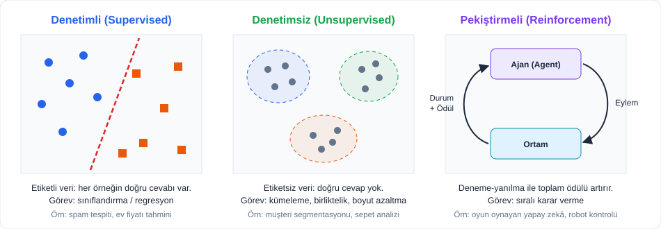

# 3. Öğrenme Türleri

Bilgisayarların veriden nasıl öğrendiğine göre makine öğrenmesi yöntemleri üç ana gruba ayrılır: denetimli, denetimsiz ve pekiştirmeli öğrenme. Yarı denetimli öğrenme ([Bölüm 3.3](03-ogrenme-turleri.md)) ise ilk ikisinin arasında yer alır.

## 3.1 Denetimli Öğrenme (Supervised Learning)

Küçük bir çocuğa hayvanları öğrettiğimizi düşünelim. Ona bir kedi resmi gösterip "bu bir kedi", bir köpek resmi gösterip "bu bir köpek" deriz. Yani her resim için **doğru cevabı** (etiketi; İng. *label*) veririz. Çocuk yeterince örnek gördükten sonra, daha önce hiç görmediği bir hayvan resmini de doğru tanımaya başlar.

Denetimli öğrenme (İng. *supervised learning*; Lat. *super*: "üstten" + *videre*: "görmek", yani "gözetim altında") tam olarak böyle çalışır. Elimizde girdiler ($X$) ve her girdiye karşılık gelen doğru çıktı ($y$) bulunur. Bu tür veriye **etiketli veri (labeled data)** denir. Amaç, girdiden çıktıya giden ilişkiyi öğrenip **yeni** girdiler için doğru çıktıyı tahmin edebilen bir model kurmaktır. Makine öğrenmesinde en sık karşılaşılan türdür.

Tahmin (İng. *prediction*; Lat. *praedicere*: "önceden söylemek") edilen çıktının türüne göre ikiye ayrılır:

| | **Sınıflandırma** (İng. *classification*; Lat. *classis*: "sınıf, grup") | **Regresyon** (İng. *regression*) |
| :--- | :--- | :--- |
| Çıktı | Kategorik (İng. *categorical*; Yun. *katēgoria*: "sınıflama") bir **sınıf** | Sürekli bir **sayı** |
| Soru | "Hangisi?" | "Ne kadar?" |
| Örnek | E-posta **spam mı, normal mi?** | Evin satış **fiyatı kaç TL?** |
| Örnek | Kredi başvurusu **onay / ret** | Yarınki **sıcaklık kaç °C?** |
| Örnek | Hastada **diyabet var / yok** | Bir öğrencinin **sınav notu** |

## 3.2 Denetimsiz Öğrenme (Unsupervised Learning)

Bir çocuğa farklı renk ve şekillerde oyuncaklarla dolu bir kutu verildiğini ve bunları benzerliklerine göre gruplaması istendiğini düşünelim. Hangi oyuncağın ne olduğunu ya da kaç grup olması gerektiğini söyleyen kimse yoktur. Çocuk, oyuncakların renklerine, boyutlarına ve şekillerine bakarak kendi gruplarını oluşturur.

Denetimsiz öğrenmede (İng. *unsupervised learning*) veri **etiketsizdir (unlabeled)**; doğru cevaplar ve sınıflar önceden bilinmez. Amaç, verinin kendi içindeki **gizli yapıyı** ortaya çıkarmaktır. Bulunan yapının anlamlı olup olmadığına genellikle **veri analisti ve alan uzmanı** karar verir.

- **Kümeleme (Clustering):** Benzer örnekleri gruplara ayırır. *Örnek:* Bir e-ticaret sitesinin müşterilerini satın alma alışkanlıklarına göre segmentlere ayırması ([Bölüm 17](17-kumeleme.md)).
- **Birliktelik Kuralları (Association Rules):** Birlikte ortaya çıkan olayları bulur. *Örnek:* **Sepet analizi**: "Ekmek alan müşterilerin çoğu tereyağı da alıyor." ([Bölüm 18](18-birliktelik-kurallari.md))
- **Boyut Azaltma** (İng. *Dimensionality Reduction*; Lat. *dimensio*: "ölçme", *reductio*: "geri götürme"): Çok sayıda özniteliği, bilgi kaybını en aza indirerek daha az sayıda öznitelikle temsil eder ([Bölüm 19](19-boyut-azaltma.md)).
- **Anomali Tespiti** (İng. *Anomaly Detection*; Yun. *anōmalia*: "düzensizlik"): Normalin dışındaki sıra dışı örnekleri bulur. *Örnek:* Olağandışı kredi kartı harcamaları.

## 3.3 Yarı Denetimli Öğrenme (Semi-supervised Learning)

Etiketlemek çoğu zaman pahalıdır (bir radyoloğun binlerce görüntüyü tek tek etiketlemesi gibi). Yarı denetimli öğrenmede **az sayıda etiketli** ve **çok sayıda etiketsiz** veri birlikte kullanılır.

## 3.4 Pekiştirmeli Öğrenme (Reinforcement Learning)

Bir köpeği eğitirken doğru davranışta ödül (mama), yanlış davranışta ödülsüzlük uygularız. Pekiştirmeli öğrenmede (İng. *reinforcement learning*; Lat. *re-* + *in-* + *fortis*: "yeniden güçlendirmek") de bir **ajan** (İng. *agent*; Lat. *agens*: "eylemde bulunan"), bir **ortamda (environment)** eylemler yapar ve karşılığında **ödül (reward)** veya ceza alır. Hiç kimse ona doğru cevabı söylemez; ajan **deneme-yanılma** ile uzun vadede toplam ödülü en büyük yapan davranış biçimini (**politika**; İng. *policy*; Yun. *politeia*: "yönetim biçimi") öğrenir. Satranç ve Go oynayan yapay zekâlar, robot kontrolü ve otonom sürüşün bazı bileşenleri bu yaklaşımı kullanır.

> **İleri seviye:** Bu derste ağırlıklı olarak **denetimli** ve **denetimsiz** öğrenme yöntemleri işlenmektedir. Pekiştirmeli öğrenme, genellikle ayrı bir ileri seviye dersin konusudur.

---

[← 2. Bir Makine Öğrenmesi Projesinin Adımları](02-proje-adimlari.md) · [İçindekiler](../Ders_Notu.md) · [4. Araçlar: WEKA ve Python →](04-araclar-weka-python.md)
