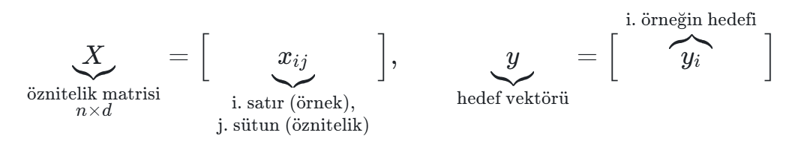
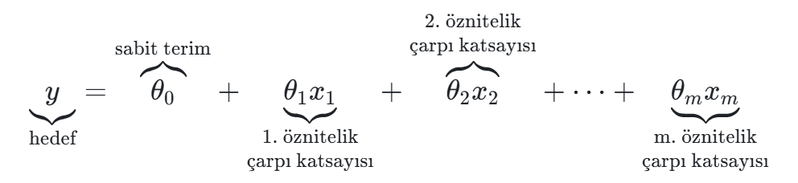
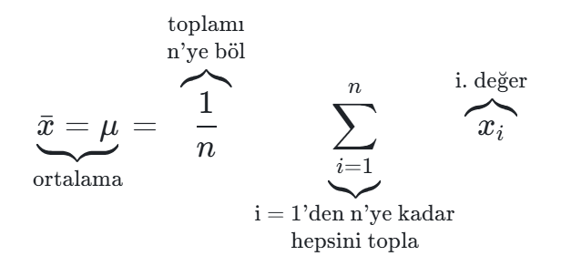
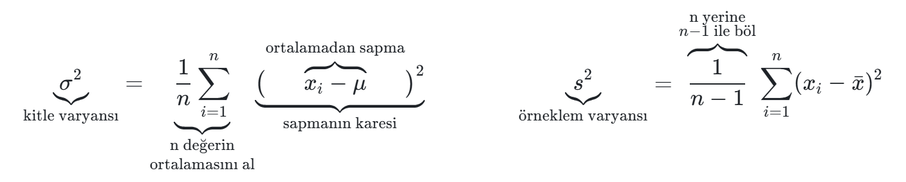
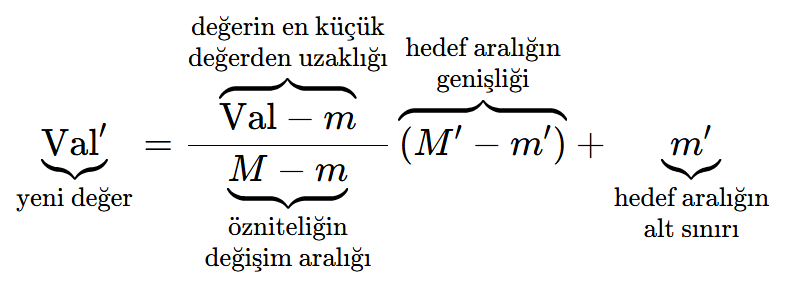
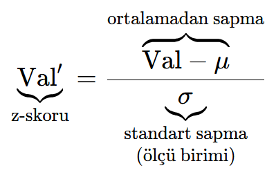
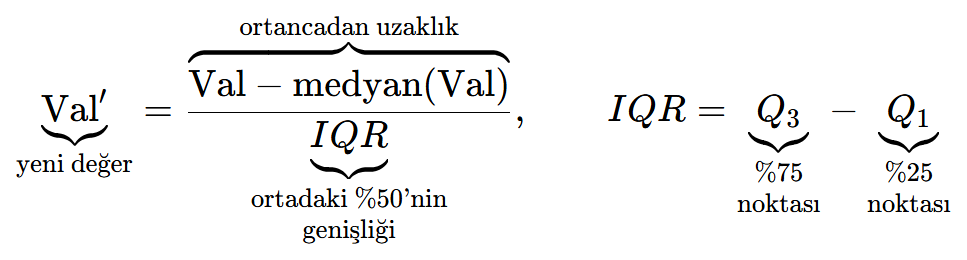
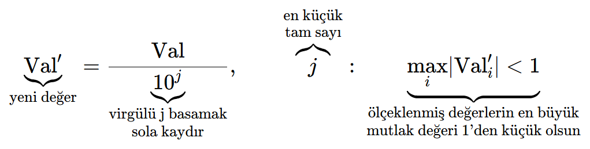
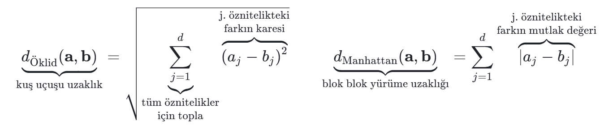

# 5. Veri ve Öznitelikler

## 5.1 Veri Setinin Dili

Makine öğrenmesinde veri genellikle bir **tablo** olarak düşünülür:

| Ad (kimlik) | Yaş | Aylık gelir (TL) | Şehir | Geçmiş gecikme | **Risk (hedef)** |
| :--- | :---: | :---: | :---: | :---: | :---: |
| Müşteri 1 | 34 | 25 000 | İstanbul | Hayır | **Düşük** |
| Müşteri 2 | 22 | 9 000 | Ankara | Evet | **Yüksek** |
| Müşteri 3 | 45 | 40 000 | İzmir | Hayır | **Düşük** |

| Terim | Karşılığı | Tablodaki yeri |
| :--- | :--- | :--- |
| **Örnek** (İng. *instance*, *sample*, *observation*; Lat. *instantia*: "mevcut olma", *exemplum*: "örnek"; kayıt) | Tek bir müşteri, hasta, çiçek… | Bir **satır** |
| **Öznitelik** (İng. *feature*, *attribute*; Lat. *attribuere*: "atfetmek, yüklemek"; değişken, İng. *variable*, Lat. *variabilis*: "değişebilen") | Örneği tanımlayan bir özellik | Bir **sütun** (Yaş, Gelir…) |
| **Hedef / Etiket / Sınıf** (target, label, class) | Tahmin etmek istediğimiz değer | Son sütun (Risk) |
| **Öznitelik vektörü** (İng. *feature vector*; Lat. *vector*: "taşıyıcı") | Bir örneğin tüm öznitelik değerleri | Bir satırın hedef dışındaki kısmı |

> **Formülleri okuma rehberi.** Bu notta önemli formüllerin hemen altında aynı formülün **açıklamalı** bir kopyası vardır: Üst ve alt parantezler (︷ ︸), formülün hangi parçasının ne anlama geldiğini gösterir. **"Ne anlatıyor?"** satırı formülün sezgisel anlamını açıklar; ardından gelen tablo sembolleri tek tek okunuşları ve anlamlarıyla verir. Tüm semboller ve okunuşları [Ek A: Sembol Sözlüğü](ek-a-sembol-sozlugu.md)'nde toplanmıştır. Formül okurken en sık takılınan noktalar:
>
> - **Alt indis bir sıra numarasıdır:** $x_i$ "iks alt i" diye okunur ve $i$. örneği gösterir. $x_{ij}$, $i$. örneğin $j$. özniteliğidir; $\theta_j$ ise $j$. parametredir.
> - **Şapka tahmin, çizgi ortalama demektir:** $y$ gerçek değer, $\hat{y}$ ("ye şapka") modelin tahminidir. $\bar{x}$ ("iks bar") ise $x$ değerlerinin ortalamasıdır.
> - **Toplam sembolü bir döngüdür:** $\sum_{i=1}^{n} x_i$, "i eşittir 1'den n'ye kadar iks alt i'lerin toplamı" diye okunur ve $x_1 + x_2 + \dots + x_n$ demektir. $\prod$ aynı işi çarpma ile yapar.
> - **$:=$ ve $\leftarrow$ eşitlik değil, atamadır:** Sağdaki değer hesaplanır ve soldaki değişkenin yeni değeri olur (koddaki `theta = theta - alfa * egim` satırı gibi).
> - **Dikey çizgi bağlama göre okunur:** $\lvert a \rvert$ mutlak değer, $\lvert S \rvert$ bir kümenin eleman sayısı, $P(A \mid B)$ ise "B verildiğinde A'nın olasılığı"dır. Çift çizgi $\lVert \mathbf{w} \rVert$ vektörün uzunluğudur (norm).
> - **Kalın küçük harf vektör, büyük harf genellikle matristir:** $\mathbf{x}$ bir örneğin tüm öznitelikleri, $X$ ise tüm veri tablosudur.

Matematiksel gösterimde $n$ örnek ve $d$ öznitelik varsa veri bir $X$ matrisiyle (İng. *matrix*; Lat. *matrix*: "ana rahmi, kaynak"), hedef ise bir $y$ vektörüyle gösterilir:

```math
X = \begin{bmatrix} x_{11} & x_{12} & \cdots & x_{1d} \\ x_{21} & x_{22} & \cdots & x_{2d} \\ \vdots & \vdots & \ddots & \vdots \\ x_{n1} & x_{n2} & \cdots & x_{nd} \end{bmatrix}, \qquad y = \begin{bmatrix} y_1 \\ y_2 \\ \vdots \\ y_n \end{bmatrix}
```

<p align="center"></p>

**Ne anlatıyor?** Her satır bir örnek, her sütun bir özniteliktir; $y$ her örneğin hedef değerini tutar. Yukarıdaki tabloda öznitelikler Yaş, Gelir, Şehir ve Geçmiş gecikme sütunlarıdır. Buna göre $x_{21} = 22$ (2. müşterinin yaşı), $x_{13} =$ İstanbul (1. müşterinin şehri) ve $y_2 =$ Yüksek'tir.

| Sembol | Okunuşu | Anlamı |
| :---: | :--- | :--- |
| $X$ | "büyük iks" | Öznitelik matrisi ($n$ satır × $d$ sütun) |
| $x_{ij}$ | "iks i j" | $i$. örneğin $j$. özniteliğinin değeri |
| $y_i$ | "ye i" | $i$. örneğin gerçek hedef değeri |
| $\hat{y}_i$ | "ye şapka i" | Modelin $i$. örnek için **tahmini** (şapka = tahmin) |
| $n$ | "en" | Örnek (satır) sayısı. Bölüm 6–7'deki maliyet formüllerinde, yaygın kaynaklarla uyumlu olması için $m$ ile gösterilir. |
| $d$ (bazen $p$ veya $n$) | "de" | Öznitelik (sütun) sayısı |

> **Öznitelik** ile **parametre** farklı şeylerdir. Öznitelik, veride bulunan bir girdidir (evin metrekaresi). **Parametre** ise modelin içinde, eğitim sırasında öğrenilen bir sayıdır (metrekarenin fiyata etkisini gösteren katsayı, $\theta$). Kaynaklarda bazen karıştırılır; biz bu ayrımı koruyacağız.

Bu ayrım, en temel model olan **lineer modelde** açıkça görülür ([Bölüm 6](06-lineer-regresyon.md)). Model, her özniteliği kendi parametresiyle çarpıp toplar:

$$
\hat{y} = \theta_0 + \theta_1 x_1 + \theta_2 x_2 + \dots + \theta_d x_d
$$

<p align="center"></p>

**Ne anlatıyor?** Her öznitelik kendi katsayısıyla çarpılır, çarpımlar sabit terimle birlikte toplanır. Katsayılar ($\theta$) veriden öğrenilir; öznitelikler ($x$) ise her örnekte veriden okunur.

| Sembol | Okunuşu | Anlamı |
| :---: | :--- | :--- |
| $\hat{y}$ | "ye şapka" | Modelin hedef için **tahmini** |
| $x_1, x_2, \dots, x_d$ | "iks bir, iks iki, …, iks de" | **Öznitelikler:** Sonucu etkilediğini düşündüğümüz, veride bulunan girdiler |
| $\theta_0$ | "teta sıfır" | **Sabit terim (kesişim):** Tüm öznitelikler sıfırken tahminin değeri |
| $\theta_1, \theta_2, \dots, \theta_d$ | "teta bir, teta iki, …, teta de" | **Parametreler (katsayılar):** Her özniteliğin tahmin üzerindeki etkisinin yönü ve büyüklüğü; eğitim sırasında veriden öğrenilir |
| $d$ | "de" | Öznitelik sayısı |

Öznitelikler bir araya gelerek **öznitelik vektörünü** $\mathbf{x} = (x_1, x_2, \dots, x_d)$ oluşturur. Hangi özniteliklerin vektöre alınacağına karar verirken önce **alan uzmanlarının** görüşüne başvurulur; tahmin edilmek istenen durumu en iyi tanımlayan özellikleri onlar bilir.

**Örnek: Yarınki hava sıcaklığının tahmini**

| Sembol | Anlamı |
| :---: | :--- |
| $y$ | Yarınki hava sıcaklığı (tahmin edilecek hedef) |
| $x_1$ | Bugünkü sıcaklık |
| $x_2$ | Bugünkü nem |
| $x_3$ | Bugünkü hava basıncı |
| $x_4$ | Bugünkü rüzgâr hızı |
| $x_5$ | Bugünkü rüzgâr yönü |

Burada $x_1, \dots, x_5$ meteoroloji istasyonunun ölçtüğü **özniteliklerdir**. $\theta_1, \dots, \theta_5$ ise modelin geçmiş yılların verisinden **öğrendiği parametrelerdir**. Örneğin $\theta_1$ büyük ve pozitif çıkarsa, "bugün sıcaksa yarın da büyük ihtimalle sıcak olur" anlamına gelir.

## 5.2 Temel İstatistikler

Veriyi tanımak için ilk bakılan değerler bunlardır. WEKA'da **Preprocess** sekmesinde bir öznitelik seçildiğinde sağ panelde otomatik görünürler.

**Aritmetik ortalama** (İng. *arithmetic mean*; Yun. *arithmos*: "sayı"):

$$
\bar{x} = \mu = \frac{1}{n}\sum_{i=1}^{n} x_i
$$

<p align="center"></p>

**Ne anlatıyor?** Bütün değerleri topla, değer sayısına böl.

**Varyans** (İng. *variance*; Lat. *variantia*: "değişkenlik") **ve standart sapma** (İng. *standard deviation*; Lat. *deviare*: "yoldan çıkmak") (değerlerin ortalama etrafında ne kadar yayıldığı):

$$
\sigma^2 = \frac{1}{n}\sum_{i=1}^{n}(x_i-\mu)^2 \qquad\qquad s^2 = \frac{1}{n-1}\sum_{i=1}^{n}(x_i-\bar{x})^2
$$

<p align="center"></p>

**Ne anlatıyor?** Her değerin ortalamadan sapmasını bul, karesini al (ortalamanın altındaki ve üstündeki sapmalar birbirini götürmesin diye) ve bu karelerin ortalamasını al. Standart sapma bunun kareköküdür ($\sigma = \sqrt{\sigma^2}$, $s = \sqrt{s^2}$); karekök, birimi verinin birimine geri döndürür (puan² → puan). $n-1$'e bölmek, ortalama da aynı örneklemden hesaplandığı için yayılımın olduğundan küçük çıkmasını düzeltir.

| Sembol | Okunuşu | Anlamı |
| :---: | :--- | :--- |
| $\bar{x}$, $\mu$ | "iks bar", "mü" | Ortalama ($\mu$ genellikle kitle, $\bar{x}$ örneklem ortalaması için kullanılır) |
| $\sum_{i=1}^{n}$ | "sigma, i eşittir birden n'e kadar" | $i=1$'den $n$'e kadar tüm terimleri **topla** |
| $\sigma^2$, $\sigma$ | "sigma kare", "sigma" | Kitle varyansı ve standart sapması ($n$'e bölünür) |
| $s^2$, $s$ | "es kare", "es" | Örneklem varyansı ve standart sapması ($n-1$'e bölünür) |

**Medyan** (İng. *median*; Lat. *medianus*: "ortadaki"): Değerler sıralandığında ortadaki değer. Aykırı değerlerden ortalamaya göre çok daha az etkilenir.
**Çeyrekler** (İng. *quartiles*; Lat. *quartus*: "dördüncü") **ve IQR** (*interquartile range*): $Q_1$ (%25), $Q_3$ (%75) ve çeyrekler arası açıklık $IQR = Q_3 - Q_1$.

**Örnek:** Notlar $[60, 70, 80, 100]$

- Ortalama: $(60+70+80+100)/4 = 77.5$
- Ortalamadan farklar: $-17.5,\ -7.5,\ 2.5,\ 22.5$ → kareleri toplamı: $306.25+56.25+6.25+506.25 = 875$
- Kitle std: $\sigma=\sqrt{875/4} \approx 14.79$ · Örneklem std: $s=\sqrt{875/3} \approx 17.08$
- Medyan: $(70+80)/2 = 75$

> **Hangi standart sapma?** `numpy.std()` ve scikit-learn'ün `StandardScaler`'ı **$n$'e böler** (14.79). Excel `STDEV`, pandas `.std()` ve WEKA **$n-1$'e böler** (17.08). Aynı veride farklı araçların küçük farklı sonuçlar vermesinin sık bir nedeni budur.

### Kısa Uygulama: 200 Öğrencinin Notlarını Özetlemek

Veri: [`data/notlar.arff`](https://github.com/erkanozhan/machinelearning/blob/main/data/notlar.arff) (WEKA) ve [`data/notlar.csv`](https://github.com/erkanozhan/machinelearning/blob/main/data/notlar.csv) (Python, R). 200 öğrencinin vize ve final notu; dönem ortalaması 60 ve üstü olanlar `gecti`.

**WEKA:** Preprocess → **Open file…** → `notlar.arff`. Sol listeden `vize`'yi seçin. Sağdaki Minimum, Maximum, Mean ve StdDev değerlerini not edin; histogram, `durum`'a göre renklenir.

**Python**

```python
import pandas as pd                                        # Tablo (DataFrame) işlemleri

VERI = "https://raw.githubusercontent.com/erkanozhan/machinelearning/main/data/"   # Veri klasörünün adresi
df = pd.read_csv(VERI + "notlar.csv")                     # 200 öğrenci: vize, final, durum

print(df.head())                                           # İlk 5 satır
print(df.describe())                                       # Sayısal sütunlar: adet, ortalama, std, min, çeyrekler, max
print("Medyan:", df["vize"].median())                      # Ortanca değer
print("Std (n-1):", round(df["vize"].std(), 2))            # pandas varsayılanı: örneklem std (÷ n-1)
print("Std (n)  :", round(df["vize"].std(ddof=0), 2))      # Kitle std (÷ n), NumPy ve StandardScaler bunu kullanır
print(df["durum"].value_counts())                          # Kategorik sütunun sıklıkları
```

> **Veriyi okuma:** Kodlar veriyi doğrudan GitHub'dan okur; Google Colab'da da çalışır. Dosyayı indirdiyseniz `VERI = "data/"` yazarak yerel klasörden okuyabilirsiniz.

**R**

```r
VERI <- "https://raw.githubusercontent.com/erkanozhan/machinelearning/main/data/"
df <- read.csv(paste0(VERI, "notlar.csv"))     # 200 öğrenci
summary(df)                                    # Min, çeyrekler (1st Qu., 3rd Qu.), medyan, ortalama, max
sd(df$vize)                                    # Örneklem standart sapması (÷ n-1) → 19.68
table(df$durum)                                # gecti: 117, kaldi: 83
```

**Gözlem soruları**
- WEKA'nın `StdDev` değeri (19.68) pandas `.std()` ile mi, yoksa `.std(ddof=0)` ile mi aynı? Neden?
- `vize` ortalaması (63.4) medyandan (65) küçük. Bu, dağılımın hangi tarafında uç değerler olduğunu gösterir?

## 5.3 Öznitelik Türleri

| Tür | Açıklama | Örnek | İzin verilen işlemler |
| :--- | :--- | :--- | :--- |
| **Nominal** (İng. *nominal*; Lat. *nomen*: "ad") (kategorik) | Sırasız kategoriler | Şehir, kan grubu, marka | Eşit mi / değil mi |
| **İkili** (İng. *binary*; Lat. *binarius*: "ikişerli") | Sadece iki değerli nominal | Garajı var mı? (Evet/Hayır) | Eşitlik |
| **Sıralı** (İng. *ordinal*; Lat. *ordo*: "sıra") | Sıralanabilen kategoriler | Eğitim: İlkokul < Lise < Lisans | Sıralama (<, >) |
| **Aralık** (İng. *interval*; Lat. *intervallum*: "iki sur arasındaki boşluk") | Sayısal, **gerçek sıfır noktası yok** | Sıcaklık (°C), takvim yılı | Toplama/çıkarma |
| **Oran** (İng. *ratio*; Lat. *ratio*: "hesap, oran") | Sayısal, **gerçek sıfır var** | Boy, gelir, yaş, kilo | Tüm aritmetik işlemler (100 kg, 50 kg'ın iki katıdır) |

> **İpucu:** Pratikte bu beş tür iki büyük gruba indirgenir: **sayısal (numeric)** ve **kategorik (nominal)**. WEKA'daki `numeric` ve `{...}` tanımları bu ayrımdır.

Sayısal öznitelikler ayrıca **sürekli** (İng. *continuous*; Lat. *continuus*: "kesintisiz") (boy: 1.753 m) veya **kesikli** (İng. *discrete*; Lat. *discretus*: "ayrılmış") (çocuk sayısı: 2) olabilir.

## 5.4 Öznitelik Seçimi ve Öznitelik Mühendisliği

Bir doktorun doğru teşhis için ateşe, tansiyona ve tahlil sonuçlarına bakması gibi, model de tahmin yaparken özniteliklere bakar. **Doğru öznitelikleri seçmek**, bir dedektifin doğru ipuçlarını izlemesine benzer: Ev fiyatını tahmin ederken metrekare çok önemlidir, kapının rengi ise muhtemelen önemsizdir. Alakasız öznitelikler modeli yanıltabilir.

- **Temel öznitelikler:** Veride doğrudan bulunan özellikler. Seçiminde **alan uzmanının** görüşü altın değerindedir.
- **Türetilmiş öznitelikler:** Mevcut özelliklerden yeni ve daha anlamlı bilgi üretmek. *Örnek:* "Doğum tarihi"nden "yaş"; "en" ve "boy"dan "alan = en × boy"; "kilo" ve "boy"dan **vücut kitle indeksi** $= \text{kilo}/\text{boy}^2$.
- **Etkileşim öznitelikleri:** Tek başına zayıf iki özellik birlikte güçlü olabilir. *Örnek:* Bir reklamın tıklanmasında "akşam saati **ve** mobil cihaz" birleşimi.
- **Gereksiz (redundant) öznitelikler:** Aynı bilgiyi tekrar edenler ("doğum tarihi" ve "yaş" birlikte). Birini çıkarmak modeli sadeleştirir.

Kısacası, bir modelin ne kadar "akıllı" olacağı ona verdiğimiz bilginin kalitesiyle doğrudan ilişkilidir. Ham veriyi zenginleştirmek ve en iyi temsilini bulmak bu işin hem bilimi hem sanatıdır. Otomatik öznitelik seçimi yöntemleri [Bölüm 19](19-boyut-azaltma.md)'dadır.

## 5.5 Eksik Veri ve Aykırı Değerler

**Eksik veri (missing values)** – WEKA'da `?` ile, Python'da `NaN` ile gösterilir.

| Strateji | Ne zaman? | Dikkat |
| :--- | :--- | :--- |
| Satırı silmek | Eksik satır çok azsa | Veri kaybı; eksiklik rastgele değilse yanlılık (İng. *bias*) yaratır |
| Sütunu silmek | Sütunun büyük kısmı boşsa | Önemli bilgi kaybolabilir |
| Ortalama / medyan ile doldurmak | Sayısal öznitelik | Medyan, aykırı değerlere karşı daha güvenlidir |
| En sık değer (mod) ile doldurmak | Kategorik öznitelik | |
| Modelle tahmin ederek doldurmak (k-NN imputation vb.) | Öznitelikler arasında ilişki varsa | Daha maliyetli |

WEKA'da: `filters → unsupervised → attribute → ReplaceMissingValues` (sayısalda ortalama, kategorikte mod ile doldurur).

**Aykırı değer** (İng. *outlier*: "dışarıda kalan") – Diğerlerinden çok farklı değer. Bir ölçüm hatası da (yaş = 250) olabilir, gerçek ama nadir bir durum da (çok yüksek gelirli bir müşteri). Yaygın bir kural, **IQR kuralıdır**: $Q_1 - 1.5\cdot IQR$ altındaki veya $Q_3 + 1.5\cdot IQR$ üstündeki değerler şüphelidir. Aykırı değeri silmeden önce **neden** oluştuğunu anlamak gerekir. WEKA'da `InterquartileRange` filtresi bu kuralı uygular; ancak filtrenin varsayılan katsayısı 3'tür, bu yüzden 1.5·IQR kuralı için ayarlarda `outlierFactor = 1.5` yapılmalıdır.

**Örnek:** $[60, 70, 80, 100, 300]$ verisinde $Q_1 = 70$, $Q_3 = 100$ ve $IQR = 30$'dur. Alt sınır $70 - 1.5 \cdot 30 = 25$, üst sınır $100 + 1.5 \cdot 30 = 145$ olur. Yalnızca 300 bu aralığın dışında kaldığı için aykırı değer olarak işaretlenir.

## 5.6 Kategorik Verinin Sayıya Dönüştürülmesi

Lineer regresyon, SVM, sinir ağları gibi matematiksel modeller yalnızca **sayılarla** çalışır. Bu yüzden kategorik öznitelikleri dönüştürmemiz gerekir.

**İkili öznitelikler:** "Evet" → `1`, "Hayır" → `0`.

**Sıralı öznitelikler:** Sıra korunarak kodlanır: İlkokul=1, Lise=2, Lisans=3.

**Nominal öznitelikler → One-Hot Encoding (Tekil Etkin Kodlama):** "Şehir" için İstanbul=1, Ankara=2, İzmir=3 dersek model "İzmir > Ankara" gibi **anlamsız bir sıralama** öğrenebilir. Bunun yerine her kategori için ayrı bir 0/1 sütunu açılır:

| Şehir | → | Şehir_İstanbul | Şehir_Ankara | Şehir_İzmir |
| :---: | :---: | :---: | :---: | :---: |
| İstanbul | → | 1 | 0 | 0 |
| Ankara | → | 0 | 1 | 0 |
| İzmir | → | 0 | 0 | 1 |

WEKA'da: `filters → unsupervised → attribute → NominalToBinary`. Python'da:

```python
import pandas as pd                                          # Tablo işlemleri için pandas

df = pd.DataFrame({"sehir": ["İstanbul", "Ankara", "İzmir", "Ankara"]})   # Tek sütunlu örnek tablo
print(pd.get_dummies(df, columns=["sehir"], dtype=int))     # Her şehir için 0/1 sütunu üretir
```

**Gruplama (binning / discretization):** Sayısal bir özniteliği aralıklara bölmek. *Örnek:* Gelir → "Düşük (0–10 000)", "Orta (10 001–20 000)", "Yüksek (20 001+)". Bazı algoritmalar (ör. klasik Naive Bayes, Apriori) kategorik veri ister; ayrıca gruplama, belirli aralıklardaki davranış değişimini yakalamaya yardımcı olabilir. WEKA'da: `Discretize` filtresi.

## 5.7 Uygulama Senaryosu: Kredi Riski Tahmini

Bir bankada, kredi başvurusu yapan müşterinin borcunu zamanında ödeyip ödemeyeceğini ("kredi riski") tahmin etmek istiyoruz.

1. **Problemi anlamak:** Kredi analistleriyle (alan uzmanları) görüşerek riski etkileyen faktörleri belirleriz. Geçmişte kredi kullanmış ve **sonucu belli olan** (ödedi / ödemedi) müşteriler **etiketli eğitim verimizi** oluşturur.
2. **Öznitelikleri ve türlerini belirlemek:**
   - *Aylık gelir* → **sayısal**. Ödeme kapasitesinin temel göstergesi.
   - *Yaşadığı şehir* → **nominal**. Bölgesel ekonomik koşulları yansıtabilir.
   - *Geçmiş ödeme gecikmesi* → **ikili**. Gelecekteki davranış için en güçlü ipuçlarından biri.
3. **Hedefi belirlemek:** "Yüksek risk" / "Düşük risk" → iki sınıflı bir **sınıflandırma** problemi.
4. **Dönüştürmek:** Gecikme → 0/1; şehir → one-hot; gelir → ölçekleme veya gruplama.
5. **Modellemek ve değerlendirmek:** Sonraki bölümlerde göreceğimiz algoritmalarla.

Bu senaryonun yapay ama gerçekçi bir veri seti depoda hazırdır: [`data/kredi_basvurulari.csv`](https://github.com/erkanozhan/machinelearning/blob/main/data/kredi_basvurulari.csv) / [`data/kredi_basvurulari.arff`](https://github.com/erkanozhan/machinelearning/blob/main/data/kredi_basvurulari.arff). 600 başvuru; `yas`, `aylik_gelir`, `borc_gelir_orani`, `calisma_yili`, `sehir`, `gecmis_gecikme` ve hedef `risk` (dusuk/yuksek). Başvuruların yaklaşık %20'si yüksek risklidir ve bazı gelir ve şehir bilgileri **eksiktir**. Bu veriyle [Bölüm 5.10](05-veri-ve-oznitelikler.md)'da ön işleme, [Bölüm 9.3](09-performans-olcutleri.md)'te ROC eğrisi ve [Bölüm 22](22-dengesiz-veri.md)'de maliyete duyarlı öğrenme uygulaması yapılır.

> **Etik not:** Kredi, işe alım, sağlık gibi insanları doğrudan etkileyen kararlarda cinsiyet, etnik köken gibi korunan özellikler (veya onların dolaylı temsilcileri, ör. posta kodu) ayrımcılığa yol açabilir. Modelin **adil** olup olmadığı ayrıca denetlenmelidir.

## 5.8 Özniteliklerin Ölçeklendirilmesi (Feature Scaling)

Bir ev fiyatı modeli düşünelim:

| Öznitelik | Örnek değer | Değer aralığı |
| :--- | :---: | :---: |
| Metrekare (m²) | 150 | ~50 – 250 |
| Oda sayısı | 3 | ~1 – 6 |

İki evin "ne kadar farklı" olduğunu ölçen **mesafe tabanlı** bir algoritma (k-NN, K-Means, SVM) metrekaredeki 10 birimlik farkı, oda sayısındaki 1 birimlik farktan çok daha önemli sayar. **Gradyan inişi** (İng. *gradient descent*; Lat. *gradiens*: "adım atan", *descendere*: "aşağı inmek") kullanan modeller (lineer/lojistik regresyon, sinir ağları) ise ölçek farkı yüzünden çok yavaş öğrenir. Ölçekleme, tüm özniteliklere **adil söz hakkı** tanımak için yapılır.

> **Hangi modeller ölçeklemeye duyarlı?** k-NN, K-Means, SVM, PCA, lineer/lojistik regresyon (özellikle düzenlileştirme (İng. *regularization*; Lat. *regularis*: "kurala uygun") varsa), sinir ağları → **Evet.** Karar ağaçları, Random Forest, gradyan artırma ağaçları, Naive Bayes → **Genellikle hayır.**

### a) Min-Max Normalizasyonu

**Normalizasyon** (İng. *normalization*; Lat. *norma*: "gönye, kural"), değerleri belirlenen bir $[m', M']$ aralığına taşır. En sık kullanılan hedef aralık $[0, 1]$'dir.

$$
\text{Val}' = \frac{\text{Val} - m}{M - m}\,(M' - m') + m'
$$

<p align="center"></p>

**Ne anlatıyor?** Kesir, değerin en küçükten en büyüğe giden yolun kaçta kaçında olduğunu bulur; en küçük değer 0'a, en büyük değer 1'e karşılık gelir. Bu oran hedef aralığın genişliğiyle $(M' - m')$ çarpılarak yeni aralığa uyacak biçimde genişletilir ve alt sınır $m'$ eklenerek o aralığa kaydırılır. Hedef aralık $[0, 1]$ ise ($m' = 0$, $M' = 1$) formül $\text{Val}' = \frac{\text{Val} - m}{M - m}$ biçimine sadeleşir.

| Sembol | Okunuşu | Anlamı |
| :---: | :--- | :--- |
| $\text{Val}$ | "val" | Özniteliğin orijinal değeri (İng. *value*: "değer") |
| $\text{Val}'$ | "val üssü" | Normalize edilmiş (yeni) değer |
| $m$, $M$ | "küçük em", "büyük em" | Özniteliğin **eğitim verisindeki** en küçük ve en büyük değeri |
| $m'$, $M'$ | "küçük em üssü", "büyük em üssü" | Hedef aralığın alt ve üst sınırı (ör. $[0, 1]$ veya $[1, 2]$) |

**Örnek 1 ($[0, 1]$ aralığı):** $[60, 70, 80, 100]$ → $m = 60$, $M = 100$. 70 için: $\frac{70-60}{100-60} = 0.25$. Sonuç: $[0,\ 0.25,\ 0.5,\ 1]$.

**Örnek 2 ($[1, 2]$ aralığı):** En küçük değeri 50, en büyük değeri 1500 olan bir veri kümesindeki 70 değeri $[1, 2]$ aralığına normalize edilsin: $m = 50$, $M = 1500$, $m' = 1$, $M' = 2$.

$$
\text{Val}' = \frac{70 - 50}{1500 - 50}\,(2 - 1) + 1 = \frac{20}{1450} + 1 \approx 0.0138 + 1 = 1.0138
$$

70, en küçük değere çok yakın olduğu için yeni aralığın da alt sınırına çok yakın bir değere dönüşür. scikit-learn'de hedef aralık `MinMaxScaler(feature_range=(1, 2))` ile verilir.

**Aykırı değerlere çok duyarlıdır.** Veriye hatalı bir 300 eklenirse diğer tüm notlar $[0, 0.17]$ aralığına sıkışır.

### b) Z-Skoru Standardizasyonu

Veriyi ortalaması 0, standart sapması 1 olacak şekilde dönüştürür. Her değer "ortalamadan kaç standart sapma uzakta?" sorusunun cevabına dönüşür.

$$
\text{Val}' = \frac{\text{Val} - \mu}{\sigma}
$$

<p align="center"></p>

**Ne anlatıyor?** Sapma, standart sapma cinsinden ölçülür. Elde edilen değere **z-skoru** denir ve kaynaklarda $z$ ile de gösterilir. $\text{Val}' = 2$ "ortalamanın iki standart sapma üstünde", $\text{Val}' = -0.5$ "yarım standart sapma altında" demektir; işaret yönü, büyüklük uzaklığı gösterir.

| Sembol | Okunuşu | Anlamı |
| :---: | :--- | :--- |
| $\text{Val}$ | "val" | Özniteliğin orijinal değeri |
| $\text{Val}'$ | "val üssü" | Standartlaştırılmış değer (z-skoru, $z$) |
| $\mu$ | "mü" | Özniteliğin (eğitim verisindeki) ortalaması; kaynaklarda mean(Val) olarak da yazılır |
| $\sigma$ | "sigma" | Özniteliğin standart sapması; kaynaklarda std olarak da yazılır |

**Örnek:** $[60, 70, 80, 100]$, $\mu = 77.5$, $\sigma \approx 14.79$ (scikit-learn'ün kullandığı değer). 70 için: $\text{Val}' = \frac{70-77.5}{14.79} \approx -0.51$ → "70, ortalamanın yaklaşık yarım standart sapma altında." Tüm sonuç: $[-1.18,\ -0.51,\ 0.17,\ 1.52]$. (WEKA $n-1$ ile hesapladığı için $\sigma \approx 17.08$ ve $\text{Val}' \approx -0.44$ bulur.)

Standardizasyon (İng. *standardization*) değerleri sabit bir aralığa sıkıştırmaz. Bu yüzden tek bir aykırı değer diğerlerini Min-Max kadar ezmez. Ancak ortalama ve standart sapma da aykırı değerlerden etkilendiği için **tam olarak dayanıklı değildir**. Normal dağılıma yakın veride ve SVM, lojistik regresyon, PCA gibi yöntemlerde genellikle ilk tercihtir.

### c) Dayanıklı Ölçekleme (Robust Scaling) (İleri Seviye)

Aykırı değerlere karşı gerçekten dayanıklı olan yöntem **medyan** ve **IQR** kullanır:

$$
\text{Val}' = \frac{\text{Val} - \text{medyan}(\text{Val})}{IQR}, \qquad IQR = Q_3 - Q_1
$$

<p align="center"></p>

**Ne anlatıyor?** Z-skorundaki ortalamanın yerine medyan, standart sapmanın yerine IQR kullanılır; ikisi de uç değerlerden neredeyse etkilenmez. Örnek: $[60, 70, 80, 100]$ için medyan 75, $Q_1 = 67.5$, $Q_3 = 85$ (NumPy ve scikit-learn'ün varsayılan hesabı), $IQR = 17.5$. 70 için $\text{Val}' = (70 - 75)/17.5 \approx -0.29$ olur.

scikit-learn'de: `RobustScaler`.

### d) Onluk Ölçekleme (Decimal Scaling)

Ondalık virgülü kaydırarak değerleri $(-1, 1)$ aralığına getirir:

$$
\text{Val}' = \frac{\text{Val}}{10^{j}}, \qquad j:\ \max_i \lvert \text{Val}'_i \rvert < 1 \text{ koşulunu sağlayan en küçük tam sayı}
$$

Bazı kaynaklarda üs $j$ yerine $n$ ile gösterilir: $\text{Val}' = \text{Val}/10^{n}$.

<p align="center"></p>

**Örnek:** $[-986, 450, 120, -50]$ → en büyük mutlak değer 986 → $j = 3$ → $[-0.986,\ 0.450,\ 0.120,\ -0.050]$. Basittir ama verinin dağılımını hiç kullanmadığından pratikte az tercih edilir.

**Karşılaştırma** (aynı veri + hatalı bir 300 değeri):

| Yöntem | $[60, 70, 80, 100, 300]$ için sonuç | Yorum |
| :--- | :--- | :--- |
| Min-Max | $[0,\ 0.04,\ 0.08,\ 0.17,\ 1]$ | Normal notlar sıkıştı |
| Z-skoru | $[-0.69,\ -0.58,\ -0.47,\ -0.25,\ 1.98]$ | Ortalama bozuldu |
| Robust | $[-0.67,\ -0.33,\ 0,\ 0.67,\ 7.33]$ | Normal notlar makul aralıkta kaldı; aykırı değer net biçimde göze çarpıyor |

> **En önemli kural:** $m$, $M$, $\mu$, $\sigma$ gibi değerler **yalnızca eğitim verisinden** hesaplanır ve test verisine **aynı değerlerle** uygulanır. Tüm veriyle hesaplarsanız test verisinin bilgisi modele sızar ([Bölüm 21](21-veri-sizintisi.md)).

### WEKA'da Ölçeklendirme

1. [`data/notlar.arff`](https://github.com/erkanozhan/machinelearning/blob/main/data/notlar.arff) dosyasını indirin. **Explorer → Preprocess → Open file…** ile açın. Bir özniteliğe tıklayınca sağ panelde Minimum, Maximum, Mean, StdDev değerleri görünür.
2. **Min-Max:** Filter → **Choose** → `weka → filters → unsupervised → attribute → Normalize` → **Apply**. `vize` seçildiğinde Minimum = 0, Maximum = 1 olur. (`scale` ve `translation` parametreleriyle farklı aralıklar da seçilebilir: `scale` hedef aralığın genişliğidir ($M' - m'$), `translation` alt sınırıdır ($m'$). Örneğin $[1, 2]$ için `scale = 1`, `translation = 1`; $[-1, 1]$ için `scale = 2`, `translation = -1` girilir.)
3. **Undo** ile geri alın.
4. **Z-skoru:** Aynı yoldan `Standardize` → **Apply**. Mean ≈ 0, StdDev = 1 olur.

> **Dikkat:** Preprocess sekmesinde uygulanan filtre **tüm veriye** uygulanır. Sadece veriyi incelemek için sorun değildir; ancak ardından çapraz doğrulama (İng. *cross-validation*, [Bölüm 8.6](08-model-degerlendirme.md)) yapılacaksa doğru yol filtreyi `FilteredClassifier` içine koymaktır ([Bölüm 21](21-veri-sizintisi.md)).

### Python'da Ölçeklendirme

```python
import numpy as np                                          # Sayısal diziler
from sklearn.preprocessing import MinMaxScaler, StandardScaler   # Min-Max ve Z-skoru ölçekleyiciler

notlar = np.array([[60], [70], [80], [100]])                # sklearn 2 boyutlu dizi ister: (örnek, öznitelik)

print(MinMaxScaler().fit_transform(notlar).ravel())        # [0.   0.25 0.5  1.  ]
print(StandardScaler().fit_transform(notlar).ravel())      # [-1.183 -0.507  0.169  1.521]
```

**Kod:** Tüm yöntemler, aykırı değer deneyi ve eğitim/test ayrımıyla doğru kullanım: [`codes/python/01_istatistik_ve_olceklendirme.py`](https://github.com/erkanozhan/machinelearning/blob/main/codes/python/01_istatistik_ve_olceklendirme.py)

## 5.9 Mesafe (Uzaklık) Ölçüleri

k-NN, K-Means, hiyerarşik kümeleme ve DBSCAN gibi yöntemler iki örneğin **ne kadar benzer** olduğunu bir mesafe (İng. *distance*; Lat. *distantia*: "uzakta durma") ölçüsüyle belirler. $\mathbf{a} = (a_1,\dots,a_d)$ ve $\mathbf{b} = (b_1,\dots,b_d)$ iki örnek olsun:

$$
d_{\text{Öklid}}(\mathbf{a},\mathbf{b}) = \sqrt{\sum_{j=1}^{d}(a_j-b_j)^2} \qquad d_{\text{Manhattan}}(\mathbf{a},\mathbf{b}) = \sum_{j=1}^{d}\lvert a_j-b_j \rvert
$$

<p align="center"></p>

**Ne anlatıyor?** Öklid uzaklığı, Pisagor teoreminin $d$ boyuta genişletilmiş hâlidir.

| Sembol | Okunuşu | Anlamı |
| :---: | :--- | :--- |
| $\mathbf{a}, \mathbf{b}$ | "a vektörü", "b vektörü" | Karşılaştırılan iki örnek (kalın harf = vektör) |
| $a_j$ | "a j" | $\mathbf{a}$'nın $j$. özniteliği |
| $\lvert \cdot \rvert$ | "mutlak değer" | İşaretsiz büyüklük |
| $d$ | "de" | Öznitelik sayısı |

**Örnek:** $\mathbf{a}=(1, 2)$, $\mathbf{b}=(4, 6)$ → Öklid: $\sqrt{3^2+4^2}=5$ (kuş uçuşu) · Manhattan: $3+4=7$ (şehir blokları boyunca yürüyerek).

> **Minkowski mesafesi** ikisini genelleştirir: $d_p = \left(\sum_j \lvert a_j-b_j\rvert^p\right)^{1/p}$. $p=1$ Manhattan, $p=2$ Öklid'dir. Metin verisinde sıklıkla **kosinüs benzerliği** kullanılır: $\cos(\mathbf{a},\mathbf{b}) = \frac{\mathbf{a}\cdot\mathbf{b}}{\lVert\mathbf{a}\rVert\thinspace \lVert\mathbf{b}\rVert}$. Kategorik verilerde ise farklı olan öznitelik sayısını sayan **Hamming mesafesi** kullanılabilir.


### Kısa Uygulama: İki Öğrenci Arasındaki Mesafe

Notlar verisinin ilk iki öğrencisi: (vize 60, final 75) ve (vize 45, final 50).

**Python**

```python
import numpy as np                             # Vektör (dizi) işlemleri

a = np.array([60, 75])                         # 1. öğrenci: vize 60, final 75
b = np.array([45, 50])                         # 2. öğrenci: vize 45, final 50

oklid = np.sqrt(((a - b) ** 2).sum())          # √(15² + 25²)
manhattan = np.abs(a - b).sum()                # 15 + 25
print(f"Öklid = {oklid:.2f}, Manhattan = {manhattan}")   # Öklid = 29.15, Manhattan = 40
```

**R**

```r
x <- rbind(c(60, 75), c(45, 50))      # Her satır bir öğrenci
dist(x)                                # Öklid (varsayılan) → 29.15
dist(x, method = "manhattan")          # Manhattan → 40
```

## 5.10 Kısa Uygulama: Kredi Başvurularında Eksik Veri ve Kodlama

Veri: [`data/kredi_basvurulari.arff`](https://github.com/erkanozhan/machinelearning/blob/main/data/kredi_basvurulari.arff) (WEKA) ve [`data/kredi_basvurulari.csv`](https://github.com/erkanozhan/machinelearning/blob/main/data/kredi_basvurulari.csv) (Python). [Bölüm 5.7](05-veri-ve-oznitelikler.md)'deki senaryonun verisi: 600 başvuru, %5'inde gelir, %3'ünde şehir bilgisi eksik.

**WEKA**
1. Preprocess → **Open file…** → `kredi_basvurulari.arff`.
2. `aylik_gelir` ve `sehir`'i seçin; sağ üstteki **Missing** satırında eksik değer sayısını (30 ve 18) görün.
3. Filter → `unsupervised → attribute → ReplaceMissingValues` → **Apply**. Missing değerleri 0 olur. *(Sayısal sütunlar ortalama, kategorik sütunlar en sık değer ile doldurulur.)*
4. Filter → `unsupervised → attribute → Discretize` → `attributeIndices = 2`, `bins = 3` → **Apply**. `aylik_gelir` üç aralığa bölünür.
5. Filter → `unsupervised → attribute → NominalToBinary` → **Apply**. Kategorik öznitelikler 0/1 sütunlarına dönüşür.

**Python**

```python
import pandas as pd                                          # Tablo işlemleri

VERI = "https://raw.githubusercontent.com/erkanozhan/machinelearning/main/data/"   # Veri klasörünün adresi
df = pd.read_csv(VERI + "kredi_basvurulari.csv")            # 600 kredi başvurusu

print(df.isna().sum())                                       # Sütun başına eksik değer sayısı
df["aylik_gelir"] = df["aylik_gelir"].fillna(df["aylik_gelir"].median())   # Sayısal → medyan
df["sehir"] = df["sehir"].fillna(df["sehir"].mode()[0])                    # Kategorik → en sık değer

df["gelir_grubu"] = pd.cut(df["aylik_gelir"], bins=[0, 25000, 45000, float("inf")],   # Aralık sınırları (TL)
                           labels=["dusuk", "orta", "yuksek"])            # Gruplama (binning)
X = pd.get_dummies(df.drop(columns="risk"), columns=["sehir", "gecmis_gecikme", "gelir_grubu"],   # Hedef hariç
                   dtype=int)                                              # One-hot kodlama
print(X.shape)                                               # (600, 13): kategorikler 0/1 sütunlarına açıldı
print(pd.crosstab(df["gecmis_gecikme"], df["risk"], normalize="index").round(2))   # Gecikme–risk ilişkisi
```

> **Veriyi okuma:** Kodlar veriyi doğrudan GitHub'dan okur; Google Colab'da da çalışır. Dosyayı indirdiyseniz `VERI = "data/"` yazarak yerel klasörden okuyabilirsiniz.

**Gözlem soruları**
- Eksik gelir neden ortalama yerine medyan ile dolduruldu? Gelir dağılımında çok yüksek gelirli birkaç kişi varsa ortalama ne olur?
- Geçmişte gecikme yaşayanların yüksek risk oranı (%43), yaşamayanlarınkinin (%13) kaç katı? Bu öznitelik model için ne kadar değerli olabilir?
- WEKA'nın `Discretize` filtresi aralıkları eşit genişlikte mi, eşit sayıda kişi içerecek şekilde mi bölüyor? (İpucu: `useEqualFrequency` parametresi.)

---

[← 4. Araçlar: WEKA ve Python](04-araclar-weka-python.md) · [İçindekiler](../Ders_Notu.md) · [6. Lineer Regresyon →](06-lineer-regresyon.md)
