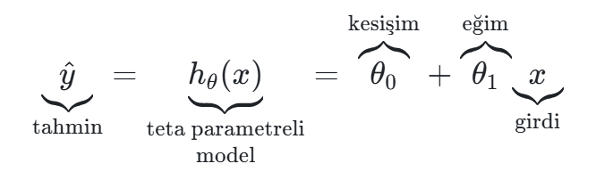
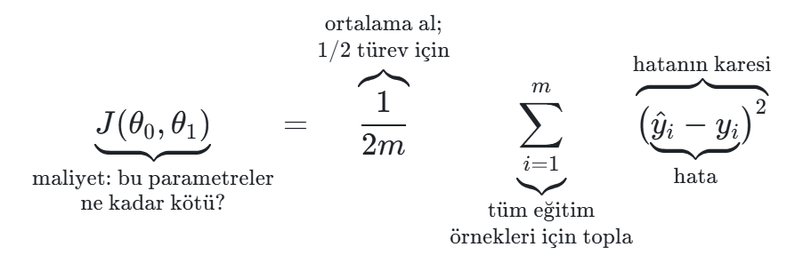
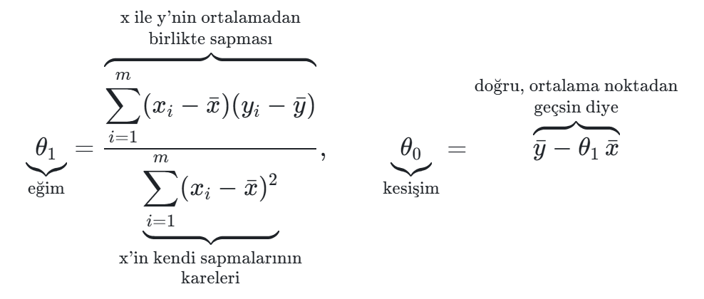
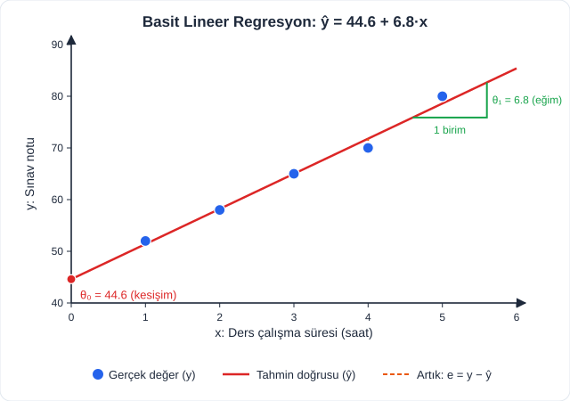
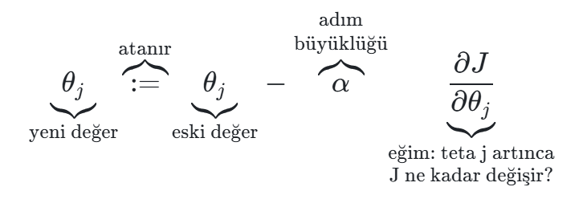
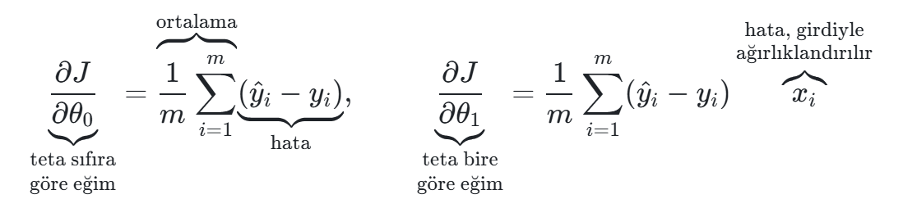
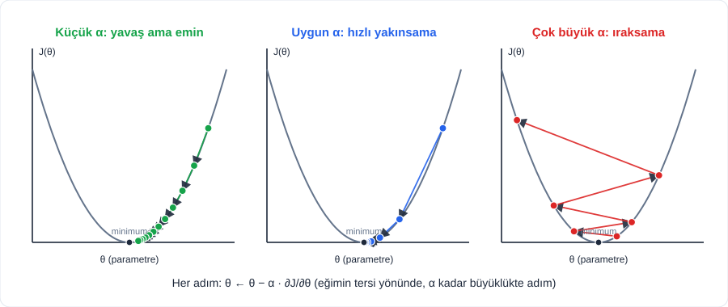
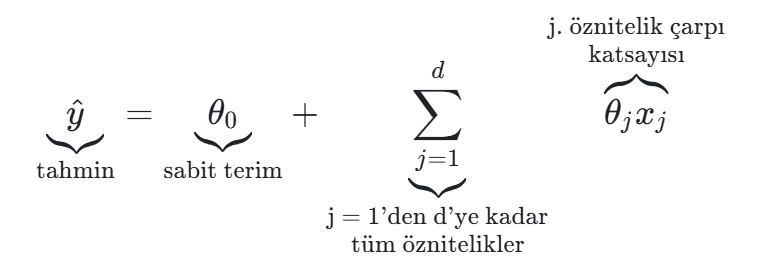
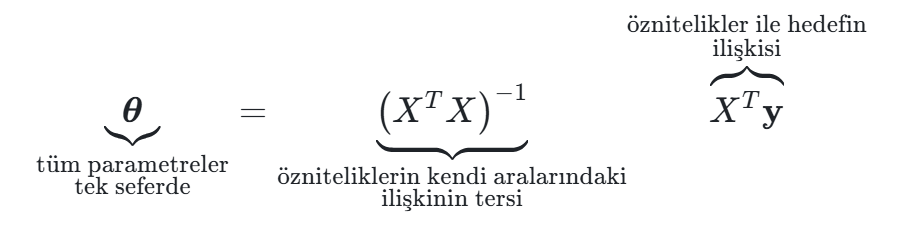
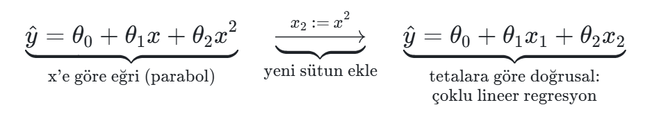

# 6. Lineer Regresyon (Doğrusal Regresyon)

## 6.1 Temel Fikir 

Hayatta birçok şeyin birbiriyle ilişkili olduğunu gözlemleriz: Evin büyüklüğü arttıkça fiyatı artar, ders çalışma süresi arttıkça sınav notu yükselme eğilimindedir. **Lineer regresyon**, bir girdi ile sürekli bir çıktı arasındaki ilişkiyi bir **doğru** ile ifade eden, makine öğrenmesinin en temel modelidir.

**Basit lineer regresyonun modeli (hipotezi; İng. *hypothesis*, Yun. *hypothesis*: "alta konan, varsayım"):**

$$
\hat{y} = h_\theta(x) = \theta_0 + \theta_1 x
$$

<p align="center"></p>

**Ne anlatıyor?** $h_\theta(x)$, "teta parametreleriyle çalışan h fonksiyonunun x'teki değeri" demektir: Alt indisteki $\theta$ bir çarpan değil, fonksiyonun hangi parametrelerle çalıştığını gösteren bir etikettir.

| Sembol | Okunuşu | Anlamı |
| :---: | :--- | :--- |
| $\hat{y}$ | "ye şapka" | Modelin tahmini (ör. tahmini sınav notu) |
| $h_\theta(x)$ | "h teta iks" | Hipotez fonksiyonu: $\theta$ parametreleriyle çalışan model |
| $x$ | "iks" | Girdi / bağımsız değişken (ör. çalışma süresi) |
| $\theta_0$ | "teta sıfır" | **Kesişim** (İng. *intercept*; Lat. *intercipere*: "araya girip yakalamak"): $x = 0$ iken tahmin; doğrunun $y$ eksenini kestiği nokta |
| $\theta_1$ | "teta bir" | **Eğim (slope):** $x$ bir birim artınca $\hat{y}$'deki değişim; ilişkinin yönü ve gücü |

> **İpucu:** Bazı kaynaklarda aynı denklem $y = \beta_0 + \beta_1 x$ (istatistik) veya $y = w x + b$ (makine öğrenmesi, $w$: ağırlık, $b$: bias) olarak yazılır. Hepsi aynı şeydir.

**Öğrenme**, eldeki verilere en iyi uyan $\theta_0$ ve $\theta_1$ değerlerini bulmaktır. Peki "en iyi uyan" ne demek?

## 6.2 Maliyet Fonksiyonu: "En İyi Doğru" Ne Demek?

Her veri noktası için gerçek değer ile tahmin arasındaki farka **artık** (İng. *residual*; Lat. *residuum*: "geride kalan") veya **hata** (İng. *error*; Lat. *errare*: "yolunu şaşırmak") denir: $e_i = y_i - \hat{y}_i$. En iyi doğru, bu hataların **karelerinin toplamını** en küçük yapan doğrudur. Bu yönteme **En Küçük Kareler (Ordinary Least Squares – OLS)** denir.

$$
J(\theta_0,\theta_1) = \frac{1}{2m}\sum_{i=1}^{m}\left(\hat{y}_i - y_i\right)^2 = \frac{1}{2m}\sum_{i=1}^{m}\left(\theta_0 + \theta_1 x_i - y_i\right)^2
$$

<p align="center"></p>

**Ne anlatıyor?** İkinci eşitlikte yalnızca $\hat{y}_i$ yerine modelin kendisi ($\theta_0 + \theta_1 x_i$) yazılmıştır. $J$, $\theta$'ların fonksiyonudur: Veri sabittir; parametreler değiştikçe maliyet değişir. Örnek (Bölüm 6.3'teki 5 öğrenci): $\theta_0 = \theta_1 = 0$ (herkese 0 tahmini) için $J = 2159.3$, en iyi doğru $\hat{y} = 44.6 + 6.8x$ için $J = 0.56$.

| Sembol | Okunuşu | Anlamı |
| :---: | :--- | :--- |
| $J(\theta)$ | "ce teta" | **Maliyet** (İng. *cost*; Lat. *constare*: "mal olmak") / **kayıp** (İng. *loss*) **fonksiyonu:** modelin toplam hatasının ölçüsü |
| $m$ | "em" | Eğitim örneği sayısı |
| $\left(\hat{y}_i - y_i\right)^2$ | — | $i$. örneğin hata karesi |
| $\frac{1}{2m}$ | "bir bölü iki em" | Ortalama almak için $\frac{1}{m}$; $\frac{1}{2}$ ise türev alınca sadeleşsin diye eklenir (sonucu değiştirmez) |

> **Neden kare?** (1) Pozitif ve negatif hatalar birbirini götürmesin. (2) Büyük hatalar daha çok cezalandırılsın. (3) Kare fonksiyonun türevi kolay alınır ve tek bir minimumu vardır.

## 6.3 Kapalı Form Çözüm ve Elle Örnek

Basit lineer regresyonda $J$'yi en küçük yapan değerler doğrudan hesaplanabilir:

```math
\theta_1 = \frac{\sum_{i=1}^{m}(x_i-\bar{x})(y_i-\bar{y})}{\sum_{i=1}^{m}(x_i-\bar{x})^2}, \qquad \theta_0 = \bar{y} - \theta_1\,\bar{x}
```

<p align="center"></p>

**Ne anlatıyor?** $\theta_0$ formülü, doğrunun $(\bar{x}, \bar{y})$ ortalama noktasından geçmesini sağlar.

| Sembol | Okunuşu | Anlamı |
| :---: | :--- | :--- |
| $\bar{x}, \bar{y}$ | "iks bar", "ye bar" | $x$ ve $y$ değerlerinin ortalaması |
| Pay | — | $x$ ile $y$'nin birlikte değişimi (kovaryansla orantılı) |
| Payda | — | $x$'in kendi değişimi (varyansla orantılı) |

**Örnek:** 5 öğrencinin çalışma süresi ve notu:

| $x$ (saat) | $y$ (not) | $x-\bar{x}$ | $y-\bar{y}$ | $(x-\bar{x})(y-\bar{y})$ | $(x-\bar{x})^2$ |
| :---: | :---: | :---: | :---: | :---: | :---: |
| 1 | 52 | −2 | −13 | 26 | 4 |
| 2 | 58 | −1 | −7 | 7 | 1 |
| 3 | 65 | 0 | 0 | 0 | 0 |
| 4 | 70 | 1 | 5 | 5 | 1 |
| 5 | 80 | 2 | 15 | 30 | 4 |
| $\bar{x}=3$ | $\bar{y}=65$ | | | **Σ = 68** | **Σ = 10** |

$\theta_1 = 68 / 10 = 6.8$ ve $\theta_0 = 65 - 6.8 \times 3 = 44.6$ → **Model:** $\hat{y} = 44.6 + 6.8x$

**Yorum:** Bu veride bir saat fazla çalışan öğrencilerin notu ortalama **6.8 puan** daha yüksektir. 6 saat çalışan bir öğrenci için tahmin: $44.6 + 6.8 \times 6 = 85.4$.

> **Dikkat:** Model, 1–5 saat arasındaki verilerle eğitilmiştir. 20 saat çalışan bir öğrenci için $44.6 + 6.8 \times 20 = 180.6$ puan tahmin eder; oysa not 100'ü geçemez. Model, eğitildiği aralığın dışında güvenilir değildir. Bu aralığın dışına tahmin yapmaya **dış değerleme** (İng. *extrapolation*; Lat. *extra*: "dışında") denir.

<p align="center"></p>

## 6.4 Gradyan İnişi (Gradient Descent)

Kapalı form çözüm her zaman mümkün veya pratik değildir (çok büyük veri, milyonlarca öznitelik, doğrusal olmayan modeller). Bu durumda **gradyan inişi** kullanılır: Parametrelere rastgele bir başlangıç değeri verilir, sonra maliyet fonksiyonunun **eğimine (türevine)** bakılarak maliyeti azaltan yönde küçük adımlar atılır.

> **İpucu:** Gözleri bağlı bir yürüyüşçünün dağdan vadiye inmeye çalıştığını düşünelim. Yürüyüşçü ayağıyla zeminin eğimini yoklar, **aşağı eğimli** yöne küçük bir adım atar ve bunu tekrarlar. Gradyan inişi tam olarak budur.

**Güncelleme kuralı** (her iki parametre **aynı anda** güncellenir):

$$
\theta_j := \theta_j - \alpha \frac{\partial J}{\partial \theta_j}
$$

<p align="center"></p>

**Dikkat:** $:=$ eşitlik değil atamadır. Bir denklem gibi okunursa ($\theta_j = \theta_j - \dots$) türevin sıfır olması gerekirdi; oysa kural, eski değerden yeni değeri hesaplayıp tekrar tekrar uygulanır. Eğim pozitifse $\theta_j$ küçülür, negatifse büyür: Her iki durumda da yokuş aşağı gidilir.

Lineer regresyon için türevler:

```math
\frac{\partial J}{\partial \theta_0} = \frac{1}{m}\sum_{i=1}^{m}(\hat{y}_i - y_i), \qquad \frac{\partial J}{\partial \theta_1} = \frac{1}{m}\sum_{i=1}^{m}(\hat{y}_i - y_i)\,x_i
```

<p align="center"></p>

**Ne anlatıyor?** $J$'deki $\frac{1}{2m}$'nin 2'si, karenin türevinden gelen 2 ile sadeleşmiş; geriye $\frac{1}{m}$ kalmıştır. Örnek (Bölüm 6.3'teki veri, $\theta_0 = \theta_1 = 0$, $\alpha = 0.05$): Tüm tahminler 0 olduğundan $\frac{\partial J}{\partial \theta_0} = -65$ ve $\frac{\partial J}{\partial \theta_1} = -208.6$ çıkar. İlk adımda $\theta_0 := 0 - 0.05 \cdot (-65) = 3.25$ ve $\theta_1 := 0 - 0.05 \cdot (-208.6) = 10.43$ olur.

| Sembol | Okunuşu | Anlamı |
| :---: | :--- | :--- |
| $:=$ | "atanır" | Sol taraftaki değişkene sağdaki yeni değeri ata (programlamadaki `=`) |
| $\alpha$ (veya $\eta$) | "alfa" ("eta") | **Öğrenme oranı (learning rate):** her adımın büyüklüğü |
| $\frac{\partial J}{\partial \theta_j}$ | "ce'nin teta j'ye göre kısmi türevi" | $\theta_j$ biraz artınca maliyetin ne kadar değiştiği = **eğim**. Tüm kısmi türevlerin oluşturduğu vektöre **gradyan** ($\nabla J$, "nabla ce") denir |
| Eksi işareti | — | Eğimin **tersi** yönünde, yani yokuş aşağı gidilir |

<p align="center"></p>

İlk adımlarda maliyetin nasıl hızla düştüğü aşağıdaki tabloda görülmektedir:

| Adım | $\theta_0$ | $\theta_1$ | $J$ |
| :---: | :---: | :---: | :---: |
| 0 | 0 | 0 | 2159.3 |
| 1 | 3.25 | 10.43 | 477.6 |
| 2 | 4.77 | 14.64 | 195.1 |
| 3 | 5.59 | 16.30 | 146.0 |

Maliyet ilk üç adımda on beş kat azalmıştır. Bu aşamada $\theta_1$ henüz olması gereken değerin (6.8) çok üstündedir; sonraki adımlarda parametreler yavaş yavaş doğru değerlere yerleşir.

Örneğimizde $\theta_0 = \theta_1 = 0$ başlangıcı ve $\alpha = 0.05$ ile 5000 adım sonunda $\theta_0 = 44.600$, $\theta_1 = 6.800$ bulunur, yani kapalı form ile **aynı sonuç**. Öğrenme oranının etkisi (100 adım sonra maliyet):

| $\alpha$ | 0.001 | 0.01 | 0.05 | 0.15 | 0.2 |
| :--- | :---: | :---: | :---: | :---: | :---: |
| $J$ | 325.5 | 102.7 | 26.8 | 1.40 | $2.6\times10^{30}$ (**ıraksadı!**) |

> **Animasyon:** Öğrenme oranını kendiniz değiştirip doğrunun ve maliyetin adım adım nasıl değiştiğini izleyin → [Gradyan İnişi Animasyonu](https://erkanozhan.github.io/machinelearning/animation/gradyan_inisi_animasyonu.html)
>
> **Kod:** kapalı form, sıfırdan gradyan inişi ve scikit-learn karşılaştırması: [`codes/python/02_lineer_regresyon.py`](https://github.com/erkanozhan/machinelearning/blob/main/codes/python/02_lineer_regresyon.py)

## 6.5 Çoklu Lineer Regresyon

Ev fiyatını sadece metrekare değil; oda sayısı, bina yaşı, semt gibi birçok faktör etkiler:

$$
\hat{y} = \theta_0 + \theta_1 x_1 + \theta_2 x_2 + \cdots + \theta_d x_d = \theta_0 + \sum_{j=1}^{d}\theta_j x_j
$$

<p align="center"></p>

**Ne anlatıyor?** Toplam sembolü, $\theta_1 x_1 + \theta_2 x_2 + \cdots + \theta_d x_d$ uzun toplamının kısa yazılışıdır.

| Sembol | Okunuşu | Anlamı |
| :---: | :--- | :--- |
| $x_j$ | "iks j" | $j$. öznitelik (ör. $x_1$: metrekare, $x_2$: oda sayısı) |
| $\theta_j$ | "teta j" | $x_j$'nin katsayısı: **diğer öznitelikler sabitken** $x_j$ bir birim artınca $\hat{y}$'deki değişim |
| $d$ | "de" | Öznitelik sayısı |

Tek öznitelikte model bir **doğru**, iki öznitelikte bir **düzlem**, daha fazlasında ise bir **hiperdüzlemdir** (İng. *hyperplane*). Model "lineer" olarak adlandırılır çünkü **parametrelere göre** doğrusaldır: her öznitelik bir katsayıyla çarpılıp toplanır.

<details>
<summary><b>Derinleşme (İleri Seviye): Matris gösterimi ve normal denklem</b></summary>

Her örneğe sabit terim için $x_0 = 1$ eklenirse model vektörlerle yazılır: $\hat{y} = \boldsymbol{\theta}^{T}\mathbf{x}$. Tüm veri için $\hat{\mathbf{y}} = X\boldsymbol{\theta}$ olur. Maliyetin $\boldsymbol{\theta}$'ya göre türevi (gradyanı) sıfıra eşitlenerek bulunan kapalı form çözüme **normal denklem** denir:

$\displaystyle \boldsymbol{\theta} = \left(X^{T}X\right)^{-1}X^{T}\mathbf{y}$



**Ne anlatıyor?** Bölüm 6.3'teki $\theta_1$ = pay / payda formülünün matris karşılığıdır. $X^T\mathbf{y}$ paya, $X^TX$ paydaya karşılık gelir; matrislerde bölme olmadığı için ters matrisle çarpılır.

| Sembol | Okunuşu | Anlamı |
| :---: | :--- | :--- |
| $\boldsymbol{\theta}$ | "teta vektörü" | Tüm parametreler $[\theta_0, \theta_1, \dots, \theta_d]^T$ |
| $X^{T}$ | "iks transpoz" | $X$ matrisinin satır ve sütunlarının yer değiştirmiş hâli |
| $(\cdot)^{-1}$ | "ters" | Matris tersi |

Normal denklem $d$ küçükken çok hızlıdır. $d$ büyüdükçe $(X^TX)^{-1}$ hesabı pahalanır ($\approx d^3$ işlem) ve öznitelikler birbirine çok bağımlıysa (**çoklu doğrusallık, multicollinearity**) sayısal olarak kararsızlaşır. Bu durumlarda gradyan inişi veya düzenlileştirme (Ridge) tercih edilir ([Bölüm 20](20-optimizasyon-hiperparametre.md)).

</details>

## 6.6 Doğrusal Olmayan İlişkiler: Öznitelik Dönüşümü

Lineer modeller şaşırtıcı derecede esnektir. İlişki eğrisel olsa bile yeni öznitelikler türetip modeli **parametrelere göre doğrusal** tutabiliriz:

```math
\hat{y} = \theta_0 + \theta_1 x + \theta_2 x^2 \quad\xrightarrow{\;x_2 \,:=\, x^2\;}\quad \hat{y} = \theta_0 + \theta_1 x_1 + \theta_2 x_2
```

<p align="center"></p>

**Ne anlatıyor?** $x^2$ veri tablosunda yeni bir sütun olur; model $x$'e göre eğridir ama $\theta$'lara göre hâlâ doğrusaldır.

Benzer şekilde $\log(x)$, $\sqrt{x}$, $x_1 \cdot x_2$ (etkileşim) gibi dönüşümler veri setine yeni sütunlar olarak eklenebilir. Yalnızca $x^2, x^3, \dots$ gibi kuvvetler eklenirse buna **polinom regresyon**, genel olarak ise **temel fonksiyon genişletmesi** denir. Ancak derece arttıkça model veriyi ezberleyebilir (aşırı öğrenme, İng. *overfitting*) ([Bölüm 8.1](08-model-degerlendirme.md)).

## 6.7 Varsayımlar, Avantajlar ve Sınırlılıklar

**Avantajlar:** Teorisi çok iyi bilinir; hızlıdır; katsayılar doğrudan yorumlanabilir ("hangi faktör sonucu ne kadar etkiliyor?"); yüz binlerce öznitelikle bile kolayca eğitilir; çoğu problemde güçlü bir **başlangıç modeli (baseline)** sunar.

**Sınırlılıklar ve varsayımlar** (İleri Seviye):
1. **Doğrusallık:** Girdi ile çıktı arasındaki ilişki (dönüşümlerden sonra) doğrusal olmalı.
2. **Hataların bağımsızlığı:** Bir örneğin hatası diğerini etkilememeli (zaman serilerinde bu sıkça ihlal edilir).
3. **Sabit varyans (homoskedastisite):** Hataların yayılımı tüm $x$ değerlerinde benzer olmalı.
4. **Hataların normalliği:** Özellikle güven aralıkları ve hipotez testleri için gereklidir.
5. **Çoklu doğrusallık olmamalı:** Öznitelikler birbirine çok bağımlıysa katsayılar kararsızlaşır ve yorumlanamaz hâle gelir.
   *Benzetme:* Aynı olayı anlatan iki tanık düşünelim; biri evin metrekaresini, diğeri oda sayısını söylemektedir. İkisi de büyük ölçüde aynı bilgiyi verdiği için hâkim (model), etkinin ne kadarını hangi tanığa yükleyeceğine karar veremez; katsayılar oynaklaşır ve beklenmedik işaretler alabilir. [Bölüm 6.8](06-lineer-regresyon.md)'deki negatif `oda_sayisi` katsayısı bunun bir örneğidir.
6. **Aykırı değerlere duyarlılık:** Hatanın karesi alındığı için tek bir aşırı değer doğruyu kendine doğru çekebilir.

> **WEKA:** Classify → `functions → LinearRegression`. Hedef sayısal olduğunda WEKA otomatik olarak regresyon yapar. `cpu.arff` üzerindeki uygulama ve çıktının yorumu [Bölüm 9.4](09-performans-olcutleri.md)'tedir.


## 6.8 Kısa Uygulama: Ev Fiyatı Modeli ve Katsayıların Yorumu

Veri: [`data/ev_fiyatlari.arff`](https://github.com/erkanozhan/machinelearning/blob/main/data/ev_fiyatlari.arff) (WEKA) ve [`data/ev_fiyatlari.csv`](https://github.com/erkanozhan/machinelearning/blob/main/data/ev_fiyatlari.csv) (Python, R). 240 ev: `metrekare`, `oda_sayisi`, `bina_yasi`, `kat`, `semt` (merkez/cevre/banliyo), `otopark` (evet/hayir) ve hedef `fiyat_bin_tl`.

**WEKA**
1. `ev_fiyatlari.arff` → Classify → `functions → LinearRegression` → **Use training set** → **Start**. Çıktının başındaki `fiyat_bin_tl = … * metrekare + …` denklemini bulun. Kategorik `semt` ve `otopark`, WEKA tarafından otomatik olarak 0/1 değişkenlere çevrilir.
2. Aynı modeli **Cross-validation (10)** ile çalıştırın; `Correlation coefficient`, `Mean absolute error` ve `Root mean squared error` değerlerini not edin. (Çapraz doğrulamada veri 10 parçaya bölünür ve her parça bir kez test için ayrılır; ayrıntılar [Bölüm 8.6](08-model-degerlendirme.md)'da, bu ölçütler [Bölüm 9.4](09-performans-olcutleri.md)'te anlatılmaktadır.)
3. `trees → M5P` ile tekrar deneyin ve hataları karşılaştırın.

**Python**

```python
import pandas as pd                                                 # Tablo işlemleri
from sklearn.linear_model import LinearRegression                  # Lineer regresyon modeli
from sklearn.model_selection import cross_val_score                # Çapraz doğrulama skoru

VERI = "https://raw.githubusercontent.com/erkanozhan/machinelearning/main/data/"   # Veri klasörünün adresi
df = pd.read_csv(VERI + "ev_fiyatlari.csv")                         # 240 ev
X = pd.get_dummies(df.drop(columns="fiyat_bin_tl"), drop_first=True, dtype=int)   # semt, otopark → 0/1
y = df["fiyat_bin_tl"]                                              # Hedef: fiyat (bin TL)

model = LinearRegression().fit(X, y)                                # En küçük kareler ile θ'ları öğren
print("θ0 (kesişim):", round(model.intercept_))                     # Sabit terim
for ad, k in zip(X.columns, model.coef_):                           # Her özniteliğin katsayısı (θ)
    print(f"{ad:<14}: {k:8.1f}")                                    # Öznitelik adı ve katsayısı
r2 = cross_val_score(LinearRegression(), X, y, cv=10, scoring="r2") # 10 katın her birinde R²
print(f"10 katlı CV R²: {r2.mean():.3f} ± {r2.std():.3f}")          # Ortalama ± standart sapma
```

| Öznitelik | Katsayı ($\theta$) | Yorum |
| :--- | :---: | :--- |
| metrekare | +30.3 | Diğer öznitelikler sabitken, her ek m² fiyatta yaklaşık **30 bin TL**'lik artışla ilişkilidir |
| bina_yasi | −25.3 | Bina bir yıl eskidikçe fiyat yaklaşık 25 bin TL düşer |
| semt_merkez | +1520.2 | Merkezdeki ev, (diğer her şey aynıyken) banliyödekinden yaklaşık 1.5 milyon TL pahalı |
| otopark_hayir | −173.3 | Otoparkı olmayan ev yaklaşık 173 bin TL ucuz |
| oda_sayisi | −26.5 | **Negatif!** (soruya bakın) |

10 katlı CV $R^2$ = **0.886 ± 0.045**. ($R^2$, **belirlilik katsayısı**dır: Modelin, hedefteki değişkenliğin ne kadarını açıkladığını gösterir; 1 tamamını, 0 hiçbirini açıklamak demektir. Ayrıntısı [Bölüm 9.4](09-performans-olcutleri.md)'tedir.)

**R** (katsayıların yanında anlamlılık testleri de verir)

```r
VERI <- "https://raw.githubusercontent.com/erkanozhan/machinelearning/main/data/"
ev <- read.csv(paste0(VERI, "ev_fiyatlari.csv"), stringsAsFactors = TRUE)
model <- lm(fiyat_bin_tl ~ ., data = ev)       # "~ ." : diğer tüm sütunlar girdi; semt ve otopark otomatik 0/1 olur
summary(model)                                 # Katsayılar, p-değerleri (Pr(>|t|)), R², düzeltilmiş R²
```

R çıktısında `oda_sayisi` için p-değeri **0.45** çıkar (anlamsız); diğer tüm öznitelikler p < 0.001 ile anlamlıdır. **p-değeri**, katsayının gerçekte sıfır olduğu (öznitelik fiyatı hiç etkilemediği) varsayılırsa, verideki kadar büyük bir katsayının yalnızca tesadüfen çıkma olasılığıdır. Küçük bir p-değeri (genellikle 0.05'in altı), etkinin tesadüf olma ihtimalinin düşük olduğunu gösterir. $R^2$ = 0.914, düzeltilmiş $R^2$ = 0.912.

**Gözlem soruları**
- Daha çok oda, evi neden **ucuzlatıyor** gibi görünüyor? İpucu: Oda sayısı ile metrekare arasındaki ilişkiyi düşünün (**çoklu doğrusallık**, [Bölüm 6.7](06-lineer-regresyon.md)). "Metrekare sabitken oda sayısı artarsa" ne olur?
- Eğitim verisindeki $R^2$ (0.914) neden 10 katlı CV $R^2$'den (0.886) büyük?
- WEKA'da hangi öznitelikler denklemden çıkarıldı (`attributeSelectionMethod = M5 method`)?

---

[← 5. Veri ve Öznitelikler](05-veri-ve-oznitelikler.md) · [İçindekiler](../Ders_Notu.md) · [7. Lojistik Regresyon →](07-lojistik-regresyon.md)
