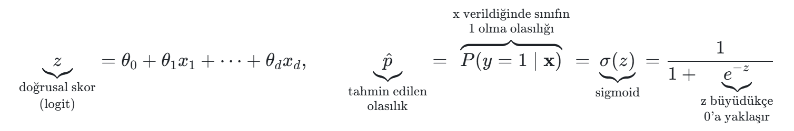
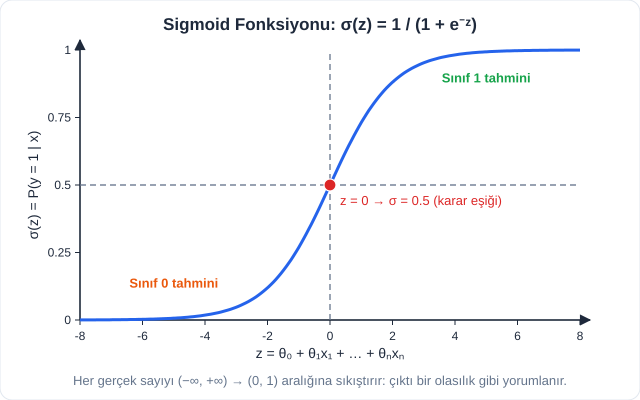
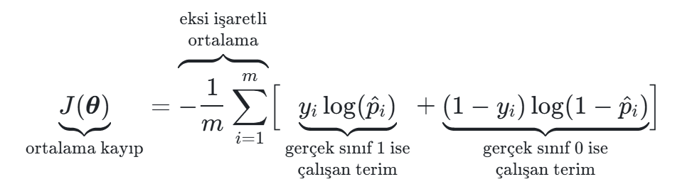

# 7. Lojistik Regresyon

## 7.1 Neden Doğrusal Regresyon Sınıflandırma İçin Uygun Değil?

"Öğrenci geçer mi (1) kalır mı (0)?" gibi bir soruda lineer regresyon 1.4 veya −0.3 gibi, olasılık olarak yorumlanamayacak değerler üretir. Bize **0 ile 1 arasında** kalan, "geçme olasılığı" gibi okunabilecek bir çıktı gerekir.

## 7.2 Sigmoid Fonksiyonu

**Lojistik regresyon** (İng. *logistic regression*; Yun. *logistikos*: "hesapla ilgili"), adında "regresyon" geçse de bir **sınıflandırma** algoritmasıdır. Lineer bir kombinasyonu **sigmoid** (Yun. *sigma* + *-eidēs*: "S biçiminde") **(lojistik) fonksiyonundan** geçirir:

$$
z = \theta_0 + \theta_1 x_1 + \cdots + \theta_d x_d, \qquad \hat{p} = P(y=1 \mid \mathbf{x}) = \sigma(z) = \frac{1}{1+e^{-z}}
$$

<p align="center"></p>

**Ne anlatıyor?** Buradaki $\sigma$ standart sapma değil, sigmoid fonksiyonunun adıdır. $z$ herhangi bir sayı olabilir; sigmoid onu 0 ile 1 arasına sıkıştırır:

| $z$ | −4 | −2 | 0 | 2 | 4 |
| :--- | :---: | :---: | :---: | :---: | :---: |
| $e^{-z}$ | 54.598 | 7.389 | 1 | 0.135 | 0.018 |
| $\sigma(z) = \frac{1}{1+e^{-z}}$ | 0.018 | 0.119 | **0.500** | 0.881 | 0.982 |

| Sembol | Okunuşu | Anlamı |
| :---: | :--- | :--- |
| $z$ | "zet" | Doğrusal skor (logit) |
| $\sigma(z)$ | "sigma zet" | Sigmoid fonksiyonu; her gerçek sayıyı $(0, 1)$ aralığına taşır |
| $e$ | "e" | Euler sayısı ($\approx 2.718$), doğal logaritmanın tabanı |
| $P(y=1 \mid \mathbf{x})$ | "iks verildiğinde ye'nin bir olma olasılığı" | **Koşullu olasılık**: bu özniteliklere sahip bir örneğin pozitif sınıfta olma olasılığı |
| $\hat{p}$ | "pe şapka" | Tahmin edilen olasılık |

<p align="center"></p>

**Karar kuralı:** $\hat{p} \ge 0.5$ ise sınıf 1, değilse sınıf 0. $\sigma(z) = 0.5 \iff z = 0$ olduğundan, **karar sınırı** $\theta_0 + \theta_1x_1 + \dots = 0$ denklemiyle tanımlanan bir **doğru/düzlemdir**. Yani lojistik regresyon **doğrusal bir sınıflandırıcıdır**.

**Örnek:** Bir modelin "sınavı geçme" için öğrendiği parametreler $\theta_0 = -4$, $\theta_1 = 1.5$ olsun ($x$: çalışma saati).
- 2 saat çalışan öğrenci: $z = -4 + 1.5\cdot 2 = -1$ → $\sigma(-1) = \frac{1}{1+e^{1}} \approx 0.27$ → **kalır** (%27 geçme olasılığı)
- 3 saat: $z = 0.5$ → $\sigma(0.5) \approx 0.62$ → **geçer**
- Karar sınırı: $z = 0 \Rightarrow x = 4/1.5 \approx 2.67$ saat.

**Bahis oranı (odds) ve logit:** Bir olayın olma olasılığının olmama olasılığına oranına **bahis oranı** (İng. *odds*) denir: $\text{odds} = \hat{p} / (1-\hat{p})$. Örneğin $\hat{p} = 0.8$ ise odds $= 0.8 / 0.2 = 4$'tür; at yarışlarındaki "4'e 1" ifadesi buradan gelir. Doğrusal skor $z$, bahis oranının doğal logaritmasına eşittir: $z = \ln(\text{odds})$. Bu yüzden $z$'ye **logit** denir. Buradan pratik bir yorum çıkar: Bir öznitelik bir birim arttığında bahis oranı $e^{\theta_j}$ katına çıkar. Yukarıdaki örnekte $e^{1.5} \approx 4.48$'dir; her ek çalışma saati, geçme bahis oranını yaklaşık 4.5 katına çıkarır (2 saatte odds ≈ 0.37, 3 saatte ≈ 1.65). WEKA'nın çıktısındaki **Odds Ratios** tablosu, her öznitelik için bu $e^{\theta_j}$ değerlerini verir.

> **Eşik (İng. *threshold*) 0.5 olmak zorunda değildir.** Hasta birini kaçırmak çok pahalıysa eşik 0.2'ye düşürülebilir ([Bölüm 22](22-dengesiz-veri.md)).

## 7.3 Log-Loss (Çapraz Entropi) Maliyet Fonksiyonu (İleri Seviye)

Lojistik regresyonda karesel hata yerine **log-loss** (ikili çapraz entropi; İng. *cross-entropy*; Yun. *entropia*: "içe dönüş, dönüşüm") kullanılır:

```math
J(\boldsymbol{\theta}) = -\frac{1}{m}\sum_{i=1}^{m}\Big[\,y_i \log(\hat{p}_i) + (1-y_i)\log(1-\hat{p}_i)\Big]
```

<p align="center"></p>

**Ne anlatıyor?** $y_i$ yalnızca 0 ya da 1 olduğundan her örnekte iki terimden biri sıfırlanır. Gerçek sınıf 1 ise ceza $-\log \hat{p}_i$, 0 ise $-\log(1-\hat{p}_i)$ olur. 1'den küçük sayıların logaritması negatif olduğu için baştaki eksi işareti cezayı pozitife çevirir. Buradaki $\log$ doğal logaritmadır (taban $e$).

| Sembol | Okunuşu | Anlamı |
| :---: | :--- | :--- |
| $y_i \in \lbrace 0,1 \rbrace$ | "ye i" | Gerçek sınıf |
| $\hat{p}_i$ | "pe şapka i" | Modelin $i$. örnek için verdiği pozitif sınıf olasılığı |
| $\log$ | "logaritma" | Doğal logaritma |

**Sezgi:** Gerçek sınıf 1 iken model $\hat{p} = 0.99$ derse ceza $-\log(0.99) \approx 0.01$ (çok az); $\hat{p} = 0.01$ derse ceza $-\log(0.01) \approx 4.6$ (çok büyük). Yani model **kendinden emin ve yanlış** olduğunda ağır cezalandırılır. Bu fonksiyonun kapalı form çözümü yoktur; **gradyan inişi** (veya türevleri) ile çözülür.

Aynı durumu hata karesiyle karşılaştırmak, lojistik regresyonda neden karesel hata kullanılmadığını gösterir (gerçek sınıf 1):

| Modelin olasılığı $\hat{p}$ | 0.9 | 0.6 | 0.1 | 0.01 |
| :--- | :---: | :---: | :---: | :---: |
| Hata karesi $(1 - \hat{p})^2$ | 0.01 | 0.16 | 0.81 | 0.98 |
| Log-loss $-\log \hat{p}$ | 0.11 | 0.51 | 2.30 | 4.61 |

Hata karesi en fazla 1'e ulaşabilir; model ne kadar emin biçimde yanılırsa yanılsın ceza 1'i geçmez. Log-loss ise "emin ama yanlış" tahmini sınırsız biçimde cezalandırır.

**Çok sınıflı durum:** Sınıf sayısı ikiden fazlaysa ya her sınıf için ayrı bir "bu sınıf / diğerleri" modeli kurulur (**one-vs-rest**) ya da sigmoidin genellemesi olan **softmax** kullanılır.

**WEKA:** `functions → Logistic` · **Python:** `sklearn.linear_model.LogisticRegression`. Iris verisinde 10 katlı çapraz doğrulamayla (bir sonraki bölümde, [Bölüm 8](08-model-degerlendirme.md)'de anlatılıyor) doğruluk ≈ **0.953**. Model her çiçek için olasılık da verir (ör. setosa = 0.985, versicolor = 0.015, virginica = 0.000). **Kod:** [`codes/python/03_siniflandirma_algoritmalari.py`](https://github.com/erkanozhan/machinelearning/blob/main/codes/python/03_siniflandirma_algoritmalari.py)


## 7.4 Kısa Uygulama: Olasılık Çıktısı ve Eşik

**WEKA**
1. WEKA kurulum klasöründeki `data/diabetes.arff` (Pima kökenli, 21 yaş ve üzeri kadınlarda diyabet; 768 kişi, 8 öznitelik) → Classify → `functions → Logistic` → Cross-validation (10) → **Start**. Doğruluk yaklaşık **%77** çıkar.
2. Çıktıdaki **Odds Ratios** tablosuna bakın ([Bölüm 7.2](07-lojistik-regresyon.md)'deki bahis oranı). WEKA bu tabloyu son sınıf dışındaki sınıf için, yani `tested_negative` (diyabet yok) için verir. Bu nedenle **1'den küçük** bir oran, öznitelik arttıkça diyabet olmama olasılığının azaldığını, yani **diyabet olasılığının arttığını** gösterir. Örneğin kan şekeri (`plas`) için oran ≈ 0.97, vücut kitle indeksi (`mass`) için ≈ 0.91'dir.
3. **More options… → Output predictions → PlainText** ile tekrar çalıştırın. `prediction` sütunu, modelin **tahmin ettiği sınıfa** verdiği olasılıktır. İki sınıfın olasılığını birlikte görmek için PlainText ayarlarında `outputDistribution = True` yapılır.

**Python**

**Veri nereden?** Aşağıdaki Python uygulamasında ve sonraki bölümlerde kullanılan **meme kanseri verisi** (Wisconsin Diagnostic Breast Cancer; 569 hasta, 30 sayısal öznitelik, 212 kötü huylu / 357 iyi huylu) gerçek bir tıbbi veridir ve `scikit-learn` kütüphanesiyle birlikte gelir. Python'da `load_breast_cancer()` veriyi bilgisayardan yükler; dosya indirmeye veya internete gerek yoktur. WEKA ve R kullananlar aynı deneyi [`data/meme_kanseri.arff`](https://github.com/erkanozhan/machinelearning/blob/main/data/meme_kanseri.arff) ve [`data/meme_kanseri.csv`](https://github.com/erkanozhan/machinelearning/blob/main/data/meme_kanseri.csv) dosyalarıyla tekrarlayabilir. Sınıf sütunu `tani`'dır ve iki değer alır: `kotu_huylu`, `iyi_huylu`. R'da veriyi `read.csv("https://raw.githubusercontent.com/erkanozhan/machinelearning/main/data/meme_kanseri.csv")` ile okunur. WEKA'nın kendi `data/` klasöründeki `breast-cancer.arff` **farklı** bir veridir (286 hasta, nominal öznitelikler); ikisi karıştırılmamalıdır.

```python
import numpy as np                                             # Sayısal işlemler
from sklearn.datasets import load_breast_cancer                # 569 hastalık meme kanseri verisi
from sklearn.model_selection import train_test_split           # Eğitim/test bölme
from sklearn.pipeline import make_pipeline                     # Ölçekleme + model zinciri
from sklearn.preprocessing import StandardScaler               # Z-skoru ölçekleme
from sklearn.linear_model import LogisticRegression            # Lojistik regresyon

X, y = load_breast_cancer(return_X_y=True)                     # y: 1 = iyi huylu, 0 = kötü huylu
X_tr, X_te, y_tr, y_te = train_test_split(X, y, test_size=0.3, stratify=y, random_state=0)   # %70 / %30
model = make_pipeline(StandardScaler(), LogisticRegression(max_iter=1000)).fit(X_tr, y_tr)  # Ölçekle ve eğit
p = model.predict_proba(X_te[:5])[:, 1]                         # İlk 5 hasta için P(iyi huylu)
print(np.round(p, 3))                                          # [0.    0.872 0.001 0.985 0.   ]
print("Tahmin:", (p >= 0.5).astype(int), "Gerçek:", y_te[:5])   # 2. hasta: model %87 emin ama yanılıyor!
print("Test doğruluğu:", round(model.score(X_te, y_te), 3))      # 0.959
```

**Gözlem soruları**
- İkinci hastada model %87 olasılıkla "iyi huylu" dedi ama hasta kötü huyluydu. Kötü huylu (hasta) sınıfı pozitif kabul edilirse bu hata türünün adı nedir ([Bölüm 9](09-performans-olcutleri.md))? Tıpta neden tehlikelidir?
- Eşiği 0.5 yerine 0.9 yaparsanız bu hasta için karar değişir mi?

### Ek Uygulama: Lojistik Regresyon Gizli Kuralı Bulabilir mi?

Notlar verisindeki `durum`, **dönem ortalaması = 0.4·vize + 0.6·final ≥ 60** kuralıyla belirlenmişti ([`data/notlar.csv`](https://github.com/erkanozhan/machinelearning/blob/main/data/notlar.csv)). Modele bu kuralı söylemeden yalnızca vize, final ve durum verildiğinde kuralı bulabilir mi?

**WEKA:** `notlar.arff` → `functions → Logistic` → Cross-validation (10) → **Start**. Doğruluk yaklaşık **%99** çıkar. Çıktıdaki katsayıların çok büyük olduğuna dikkat edin.

**Python**

```python
import pandas as pd                                                  # Tablo işlemleri
from sklearn.linear_model import LogisticRegression                 # Lojistik regresyon
from sklearn.model_selection import cross_val_score                 # Çapraz doğrulama

VERI = "https://raw.githubusercontent.com/erkanozhan/machinelearning/main/data/"   # Veri klasörünün adresi
df = pd.read_csv(VERI + "notlar.csv")                                # 200 öğrenci
X, y = df[["vize", "final"]], (df["durum"] == "gecti").astype(int)   # gecti = 1, kaldi = 0

model = LogisticRegression(C=1000, max_iter=10000).fit(X, y)        # Büyük C: neredeyse cezasız
t0, (t1, t2) = model.intercept_[0], model.coef_[0]                   # θ0, θ1 (vize), θ2 (final)
print(f"z = {t0:.2f} + {t1:.3f}·vize + {t2:.3f}·final")             # Öğrenilen doğrusal skor
print(f"θ1/θ2 = {t1 / t2:.2f}   (gerçek kuralda 0.4/0.6 = 0.67)")  # Ağırlıkların oranı
print(f"Karar sınırı: final = {-t0 / t2:.1f} − {t1 / t2:.2f}·vize")  # z = 0 doğrusu
print("10 katlı CV doğruluğu:", round(cross_val_score(model, X, y, cv=10).mean(), 3))   # Genelleme başarısı
```

Çıktı: $\theta_1/\theta_2 = 0.69$ (gerçek: 0.67) ve karar sınırı **final ≈ 101.3 − 0.69·vize**. Gerçek kural ise final = 100 − 0.67·vize'dir; model kuralı neredeyse aynen bulmuştur.

**Gözlem soruları**
- Katsayılar (θ₀ ≈ −736) neden bu kadar büyük? İpucu: Veri, bir doğruyla **kusursuz** ayrılabiliyor. Sigmoid'in 0 ve 1'e tam ulaşması için $z$ ne olmalıdır? *(Bu duruma **tam ayrılma** (İng. *perfect separation*) denir; R'ın `glm` fonksiyonu bu veride "algorithm did not converge" uyarısı verir.)*
- Katsayıların büyüklüğü değil, **oranı** neden anlamlıdır?

---

[← 6. Lineer Regresyon](06-lineer-regresyon.md) · [İçindekiler](../Ders_Notu.md) · [8. Model Değerlendirme Yöntemleri →](08-model-degerlendirme.md)
