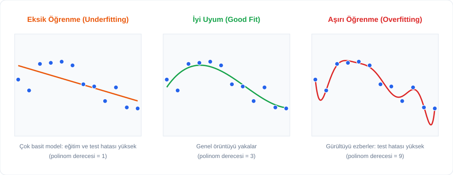
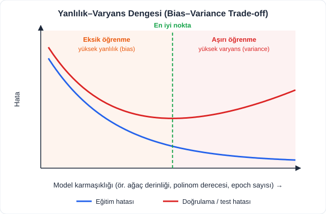
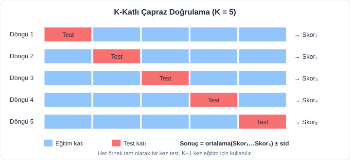
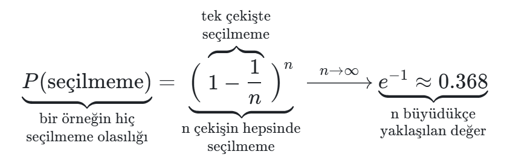

# 8. Model Değerlendirme Yöntemleri: Modelimiz Gerçekten Öğrendi mi?

Şimdiye kadar iki model tanıdık: lineer regresyon ve lojistik regresyon. Yeni algoritmalara geçmeden önce çok temel bir soruyu cevaplamamız gerekiyor: **Bir modelin iyi olup olmadığını nasıl anlarız?** Bu bölümde ve bir sonrakinde öğreneceğimiz değerlendirme yöntemleri ve performans ölçütleri, sonraki tüm algoritmaları karşılaştırırken kullanacağımız ortak dildir.

## 8.1 Ezberleme ile Öğrenme Arasındaki Fark

Bir öğrenci çalışma kitabındaki soruları cevaplarıyla birlikte **ezberlerse**, aynı sorular sorulduğunda %100 alır. Ama sınavda aynı konudan **farklı** sorular gelince başarısız olur. Model de böyledir: Eğitildiği veriyle test edilirse sonuç bir **yanılsama** olabilir.

**Deney:** Sınırlandırılmamış bir karar ağacı (ayrıntıları [Bölüm 12](12-karar-agaclari.md)'de; şimdilik veriden EĞER–İSE kuralları öğrenen bir model olarak düşünün) meme kanseri verisiyle eğitilip **aynı veriyle** test edildiğinde doğruluk **1.000** çıkar. Görülmemiş veride ise **≈ 0.92**'dir.

<p align="center"></p>

| | **Eksik öğrenme (Underfitting)** | **İyi uyum** | **Aşırı öğrenme (Overfitting)** |
| :--- | :--- | :--- | :--- |
| Eğitim hatası | Yüksek | Düşük | Çok düşük (≈ 0) |
| Test hatası | Yüksek | Düşük | **Yüksek** |
| Neden | Model çok basit | Doğru karmaşıklık | Model çok karmaşık, gürültüyü (İng. *noise*; Lat. *nausea*: "deniz tutması, rahatsızlık") ezberliyor |
| Çözüm | Daha karmaşık model, daha iyi öznitelikler | — | Daha fazla veri, düzenlileştirme, budama (İng. *pruning*), erken durdurma (İng. *early stopping*), daha basit model |

## 8.2 Yanlılık–Varyans Dengesi (Bias–Variance Trade-off)

- **Yanlılık (bias):** Modelin **sistematik** hatası. Gerçek ilişkiyi yakalayamayacak kadar basit bir model (eğrisel veriye düz bir doğru uydurmak gibi) yüksek yanlılığa sahiptir.
- **Varyans (variance):** Modelin eğitim verisindeki küçük değişikliklere **aşırı duyarlılığı**. Farklı bir örneklemle eğitilse bambaşka bir model çıkıyorsa varyans yüksektir.

<p align="center"></p>

Model karmaşıklaştıkça yanlılık azalır ama varyans artar. Amaç, **test hatasını** en küçük yapan dengeyi bulmaktır.

> **Benzetme (dart tahtası):** Aynı modelin farklı eğitim setleriyle tekrar tekrar eğitildiğini ve her seferinde hedefe bir dart atıldığını düşünelim. **Yüksek yanlılık**, okların tahtanın merkezinden sistematik olarak kaymış bir noktada toplanmasıdır. **Yüksek varyans**, okların merkezin çevresine geniş bir alanda dağılmasıdır. İdeal model, okları hem merkeze yakın hem de birbirine yakın atar.

<details>
<summary><b>Derinleşme (İleri Seviye): Hatanın ayrıştırılması</b></summary>

Karesel hata için beklenen test hatası üç parçaya ayrılır:

$\displaystyle E\big[(y-\hat{f}(x))^2\big] = \underbrace{\big(E[\hat{f}(x)] - f(x)\big)^2}_ {\text{Yanlılık}^2} + \underbrace{E\big[(\hat{f}(x) - E[\hat{f}(x)])^2\big]}_ {\text{Varyans}} + \underbrace{\sigma_ \varepsilon^2}_ {\text{Gürültü}}$

| Sembol | Okunuşu | Anlamı |
| :---: | :--- | :--- |
| $f(x)$ | "ef iks" | Gerçek (bilinmeyen) ilişki |
| $\hat{f}(x)$ | "ef şapka iks" | Öğrenilen model |
| $E[\cdot]$ | "beklenen değer" | Farklı eğitim setleri üzerinden ortalama |
| $\sigma_\varepsilon^2$ | "sigma epsilon kare" | İndirgenemez gürültü; hiçbir model bunu yok edemez |

**Ne anlatıyor?** Yanlılık, farklı eğitim setlerinde öğrenilen modellerin **ortalamasının** gerçek ilişkiden ne kadar uzak olduğudur. Varyans, modelin eğitim setine göre ne kadar **oynadığıdır**. Gürültü ise verinin kendisinden gelir.

</details>

## 8.3 Holdout (Dışarıda Tutma)

En basit yöntem: Veri **bir kez** ikiye bölünür. Büyük parça **eğitim**, küçük parça **test** için kullanılır (yaygın oranlar: 80/20, 70/30, 66/34).

<p align="center"></p>

**Dezavantajı:** Sonuç, bölmenin şansına bağlıdır. Aynı model ve veriyle, sadece rastgele bölme değiştirilerek (10 farklı `random_state`) elde edilen test doğrulukları **0.889 ile 0.977** arasında değişti. Küçük veri setlerinde bu risk daha da büyüktür.

## 8.4 Parametre ile Hiperparametre Arasındaki Fark

| | **Parametre** | **Hiperparametre** |
| :--- | :--- | :--- |
| Ne zaman belirlenir? | Eğitim **sırasında**, veriden öğrenilir | Eğitimden **önce**, insan (veya arama algoritması) belirler |
| Örnekler | Regresyon katsayıları $\theta$, sinir ağı ağırlıkları, SVM'nin $\mathbf{w}$'si, ağacın bölme eşikleri | Öğrenme oranı, epoch sayısı, $k$ (k-NN), $C$ ve $\gamma$ (SVM), ağaç derinliği, $\lambda$, ağaç sayısı |

Hiperparametreler, parametrelerin **nasıl öğrenileceğini** belirleyen üst düzey ayarlardır. Doğru değerlerin önceden bilinen bir formülü yoktur; **sistematik olarak denenmeleri** gerekir.

## 8.5 Eğitim / Doğrulama / Test (Üçlü Ayırma)

Model geliştirirken **hiperparametre** (ağacın derinliği, $k$, $C$…) seçmemiz gerekir. Bu seçim test setine bakılarak yapılırsa, test setinin bilgisi dolaylı olarak modele **sızar** ve test sonucu artık tarafsız olmaz. Çözüm veriyi üçe ayırmaktır:

1. **Eğitim seti (training):** Modelin parametrelerini öğrendiği kısım (ör. %60).
2. **Doğrulama seti** (İng. *validation set*; Lat. *validus*: "güçlü, geçerli"): Hiperparametre ayarlama ve model seçimi için (ör. %20).
3. **Test seti (test):** Tüm kararlar verildikten sonra **yalnızca bir kez**, nihai performansı raporlamak için (ör. %20). Tüm süreç boyunca "kasada kilitli" tutulur.

## 8.6 K-Katlı Çapraz Doğrulama (K-Fold Cross-Validation)

Tek bir bölmenin şansına güvenmek yerine, veriyi **K eşit parçaya (kat; İng. *fold*)** ayırıp K kez deneme yaparız:

1. Veri $K$ kata bölünür (genellikle $K = 5$ veya $10$).
2. Her turda **bir kat test**, kalan $K-1$ kat **eğitim** için kullanılır.
3. $K$ adet skorun **ortalaması (± standart sapması)** raporlanır.

<p align="center"></p>

**Avantajı:** Her örnek tam olarak bir kez test, $K-1$ kez eğitim için kullanılır. Verinin tamamından yararlanılır ve sonuç çok daha **kararlıdır**. Bu, veri az olduğunda hayati önem taşır.

### K Değerinin Seçimi (İleri Seviye)

| | **Küçük K (ör. 2–3)** | **Büyük K (ör. 10, LOOCV)** |
| :--- | :--- | :--- |
| Eğitim seti boyutu | Küçük (K=2 ise verinin %50'si) | Büyük (K=10 ise %90) |
| Tahminin **yanlılığı** | **Yüksek**: az veriyle eğitilen model gerçekte olacağından kötü görünür (**kötümser** tahmin) | **Düşük**: nihai modele çok yakın bir model test edilir |
| Tahminin **varyansı** | Düşük olma eğiliminde | Daha yüksek olabilir: eğitim setleri neredeyse aynıdır, modeller birbirine çok benzer ve hataları ilişkilidir |
| Hesaplama maliyeti | Düşük (K model) | Yüksek |

Genel kabul görmüş uygulama $K = 5$ veya $K = 10$'dur. Bu değerler yanlılık, varyans ve hesaplama maliyeti arasında makul bir denge sağlar.

## 8.7 Tabakalı Örnekleme (Stratified K-Fold)

Sınıflar dengesizse (İng. *imbalanced*; Lat. *bilanx*: "iki kefeli terazi"; ör. 1000 kişinin 950'si sağlıklı, 50'si hasta) rastgele bölmede bazı katlarda hiç hasta olmayabilir. **Tabakalı** (İng. *stratified*; Lat. *stratum*: "tabaka, serilmiş örtü") çapraz doğrulama, her katta **sınıf oranlarının orijinal veriyle olabildiğince aynı** (yaklaşık %95 / %5) kalmasını sağlar. Sınıflandırmada **varsayılan tercih** olmalıdır (WEKA'nın çapraz doğrulaması zaten tabakalıdır; scikit-learn'de `StratifiedKFold` veya `train_test_split(..., stratify=y)`).

## 8.8 Birini Dışarıda Bırak (Leave-One-Out, LOOCV)

$K = N$ (örnek sayısı) olan özel durum: Her seferinde **tek bir örnek** test edilir, kalan $N-1$ örnekle eğitilir; bu $N$ kez tekrarlanır. Yanlılığı çok düşüktür ama $N$ model eğitmek gerektiğinden **hesaplama maliyeti çok yüksektir**. Genellikle çok küçük veri setlerinde (onlarca örnek) kullanılır.

## 8.9 Bootstrap Örnekleme ve Torba Dışı (OOB) Örnekler

Torbada 10 farklı renkte bilye var. Bir bilye çekip rengini not ediyor ve **torbaya geri koyuyorsunuz**. Bunu 10 kez tekrarlıyorsunuz. Sonuçta bazı renkler birden fazla kez seçilir (kopyalar), bazıları ise hiç seçilmez. Bu **yerine koyarak örnekleme (sampling with replacement)** işlemine **bootstrap** denir (İng. deyim *to pull oneself up by one's bootstraps*: "kendi çizme kayışından çekerek kalkmak", yani dış yardım olmadan, eldeki veriyle idare etmek).

Makine öğrenmesinde $n$ satırlık veriden yine $n$ satırlık bir **eğitim seti** bu şekilde çekilir. Hiç seçilmeyen satırlara **torba dışı (out-of-bag, OOB)** örnekler denir. Model bunları hiç görmediği için bu örnekler doğal bir **test seti** oluşturur.

**Bir örneğin hiç seçilmeme olasılığı:** Her çekişte seçilmeme olasılığı $1 - \frac{1}{n}$, $n$ çekişte:

```math
P(\text{seçilmeme}) = \left(1-\frac{1}{n}\right)^{n} \xrightarrow{\;n\to\infty\;} e^{-1} \approx 0.368
```

<p align="center"></p>

**Ne anlatıyor?** Bağımsız olayların olasılıkları çarpıldığı için tek çekişteki olasılığın $n$'inci kuvveti alınır. Değer $n$ büyüdükçe hızla sabitlenir: $n = 10$ için $0.349$, $n = 100$ için $0.366$, $n = 1000$ için $0.368$.

| Sembol | Okunuşu | Anlamı |
| :---: | :--- | :--- |
| $n$ | "en" | Veri setindeki örnek sayısı (= çekiş sayısı) |
| $e^{-1}$ | "e üzeri eksi bir" | $\approx 0.368$ |
| $\xrightarrow{n\to\infty}$ | "en sonsuza giderken" | Limit |

Yani her bootstrap eğitim seti, farklı örneklerin ortalama **%63.2**'sini içerir; kalan **%36.8** OOB setidir (**0.632 kuralı**). Kodla yapılan 200 tekrarlı deneyde ortalama OOB oranı **0.368** çıktı.

Bootstrap, **Bagging** ve **Random Forest**'ın temelidir ([Bölüm 16](16-topluluk-ogrenmesi.md)). Topluluktaki her örnek, onu eğitimde **görmemiş** ağaçların oylamasıyla tahmin edilir; bu tahminlerin doğruluğuna **OOB skoru** denir. OOB skoru, ayrı bir doğrulama seti ayırmadan genelleme başarısı hakkında güvenilir bir **tahmin** verir. Yine de akademik bir çalışmada nihai sonuç için ayrı bir test seti veya çapraz doğrulama kullanmak iyi bir uygulamadır.

## 8.10 Özet Deney

Meme kanseri verisi, karar ağacı:

| Yöntem | Sonuç |
| :--- | :--- |
| Eğitim verisinde test (**yanlış!**) | 1.000 |
| Holdout (10 farklı bölme) | 0.889 – 0.977 arası |
| 5 katlı tabakalı CV | 0.926 ± 0.022 |
| 10 katlı tabakalı CV | 0.923 ± 0.040 |
| Bootstrap / OOB (200 tekrar) | 0.922 ± 0.019 |

**Kod:** Tüm yöntemlerin kodu: [`codes/python/05_model_degerlendirme_yontemleri.py`](https://github.com/erkanozhan/machinelearning/blob/main/codes/python/05_model_degerlendirme_yontemleri.py)

**WEKA'da karşılıkları** (Classify → *Test options*):

| WEKA seçeneği | Yöntem |
| :--- | :--- |
| Use training set | Eğitim verisinde test (**sadece model incelemek için; performans raporlamak için değil!**) |
| Supplied test set | Ayrı bir test dosyasıyla holdout |
| Cross-validation (Folds = 10) | Tabakalı K-katlı CV |
| Percentage split (% 66) | Holdout |


## 8.11 Kısa Uygulama: Aynı Model, Üç Farklı Değerlendirme

**WEKA**
1. WEKA klasöründeki `data/iris.arff` → Classify → `trees → J48`.
2. Test options'ı sırayla değiştirip her birinde **Start**'a basın ve `Correctly Classified Instances` değerini bir tabloya yazın:
   - **Use training set** (eğitim verisinde test)
   - **Percentage split** (% 66)
   - **Cross-validation** (Folds = 10)
3. Percentage split'i **More options… → Random seed** değerini 1, 2, 3 yaparak tekrarlayın.

**Python**

```python
from sklearn.datasets import load_iris                         # 150 çiçeklik Iris verisi
from sklearn.tree import DecisionTreeClassifier                # Karar ağacı
from sklearn.model_selection import train_test_split, cross_val_score   # Holdout ve çapraz doğrulama

X, y = load_iris(return_X_y=True)                              # Öznitelikler ve türler
agac = DecisionTreeClassifier(random_state=0)                  # Sınırsız (budanmamış) ağaç
print("Eğitim verisinde:", agac.fit(X, y).score(X, y))                        # 1.0 → yanıltıcı!
X_tr, X_te, y_tr, y_te = train_test_split(X, y, test_size=0.34, stratify=y, random_state=1)   # %66 / %34
print("Holdout %66/%34 :", round(agac.fit(X_tr, y_tr).score(X_te, y_te), 3))   # 0.942
s = cross_val_score(agac, X, y, cv=10)                         # 10 katın doğrulukları
print(f"10 katlı CV     : {s.mean():.3f} ± {s.std():.3f}")                    # 0.960 ± 0.044
```

**Gözlem soruları**
- Hangi yöntem en yüksek, hangisi en güvenilir sonucu verdi? Neden aynı değil?
- Seed değiştikçe Percentage split sonucu ne kadar oynadı? Çapraz doğrulamanın "±" değeri size ne söylüyor?

---

[← 7. Lojistik Regresyon](07-lojistik-regresyon.md) · [İçindekiler](../Ders_Notu.md) · [9. Performans Ölçütleri →](09-performans-olcutleri.md)
