# 9. Performans Ölçütleri

"Bu model ne kadar iyi?" sorusunu nesnel olarak cevaplamak için **performans ölçütleri (metrikler)** kullanılır. Sınıflandırma ve regresyon için farklı ölçütler vardır.

## 9.1 Karışıklık Matrisi (Confusion Matrix)

Sınıflandırma performansını analiz etmeye her zaman buradan başlanır. Tablo, modelin tahminlerini gerçek değerlerle karşılaştırır.

<p align="center">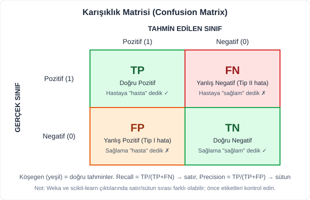</p>

| Terim | Anlamı | Örnek (hastalık testi) |
| :--- | :--- | :--- |
| **TP** – Gerçek Pozitif | Pozitifi doğru bildik | Hastaya "hasta" dedik |
| **TN** – Gerçek Negatif | Negatifi doğru bildik | Sağlıklıya "sağlıklı" dedik |
| **FP** – Sahte Pozitif (**Tip I hata**) | Negatife yanlışlıkla pozitif dedik | Sağlıklıya "hasta" dedik (yanlış alarm) |
| **FN** – Sahte Negatif (**Tip II hata**) | Pozitifi kaçırdık | Hastaya "sağlıklı" dedik |

> **Hatırlama yolu:** İkinci kelime modelin **ne dediğini** (Pozitif/Negatif), ilk kelime bu tahminin **gerçek mi sahte mi** olduğunu söyler. "Sahte Pozitif" = model "pozitif" dedi ama bu tahmin sahteydi (gerçekte negatifti). "Gerçek Negatif" = model "negatif" dedi ve gerçekten de negatifti.

**Çalışma örneği** (1000 kişi: 500 gerçekten hasta, 500 sağlıklı):

| | **Tahmin: Pozitif** | **Tahmin: Negatif** | **Toplam** |
| :--- | :---: | :---: | :---: |
| **Gerçek: Pozitif** | TP = 350 | FN = 150 | 500 |
| **Gerçek: Negatif** | FP = 250 | TN = 250 | 500 |
| **Toplam** | 600 | 400 | 1000 |

## 9.2 Sınıflandırma Ölçütleri

### Doğruluk (Accuracy)

"Tüm tahminlerin ne kadarı doğru?" (İng. *accuracy*; Lat. *accuratus*: "özenle yapılmış")

$$
\text{Accuracy} = \frac{TP + TN}{TP + TN + FP + FN}
$$

$$
\text{Accuracy} = \frac{\overbrace{TP + TN}^{\text{doğru tahminler}}}{\underbrace{TP + TN + FP + FN}_{\text{tüm tahminler}}}
$$

**Ne anlatıyor?** Pay, karışıklık matrisinin köşegenidir; payda tüm hücrelerin toplamıdır.

**Örnek:** $(350 + 250)/1000 = 0.60$

> **Doğruluk tuzağı:** 990 sağlıklı, 10 hasta olan bir veri setinde herkese "sağlıklı" diyen, **hiçbir şey öğrenmemiş** bir model %99 doğruluk elde eder, ama tek bir hastayı bile bulamaz. **Dengesiz veri setlerinde doğruluk tek başına kullanılmamalıdır.**

### Kesinlik (Precision)

"Pozitif dediklerimin ne kadarı gerçekten pozitif?" (İng. *precision*; Lat. *praecisio*: "kesip ayırma, kesinlik")

$$
\text{Precision} = \frac{TP}{TP + FP}
$$

<p align="center">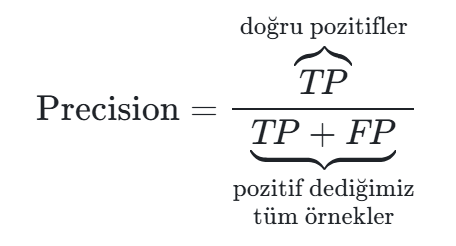</p>

**Ne anlatıyor?** Payda, karışıklık matrisinin **Tahmin: Pozitif** sütunudur.

**Örnek:** $350/600 \approx 0.583$. **Yanlış alarmın pahalı olduğu** durumlarda kritiktir. *Örnek:* Önemli bir e-postanın spam kutusuna düşmesi.

### Duyarlılık (Recall, Sensitivity, TPR)

"Gerçek pozitiflerin ne kadarını yakalayabildim?" (İng. *recall*, *sensitivity*; Lat. *sensitivus*: "duyumsayan"). TPR, **Gerçek Pozitif Oranı**dır (İng. *True Positive Rate*).

$$
\text{Recall} = \text{TPR} = \frac{TP}{TP + FN}
$$

<p align="center">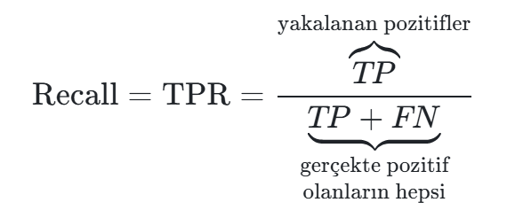</p>

**Ne anlatıyor?** Payda, **Gerçek: Pozitif** satırıdır. Precision ile recall'un payı aynıdır; farkları yalnızca paydadadır (precision'da FP, recall'da FN).

**Örnek:** $350/500 = 0.70$. **Kaçırmanın pahalı olduğu** durumlarda kritiktir. *Örnek:* Kanser taraması, dolandırıcılık tespiti.

> **Benzetme (balıkçı ağı):** Bir göle ağ atıldığını düşünelim. **Recall**, göldeki balıkların ne kadarının ağa girdiğidir. **Precision**, ağdan çıkanların ne kadarının gerçekten balık olduğudur (geri kalanı yosun, taş, eski çizme olabilir). Ağı büyütmek daha çok balık yakalar (recall artar) ama ağa daha çok çöp de girer (precision düşer).

### Özgüllük (Specificity, TNR) ve Sahte Pozitif Oranı (FPR)

"Gerçek negatiflerin ne kadarını doğru bildim?" (İng. *specificity*; Lat. *species*: "tür, görünüş"; TNR: **Gerçek Negatif Oranı**, İng. *True Negative Rate*) ve bunun tümleyeni olan "yanlış alarm oranı":

$$
\text{Specificity} = \text{TNR} = \frac{TN}{TN + FP}, \qquad \text{FPR} = \frac{FP}{FP + TN} = 1 - \text{Specificity}
$$

<p align="center">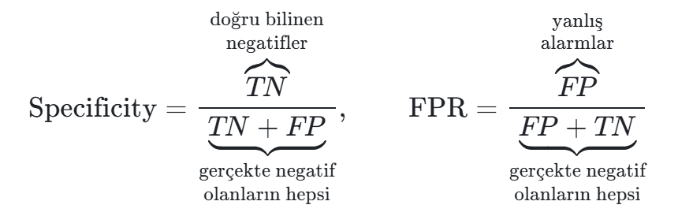</p>

**Ne anlatıyor?** İki oranın paydası aynıdır (**Gerçek: Negatif** satırı); bu yüzden toplamları 1'dir.

**Örnek:** Specificity $= 250/500 = 0.50$, FPR $= 0.50$. (Tıpta "duyarlılık" ve "özgüllük" birlikte raporlanır.)

### F1-Skoru

Precision ile recall genellikle ters yönde hareket eder: Biri artarken diğeri azalma eğilimindedir. F1 ikisinin **harmonik ortalamasıdır**; ikisinden biri düşükse F1 de düşük çıkar:

```math
F_1 = 2\cdot\frac{\text{Precision}\cdot\text{Recall}}{\text{Precision} + \text{Recall}} = \frac{2\,TP}{2\,TP + FP + FN}
```

<p align="center">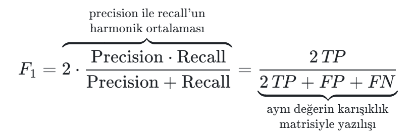</p>

**Ne anlatıyor?** Harmonik ortalama küçük olan değere yakın durur: Precision = 1.0 ve recall = 0.1 olan bir modelin aritmetik ortalaması 0.55 iken $F_1 = \frac{2 \cdot 1.0 \cdot 0.1}{1.1} \approx 0.18$'dir.

**Örnek:** $\frac{2 \cdot 0.583 \cdot 0.70}{0.583 + 0.70} \approx 0.636$

> **$F_\beta$ skoru:** $F_\beta = (1+\beta^2)\frac{P\cdot R}{\beta^2 P + R}$. $\beta = 2$ recall'a, $\beta = 0.5$ precision'a daha fazla ağırlık verir.

### Cohen'in Kappa Katsayısı ($\kappa$)

Kappa, modelin başarısının **şansın ne kadar ötesinde** olduğunu ölçer. Sınıf dağılımlarını bilen ama öznitelikleri hiç kullanmayan "rastgele" bir tahminciyle karşılaştırma yapar.

$$
\kappa = \frac{p_o - p_e}{1 - p_e}
$$

<p align="center">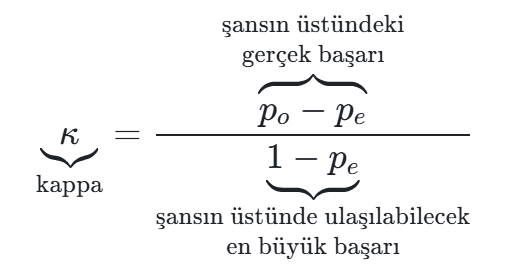</p>

**Ne anlatıyor?** Model şans düzeyinde ise ($p_o = p_e$) $\kappa = 0$, kusursuz ise ($p_o = 1$) $\kappa = 1$ olur.

| Sembol | Okunuşu | Anlamı |
| :---: | :--- | :--- |
| $\kappa$ | "kappa" | Kappa katsayısı ($-1$ ile $+1$ arası) |
| $p_o$ | "pe o" | **Gözlenen uyum** = doğruluk (accuracy) |
| $p_e$ | "pe e" | **Şans eseri beklenen uyum:** her sınıf için (gerçek oran × tahmin oranı) toplamı |

**Adım adım (örneğimiz):**
1. $p_o = 0.60$
2. Pozitif için şans uyumu: gerçek pozitif oranı $500/1000 = 0.5$ × tahmin pozitif oranı $600/1000 = 0.6$ → $0.30$. Negatif için: $0.5 \times 0.4 = 0.20$. Toplam $p_e = 0.50$. *(Hiçbir şey bilmeyen, sadece oranlara göre tahmin yapan biri bile %50 tutturabilirdi.)*
3. $\kappa = \frac{0.60 - 0.50}{1 - 0.50} = 0.20$

**Yorum:** Şansın ötesinde elde edilebilecek en büyük iyileşmenin ($1 - p_e = 0.50$) yalnızca **%20'si** gerçekleşmiştir. %60'lık doğruluk ilk bakışta kabul edilebilir görünse de başarının büyük kısmı şans düzeyindedir.

> **Günlük hayattan bir örnek:** Yılın neredeyse her günü güneşli geçen bir çöl kentinde, her gün "yarın yağmur yok" diyen bir hava durumu sunucusu %95 doğruluğa ulaşır. Ancak sunucu hiçbir şey öngörmemektedir; yalnızca çoğunluk durumunu tekrarlamaktadır. Kappa bu durumda 0 çıkar ve sunucunun şanstan öte bir başarısı olmadığını ortaya koyar.

| Kappa | Uyum düzeyi (Landis & Koch, 1977) |
| :--- | :--- |
| < 0 | Uyum yok (şanstan kötü) |
| 0.00 – 0.20 | Çok zayıf |
| 0.21 – 0.40 | Zayıf |
| 0.41 – 0.60 | Orta |
| 0.61 – 0.80 | İyi |
| 0.81 – 1.00 | Çok iyi / neredeyse mükemmel |

WEKA her sınıflandırma çıktısında `Kappa statistic` değerini otomatik verir.

### Matthews Korelasyon Katsayısı (MCC) (İleri Seviye)

Karışıklık matrisinin dört hücresini birden kullanan, dengesiz veride çok güvenilir bir ölçüttür ($-1$: tamamen ters, $0$: rastgele, $+1$: mükemmel). Gerçek etiketler ile tahmin edilen etiketler arasındaki **korelasyondur** (korelasyon kavramı için bkz. [Bölüm 9.4](09-performans-olcutleri.md)):

$$
MCC = \frac{TP\cdot TN - FP\cdot FN}{\sqrt{(TP+FP)(TP+FN)(TN+FP)(TN+FN)}}
$$

<p align="center">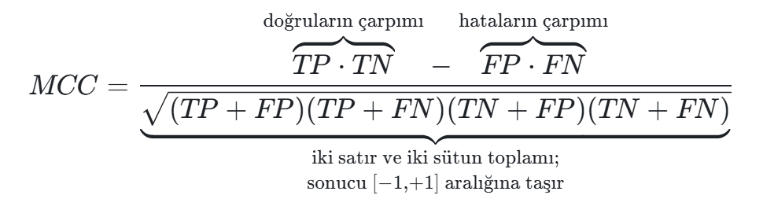</p>

**Ne anlatıyor?** Paydadaki dört çarpan, karışıklık matrisinin satır ve sütun toplamlarıdır (örnekte 600, 500, 500 ve 400).

**Örnek:** $\frac{350\cdot 250 - 250\cdot 150}{\sqrt{600\cdot 500\cdot 500\cdot 400}} \approx 0.204$. WEKA'da `MCC` sütunu olarak görünür.

### Çok Sınıflı Problemlerde Ortalama Alma: Macro ve Weighted

Üç sınıf (A, B, C) varsa her sınıf için ayrı precision, recall ve F1 hesaplanır ("bu sınıf pozitif, diğerleri negatif"). Genel skor için ortalama alınır:

- **Macro ortalama:** Tüm sınıflara **eşit** ağırlık verir; sınıf büyüklüğüne bakmaz.
- **Ağırlıklı (weighted) ortalama:** Her sınıfın skorunu örnek sayısıyla (**support**) ağırlıklandırır.

**Örnek:** F1 skorları A = 0.90, B = 0.40, C = 0.50; örnek sayıları A = 800, B = 150, C = 50.

$$
\text{Macro} = \frac{0.90 + 0.40 + 0.50}{3} = 0.60 \qquad \text{Weighted} = \frac{0.90\cdot800 + 0.40\cdot150 + 0.50\cdot50}{1000} = 0.805
$$

Macro ortalama, azınlık sınıflarındaki (B, C) kötü performansı açıkça gösterir. Weighted ortalama ise çoğunluk sınıfının (A) başarısıyla yüksek görünür. **Nadir sınıflar önemliyse** (nadir bir hastalık gibi) macro ortalamaya bakılmalıdır. scikit-learn'ün `classification_report` çıktısında ikisi `macro avg` ve `weighted avg` olarak yan yana verilir.

> **Micro ortalama:** Tüm sınıfların TP, FP ve FN değerleri önce toplanır, sonra metrik hesaplanır. Tek etiketli çok sınıflı problemlerde micro-F1 doğruluğa eşittir.

## 9.3 ROC Eğrisi ve AUC

### Kökeni

ROC (*Receiver Operating Characteristic*), II. Dünya Savaşı'nda **radar operatörlerinin** performansını ölçmek için geliştirildi. Operatör ekrandaki bir sinyalin düşman uçağı mı (pozitif), yoksa kuş sürüsü veya gürültü mü (negatif) olduğuna karar veriyordu.
- **Çok hassas** operatör en zayıf sinyali bile düşman sayar: Hiçbir uçağı kaçırmaz (yüksek TPR) ama çok yanlış alarm verir (yüksek FPR).
- **Az hassas** operatör sadece güçlü sinyalleri düşman sayar: Az yanlış alarm verir (düşük FPR) ama bazı uçakları kaçırır (düşük TPR).

### Karar Eşiği (Threshold)

Çoğu sınıflandırıcı bir **olasılık/skor** üretir (lojistik regresyonda $\hat{p}$). Bu skor bir **eşikle** karşılaştırılarak sınıfa çevrilir. Aşağıdaki şekilde negatif ve pozitif sınıfların skor dağılımları ve bir eşik görülüyor. Eşiğin sağında kalanlar "pozitif" tahmin edilir; bu yüzden negatif dağılımın eşiğin sağındaki kuyruğu **FP**, pozitif dağılımın solundaki kuyruğu **FN** olur. İki dağılım ne kadar ayrıksa model o kadar iyidir.

<p align="center">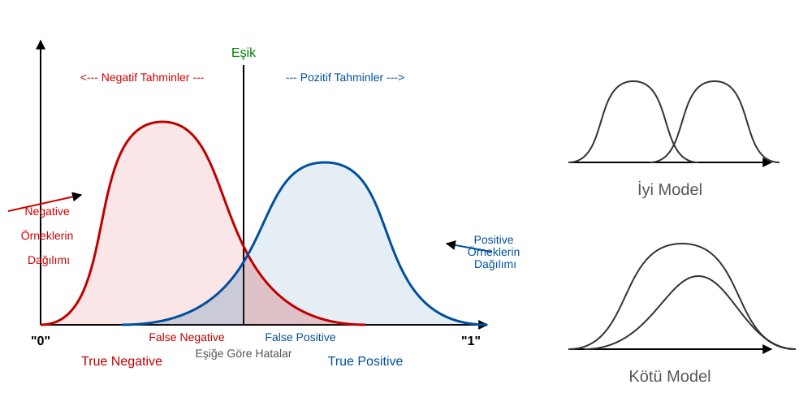</p>

- **Katı eşik (ör. 0.95):** Az yanlış alarm (düşük FPR), ama birçok pozitif kaçar (düşük TPR).
- **Gevşek eşik (ör. 0.20):** Neredeyse tüm pozitifler yakalanır (yüksek TPR), ama çok yanlış alarm olur (yüksek FPR).

### ROC Eğrisinin Çizilmesi

Eşik 1'den 0'a doğru kaydırılır ve her eşik için **(FPR, TPR)** noktası çizilir:
- **Eşik = 1:** Model hiçbir şeye pozitif demez → **(0, 0)**.
- **Eşik düştükçe:** Daha fazla örneğe pozitif denir; hem TPR hem FPR artar.
- **Eşik = 0:** Her şeye pozitif denir → **(1, 1)**.

<p align="center">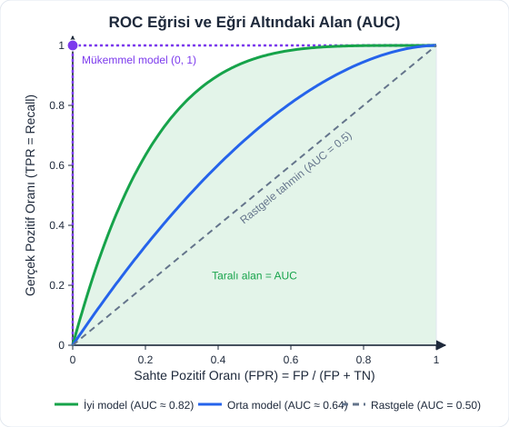</p>

- **Köşegen:** Rastgele tahmin (yazı-tura), AUC = 0.5.
- **Sol üst köşe (0, 1):** Mükemmel model: hiç yanlış alarm vermeden tüm pozitifleri bulur.
- Eğri sol üst köşeye ne kadar yakınsa model o kadar iyidir.

> **Animasyon:** Eşiği kaydırdıkça ROC eğrisinin nasıl oluştuğunu izleyin → [ROC Eğrisi Animasyonu](https://erkanozhan.github.io/machinelearning/roc_animation.html)

### Eğri Altındaki Alan (AUC)

ROC performansını tek bir sayıyla özetler:

| AUC | Yorum |
| :--- | :--- |
| 1.0 | Mükemmel ayırma |
| 0.9 – 1.0 | Çok iyi |
| 0.8 – 0.9 | İyi |
| 0.7 – 0.8 | Orta |
| 0.6 – 0.7 | Zayıf |
| 0.5 – 0.6 | Çok zayıf |
| 0.5 | Rastgele |
| < 0.5 | Rastgeleden kötü (tahminler ters çevrilirse iyileşir) |

> **AUC'nin olasılıksal anlamı:** Rastgele seçilen bir pozitif örneğin skorunun, rastgele seçilen bir negatif örneğin skorundan **yüksek olma olasılığıdır**. Bu yüzden AUC eşikten bağımsızdır ve modelin **sıralama** başarısını ölçer.
>
> **Örnek:** Pozitif örneklerin skorları {0.9, 0.6}, negatif örneklerin skorları {0.7, 0.3, 0.2} olsun. Toplam 2 × 3 = 6 pozitif–negatif çifti vardır. Bu çiftlerin 5'inde pozitif örneğin skoru daha yüksektir; yalnızca (0.6, 0.7) çiftinde negatif öndedir. Dolayısıyla AUC = 5/6 ≈ 0.83'tür.

### Precision–Recall (PR) Eğrisi (İleri Seviye)

Pozitif sınıf **çok nadirse** (ör. %1 dolandırıcılık), ROC eğrisi iyimser görünebilir: TN sayısı çok büyük olduğu için FPR küçük kalır. Bu durumda **recall (x) – precision (y)** eğrisi ve altındaki alan (**AP, Average Precision**; WEKA'da `PRC Area`) daha bilgilendiricidir. Rastgele bir modelin AP değeri, pozitif sınıfın oranına eşittir.

### Python ile Dengesiz Veride Tüm Ölçütler

%90 negatif, %10 pozitif yapay veri; lojistik regresyon:

```python
from sklearn.datasets import make_classification               # Yapay veri üretici
from sklearn.model_selection import train_test_split           # Eğitim/test bölme
from sklearn.linear_model import LogisticRegression            # Sınıflandırıcı
from sklearn.metrics import classification_report, roc_auc_score, average_precision_score   # Ölçütler

X, y = make_classification(n_samples=1000, n_features=2, n_informative=2, n_redundant=0,   # 1000 örnek, 2 öznitelik
                           weights=[0.9, 0.1], flip_y=0, random_state=42)   # %90 / %10 dengesiz veri
X_tr, X_te, y_tr, y_te = train_test_split(X, y, test_size=0.3, stratify=y, random_state=42)   # Oranları koru

model = LogisticRegression().fit(X_tr, y_tr)                 # Modeli eğit
y_pred = model.predict(X_te)                                 # Sınıf tahmini (eşik 0.5)
y_skor = model.predict_proba(X_te)[:, 1]                     # Pozitif sınıf olasılığı (ROC/PR için)

print(classification_report(y_te, y_pred, digits=3))        # Precision, recall, F1, macro/weighted
print("ROC-AUC:", roc_auc_score(y_te, y_skor))               # Eşikten bağımsız sıralama başarısı
print("PR-AUC :", average_precision_score(y_te, y_skor))     # Nadir sınıf için daha bilgilendirici
```

Çıktının yorumu:

| Ölçüt | Değer | Yorum |
| :--- | :---: | :--- |
| Accuracy | 0.940 | Herkese "negatif" diyen model bile **0.900** alır; yanıltıcı |
| Pozitif sınıf precision | 0.929 | Pozitif dediğinde çoğunlukla haklı |
| Pozitif sınıf **recall** | **0.433** | Pozitiflerin yarısından fazlasını **kaçırıyor**! |
| Pozitif sınıf F1 | 0.591 | |
| Macro F1 / Weighted F1 | 0.779 / 0.930 | Macro, azınlık sınıfındaki zayıflığı gösteriyor |
| ROC-AUC | 0.919 | Sıralama başarısı aslında iyi, sorun **eşikte** |
| PR-AUC | 0.746 | Rastgele model ≈ 0.10 |

Eşik düşürülünce precision ile recall arasındaki ödünleşim (İng. *trade-off*):

| Eşik | 0.2 | 0.3 | 0.5 | 0.7 |
| :--- | :---: | :---: | :---: | :---: |
| Precision | 0.615 | 0.655 | 0.929 | 1.000 |
| Recall | **0.800** | 0.633 | 0.433 | 0.300 |

**Kod:** Grafiklerle birlikte tam kod: [`codes/python/06_siniflandirma_metrikleri.py`](https://github.com/erkanozhan/machinelearning/blob/main/codes/python/06_siniflandirma_metrikleri.py)

### Hangi Ölçütü Ne Zaman Kullanmalı?

| Durum | Öncelikli ölçüt |
| :--- | :--- |
| Sınıflar dengeli, hataların maliyeti eşit | Accuracy, Kappa |
| Pozitifi kaçırmak pahalı (hastalık, dolandırıcılık) | **Recall**, $F_2$ |
| Yanlış alarm pahalı (spam filtresi, gereksiz ameliyat) | **Precision** |
| İkisi birden önemli | F1 |
| Sınıflar dengesiz | F1, MCC, Kappa, **PR-AUC**, macro ortalama |
| Eşikten bağımsız genel sıralama başarısı | ROC-AUC |
| Hataların maliyetleri farklı ve biliniyor | **Toplam maliyet** ([Bölüm 22](22-dengesiz-veri.md)) |

> **İpucu:** Tek bir "en iyi" ölçüt yoktur; **probleme en uygun** ölçüt vardır. Akademik raporlarda birden fazla ölçüt birlikte verilmelidir.

### Kısa Uygulama: Kredi Riskinde ROC Eğrisi ve Eşik Seçimi

Veri: [`data/kredi_basvurulari.arff`](https://github.com/erkanozhan/machinelearning/blob/main/data/kredi_basvurulari.arff) / [`data/kredi_basvurulari.csv`](https://github.com/erkanozhan/machinelearning/blob/main/data/kredi_basvurulari.csv). Pozitif sınıf: `risk = yuksek` (yaklaşık %20).

**WEKA**
1. `kredi_basvurulari.arff` → Classify → `functions → Logistic` → Cross-validation (10) → **Start**. *(Logistic eksik değerleri kendisi doldurur.)* `Detailed Accuracy By Class` tablosunda `yuksek` satırının `ROC Area` değerini not edin.
2. Result list'te modele sağ tık → **Visualize threshold curve** → `yuksek`. X ekseni `False Positive Rate`, Y ekseni `True Positive Rate` seçili olsun. Gördüğünüz eğri, ROC eğrisidir.
3. Eğri üzerindeki noktalara tıklayarak farklı eşiklerdeki (`Threshold`) TP, FP değerlerini inceleyin.

**Python**

```python
import pandas as pd                                                      # Tablo işlemleri
from sklearn.compose import make_column_transformer                     # Sütun türüne göre farklı ön işleme
from sklearn.impute import SimpleImputer                                # Eksik değer doldurma
from sklearn.linear_model import LogisticRegression                     # Sınıflandırıcı
from sklearn.metrics import roc_auc_score, precision_score, recall_score   # Ölçütler
from sklearn.model_selection import train_test_split                    # Eğitim/test bölme
from sklearn.pipeline import make_pipeline                              # Adımları zincirleme
from sklearn.preprocessing import OneHotEncoder, StandardScaler         # One-hot ve Z-skoru

VERI = "https://raw.githubusercontent.com/erkanozhan/machinelearning/main/data/"   # Veri klasörünün adresi
df = pd.read_csv(VERI + "kredi_basvurulari.csv")                         # 600 başvuru
X, y = df.drop(columns="risk"), (df["risk"] == "yuksek").astype(int)    # Pozitif sınıf: yüksek risk
sayisal = ["yas", "aylik_gelir", "borc_gelir_orani", "calisma_yili"]    # Sayısal sütunlar
kategorik = ["sehir", "gecmis_gecikme"]                                 # Kategorik sütunlar

on_isleme = make_column_transformer(                                     # Eksik doldurma + ölçekleme + one-hot
    (make_pipeline(SimpleImputer(strategy="median"), StandardScaler()), sayisal),            # Sayısal: medyan + ölçek
    (make_pipeline(SimpleImputer(strategy="most_frequent"), OneHotEncoder()), kategorik))   # Kategorik: mod + 0/1
model = make_pipeline(on_isleme, LogisticRegression(max_iter=1000))      # Ön işleme + model tek parça

X_tr, X_te, y_tr, y_te = train_test_split(X, y, test_size=0.3, stratify=y, random_state=0)   # %70 / %30
p = model.fit(X_tr, y_tr).predict_proba(X_te)[:, 1]                     # P(yüksek risk)
print("ROC-AUC:", round(roc_auc_score(y_te, p), 3))                     # Eşikten bağımsız başarı
for esik in [0.5, 0.3, 0.2]:                                            # Eşik düştükçe recall artar
    t = (p >= esik).astype(int)                                         # Olasılığı eşikle sınıfa çevir
    # Bu eşikteki precision ve recall değerlerini yazdır
    print(f"eşik={esik}: precision={precision_score(y_te, t):.2f}  recall={recall_score(y_te, t):.2f}")
```

| Eşik | Precision | Recall |
| :---: | :---: | :---: |
| 0.5 | 0.77 | 0.29 |
| 0.3 | 0.43 | 0.63 |
| 0.2 | 0.37 | **0.89** |

ROC-AUC = **0.841**.

**Gözlem soruları**
- Varsayılan 0.5 eşiğinde riskli başvuruların yalnızca %29'u yakalanıyor. Banka için hangi eşik daha uygun olur? Bu karar hangi bilgiye bağlıdır ([Bölüm 22](22-dengesiz-veri.md))?
- Modelin doğruluğu (accuracy) yüksek olabilir ama recall düşüktür. Bu çelişki dengesiz veride neden sık görülür?

## 9.4 Regresyon Ölçütleri

Regresyonda soru "Doğru bildi mi?" değil, "**Gerçek değere ne kadar yaklaştı?**" sorusudur.

**Çalışma örneği** (ev fiyatları, bin TL):

| Gerçek $y$ | Tahmin $\hat{y}$ | Hata $y - \hat{y}$ | Mutlak hata | Karesel hata |
| :---: | :---: | :---: | :---: | :---: |
| 250 | 260 | −10 | 10 | 100 |
| 300 | 290 | 10 | 10 | 100 |
| 200 | 215 | −15 | 15 | 225 |
| 500 | 480 | 20 | 20 | 400 |
| 420 | 450 | −30 | 30 | 900 |
| | | **Toplam** | **85** | **1725** |

### Ortalama Mutlak Hata (MAE)

$$
MAE = \frac{1}{n}\sum_{i=1}^{n}\lvert y_i - \hat{y}_i \rvert
$$

<p align="center">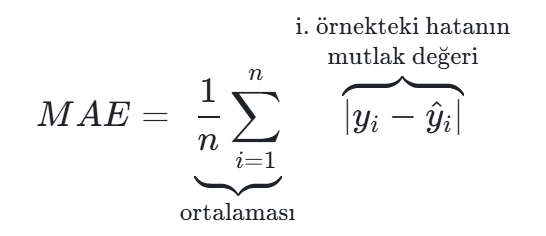</p>

**Ne anlatıyor?** Her tahminin gerçek değerden sapması, işaretine bakılmadan (mutlak değer) alınır ve bu sapmaların ortalaması hesaplanır. Fazla ve eksik tahminler birbirini götürmez.

**Örnek:** $85/5 = 17$ → "Tahminler gerçek fiyattan **ortalama 17 bin TL** sapıyor." Hedefle aynı birimdedir ve yorumlaması en kolay olanıdır.

### Ortalama Karesel Hata (MSE) ve Kökü (RMSE)

$$
MSE = \frac{1}{n}\sum_{i=1}^{n}(y_i - \hat{y}_i)^2, \qquad RMSE = \sqrt{MSE}
$$

<p align="center">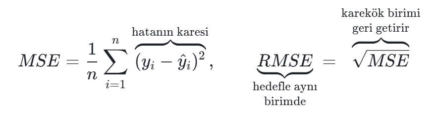</p>

**Ne anlatıyor?** MSE, [Bölüm 6.2](06-lineer-regresyon.md)'deki maliyet fonksiyonunun $\frac{1}{2}$'siz hâlidir: $J = MSE / 2$.

**Örnek:** $MSE = 1725/5 = 345$ (bin TL)², $RMSE = \sqrt{345} \approx 18.57$ bin TL.

| Sembol | Okunuşu | Anlamı |
| :---: | :--- | :--- |
| $y_i$, $\hat{y}_i$ | "ye i", "ye şapka i" | Gerçek ve tahmin edilen değer |
| $\lvert \cdot \rvert$ | "mutlak değer" | Hatanın işaretini yok sayar |
| $(\cdot)^2$ | "kare" | Büyük hataları orantısız biçimde büyütür (2'lik hata → 4, 10'luk hata → 100) |

- MSE'nin birimi hedefin **karesidir** (TL²) ve doğrudan yorumlanması zordur. RMSE birimi geri getirir.
- RMSE **büyük hatalara daha duyarlıdır**. RMSE her zaman MAE'ye eşit ya da ondan büyüktür; örnekte aradaki farkı (18.57'ye karşı 17) büyüten esas olarak −30'luk tek hatadır. **RMSE ile MAE arasındaki fark büyüdükçe model arada bir büyük hatalar yapıyor demektir.**

| Ölçüt | Birim | Yorum kolaylığı | Aykırı değere duyarlılık |
| :--- | :--- | :--- | :--- |
| MAE | Hedefle aynı | Çok kolay | Düşük |
| MSE | Hedefin karesi | Zor | Çok yüksek |
| RMSE | Hedefle aynı | Kolay | Yüksek |

> [!CAUTION]
> **VİZE SINIRI (2 Kasım 2026):** Vize sınavı, ders notunun başından **buraya kadar** olan konuları kapsar (Bölüm 9.4'teki MAE, MSE ve RMSE dahil). Aşağıdaki **Belirlilik Katsayısı (R²) ve sonrasındaki tüm konular vizeye dahil değildir.**

### Belirlilik Katsayısı ($R^2$)

"Hedefteki değişkenliğin yüzde kaçını model açıklıyor?"

$$
R^2 = 1 - \frac{SS_{res}}{SS_{tot}} = 1 - \frac{\sum_i (y_i - \hat{y}_i)^2}{\sum_i (y_i - \bar{y})^2}
$$

<p align="center">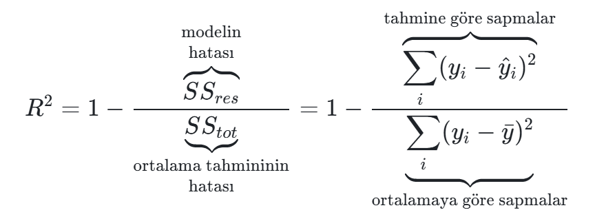</p>

**Ne anlatıyor?** Kesir, modelin hatasının "herkese ortalamayı söyle" stratejisinin hatasına oranıdır. Model bu stratejiden ne kadar iyiyse kesir o kadar küçük, $R^2$ o kadar 1'e yakın olur.

| Sembol | Okunuşu | Anlamı |
| :---: | :--- | :--- |
| $SS_{res}$ | "es es res" | **Artık kareler toplamı:** modelin açıklayamadığı hata |
| $SS_{tot}$ | "es es tot" | **Toplam kareler:** her tahmine sadece ortalamayı ($\bar{y}$) söyleyen en basit (naif) modelin hatası |
| $\bar{y}$ | "ye bar" | Gerçek değerlerin ortalaması |

**Örnek:** $\bar{y} = 334$; $SS_{tot} = 84^2 + 34^2 + 134^2 + 166^2 + 86^2 = 61\thinspace 120$; $SS_{res} = 1725$.
$R^2 = 1 - 1725/61\thinspace 120 \approx 0.972$ → "Fiyatlardaki değişkenliğin **%97.2'si** model tarafından açıklanıyor."

- $R^2 = 1$: Mükemmel uyum.
- $R^2 = 0$: Model, herkese ortalamayı söylemekten daha iyi değil.
- **$R^2 < 0$ olabilir!** Test verisinde model ortalamadan bile kötü tahmin yapıyorsa $R^2$ negatif çıkar. (Örneğin tahminler $[500, 200, 450, 250, 300]$ olsaydı $R^2 = -2.47$ çıkardı.) "R² bir karedir, negatif olamaz" düşüncesi yalnızca en küçük kareler ile eğitim verisinde hesaplanan değer için geçerlidir.

### Düzeltilmiş $R^2$ (Adjusted $R^2$) (İleri Seviye)

Modele **anlamsız** bir öznitelik bile eklense (ev sahibinin ayakkabı numarası gibi), eğitim verisindeki $R^2$ artar ya da en kötü ihtimalle aynı kalır; asla azalmaz. Düzeltilmiş $R^2$ öznitelik sayısını cezalandırır:

$$
R^2_{adj} = 1 - \frac{(1-R^2)(n-1)}{n-d-1}
$$

<p align="center">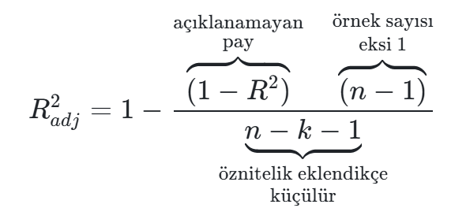</p>

**Ne anlatıyor?** $d$ arttıkça payda küçülür, kesir büyür ve $R^2_{adj}$ düşer. Yeni öznitelik $R^2$'yi bu cezayı aşacak kadar artırmazsa $R^2_{adj}$ azalır.

| Sembol | Okunuşu | Anlamı |
| :---: | :--- | :--- |
| $n$ | "en" | Örnek sayısı |
| $d$ | "de" | Modeldeki öznitelik (bağımsız değişken) sayısı |

Eklenen öznitelik açıklayıcılığa anlamlı katkı yapmıyorsa $R^2_{adj}$ artmaz, hatta düşer. **Örnek:** $n = 5$, $d = 1$ için $R^2_{adj} = 1 - \frac{0.0282 \cdot 4}{3} \approx 0.962$.

### Korelasyon Katsayısı ($r$)

Korelasyon (İng. *correlation*; Lat. *com-*: "birlikte" + *relatio*: "ilişki"), iki sayısal değişkenin **doğrusal** olarak birlikte ne kadar hareket ettiğini ölçer ($-1 \le r \le +1$):

```math
r = \frac{\sum_i (x_i - \bar{x})(y_i - \bar{y})}{\sqrt{\sum_i (x_i-\bar{x})^2}\,\sqrt{\sum_i (y_i-\bar{y})^2}}
```

<p align="center">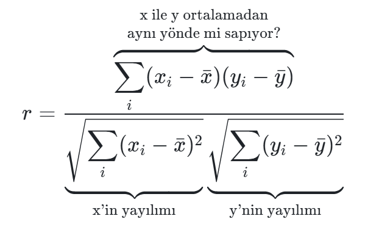</p>

**Ne anlatıyor?** Pay, Bölüm 6.3'teki $\theta_1$ formülünün payıyla aynıdır; payda iki değişkenin yayılımına bölerek sonucu birimsiz yapar. Örnek (Bölüm 6.3'teki 5 öğrenci): $r = \frac{68}{\sqrt{10}\thinspace \sqrt{468}} \approx 0.994$.

- $r = +1$: Mükemmel pozitif doğrusal ilişki · $r = -1$: Mükemmel negatif · $r = 0$: **Doğrusal** ilişki yok. (Doğrusal olmayan bir ilişki yine de olabilir; ör. $x$, $-3$ ile $3$ arasında simetrik dağılmışsa $y = x^2$ için $r = 0$ çıkar.)

<p align="center">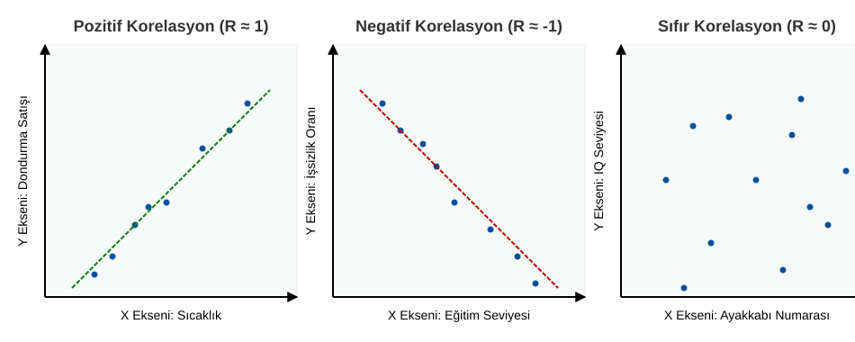</p>

**Regresyonda kullanımı:** Gerçek değerler ile tahminler arasındaki korelasyon, modelin gerçeği ne kadar iyi takip ettiğini gösterir. Örneğimizde $r(y, \hat{y}) \approx 0.987$ çok güçlü bir pozitif ilişki demektir.

> **$r^2$ ile $R^2$ her zaman eşit değildir.** Eşitlik yalnızca en küçük kareler ile kurulmuş bir lineer modelin **kendi eğitim verisinde** geçerlidir. Örneğimizde $r^2 = 0.975$, $R^2 = 0.972$'dir. Ayrıca korelasyon ölçek ve kaymadan etkilenmez: Tüm tahminler 100 bin TL fazla olsa bile $r$ değişmez ama model açıkça kötüdür. Bu yüzden korelasyon **tek başına** bir hata ölçüsü değildir. **Korelasyon nedensellik de değildir:** Dondurma satışı ile boğulma vakaları birlikte artar, ama ortak neden sıcak havadır.

**Kod:** Tüm hesaplar: [`codes/python/07_regresyon_metrikleri.py`](https://github.com/erkanozhan/machinelearning/blob/main/codes/python/07_regresyon_metrikleri.py)

### WEKA ile Regresyon: `cpu.arff`

`cpu.arff`, 209 bilgisayar işlemcisinin donanım özelliklerinden (MYCT: saat döngü süresi, MMIN/MMAX: bellek, CACH: önbellek, CHMIN/CHMAX: kanal sayısı) göreli performansını (son öznitelik `class`, sayısal) tahmin etmeyi amaçlar.

1. Explorer → Preprocess → WEKA kurulum klasöründeki `data/cpu.arff` dosyasını açın.
2. Classify → Choose → `functions → LinearRegression`. Hedef sayısal olduğu için WEKA regresyon yapar.
3. Test options: **Cross-validation, 10 kat** → **Start**.

Çıktının özet bölümü şu biçimdedir (değerler WEKA sürümüne göre küçük farklılıklar gösterebilir):

```text
=== Cross-validation ===
=== Summary ===

Correlation coefficient                  0.90      ← r: tahmin ile gerçek arasındaki korelasyon
Mean absolute error                     41.1       ← MAE (hedefle aynı birim)
Root mean squared error                 69.6       ← RMSE
Relative absolute error                 42.7  %    ← RAE
Root relative squared error             43.2  %    ← RRSE
Total Number of Instances              209
```

- **MAE ≈ 41:** Tahminler ortalama 41 performans birimi sapıyor. **RMSE (≈ 70) MAE'den belirgin biçimde büyük:** Model bazı işlemcilerde çok büyük hatalar yapıyor.
- **Correlation coefficient ≈ 0.90:** Tahminler gerçeği güçlü biçimde izliyor. Karesi (≈ 0.81) yalnızca **yaklaşık** bir $R^2$ fikri verir (yukarıdaki uyarıya bakın).
- **RAE ve RRSE:** Modelin hatasının, her örneğe ortalamayı söyleyen modelin hatasına oranıdır. $RAE = \frac{\sum\lvert y_i-\hat{y}_i\rvert}{\sum\lvert y_i-\bar{y}\rvert}$, $RRSE = \sqrt{\frac{\sum(y_i-\hat{y}_i)^2}{\sum(y_i-\bar{y})^2}}$. %100 = ortalama kadar kötü, %0 = mükemmel. Dikkat: $RRSE^2 = 1 - R^2$, yani $R^2 \approx 1 - 0.432^2 \approx 0.81$.

`trees → M5P` (model ağacı) ve `functions → MultilayerPerceptron` ile de deneyip sonuçları karşılaştırın.


### Kısa Uygulama: Regresyon Ölçütlerini Formüllerle Hesaplamak

Ev fiyatı modelinin ([Bölüm 6.8](06-lineer-regresyon.md)) hatalarını, bu bölümdeki formüllerle kendimiz hesaplayalım. Veri: [`data/ev_fiyatlari.csv`](https://github.com/erkanozhan/machinelearning/blob/main/data/ev_fiyatlari.csv)

**Python**

```python
import numpy as np, pandas as pd                               # Sayısal işlemler ve tablolar
from sklearn.linear_model import LinearRegression              # Lineer regresyon
from sklearn.model_selection import cross_val_predict          # CV ile her örneğe tahmin

VERI = "https://raw.githubusercontent.com/erkanozhan/machinelearning/main/data/"   # Veri klasörünün adresi
df = pd.read_csv(VERI + "ev_fiyatlari.csv")                    # 240 ev
X = pd.get_dummies(df.drop(columns="fiyat_bin_tl"), drop_first=True, dtype=int)   # Kategorikler → 0/1
y = df["fiyat_bin_tl"].to_numpy()                              # Gerçek fiyatlar (NumPy dizisi)

y_hat = cross_val_predict(LinearRegression(), X, y, cv=10)    # Her ev, görmediği katta tahmin edilir
e = y - y_hat                                                  # Artıklar
mae  = np.abs(e).mean()                                        # Ortalama mutlak hata
rmse = np.sqrt((e ** 2).mean())                                # Kök ortalama karesel hata
r2   = 1 - (e ** 2).sum() / ((y - y.mean()) ** 2).sum()        # 1 − SS_res / SS_tot
r    = np.corrcoef(y, y_hat)[0, 1]                             # Gerçek–tahmin korelasyonu
# Dört ölçütü birlikte yazdır
print(f"MAE={mae:.0f}  RMSE={rmse:.0f}  R²={r2:.3f}  r={r:.3f}  (bin TL)")
```

Çıktı: **MAE = 283**, **RMSE = 361**, **R² = 0.906**, **r = 0.952** (bin TL). Tahminler gerçek fiyattan ortalama 283 bin TL sapıyor. RMSE'nin MAE'den büyük olması, bazı evlerde büyük hatalar yapıldığını gösterir.

**Gözlem soruları**
- `sklearn.metrics` içindeki `mean_absolute_error`, `root_mean_squared_error` ve `r2_score` fonksiyonlarıyla aynı sonucu buluyor musunuz?
- Buradaki $R^2$ (0.906), [Bölüm 6.8](06-lineer-regresyon.md)'deki katların ortalama $R^2$'sinden (0.886) biraz farklı. Neden? (İpucu: Burada tüm tahminler birleştirilip **tek** bir $R^2$ hesaplanıyor.)

## 9.5 Kısa Uygulama: Ölçütleri Karışıklık Matrisinden Elle Hesaplamak

**WEKA**
1. WEKA klasöründeki `data/diabetes.arff` → Classify → `bayes → NaiveBayes` → Cross-validation (10) → **Start** (doğruluk yaklaşık **%76**).
2. Çıktının en altındaki **Confusion Matrix**'i deftere yazın. Pozitif sınıf `tested_positive` olsun.
3. TP, FN, FP, TN değerlerinden **precision, recall, F1 ve accuracy**'yi elle hesaplayın. Sonuçlarınızı `Detailed Accuracy By Class` tablosundaki `tested_positive` satırıyla karşılaştırın.

**Python**

```python
from sklearn.datasets import load_breast_cancer                  # Meme kanseri verisi
from sklearn.model_selection import train_test_split             # Eğitim/test bölme
from sklearn.naive_bayes import GaussianNB                       # Sayısal öznitelikler için Naive Bayes
from sklearn.metrics import confusion_matrix, classification_report   # Karışıklık matrisi ve rapor

X, y = load_breast_cancer(return_X_y=True)                       # y: 1 = iyi huylu, 0 = kötü huylu
X_tr, X_te, y_tr, y_te = train_test_split(X, y, test_size=0.3, stratify=y, random_state=0)   # %70 / %30
y_pred = GaussianNB().fit(X_tr, y_tr).predict(X_te)              # Eğit ve test setinde tahmin et
print(confusion_matrix(y_te, y_pred, labels=[1, 0]))             # Satır: gerçek, sütun: tahmin → [[101 6] [7 57]]
print(classification_report(y_te, y_pred, labels=[1, 0], digits=3,   # Sınıf bazında precision, recall, F1
                            target_names=["iyi huylu (1)", "kötü huylu (0)"]))   # Sınıfların görünen adları
```

**Gözlem soruları**
- Python çıktısında "iyi huylu" pozitif kabul edildiğinde precision = 101 / (101 + 7) ≈ 0.935 ve recall = 101 / (101 + 6) ≈ 0.944'tür. Rapordaki değerlerle karşılaştırın.
- Tıbbi açıdan hangi hata daha tehlikeli: 6 mı yoksa 7 mi? Hangi ölçüte öncelik verirdiniz?

---

[← 8. Model Değerlendirme Yöntemleri](08-model-degerlendirme.md) · [İçindekiler](../Ders_Notu.md) · [10. k-En Yakın Komşu (k-NN) →](10-k-en-yakin-komsu.md)
