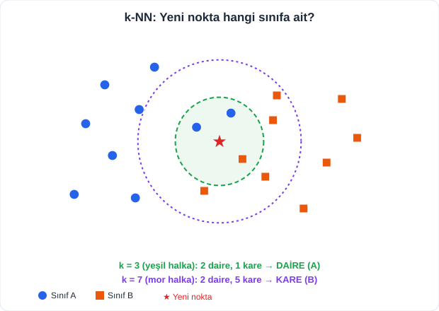

# 10. k-En Yakın Komşu (k-Nearest Neighbors, k-NN)

## 10.1 Temel Fikir

"Bana arkadaşını söyle, sana kim olduğunu söyleyeyim." k-NN, yeni bir örneği sınıflandırmak için eğitim verisindeki **en yakın k komşusuna** bakar ve **çoğunluk oyuna** göre karar verir.

**Algoritma:**
1. Yeni örnek ile **tüm** eğitim örnekleri arasındaki mesafeyi hesapla (genellikle Öklid, [Bölüm 5.9](05-veri-ve-oznitelikler.md)).
2. En yakın $k$ örneği seç.
3. **Sınıflandırma:** Bu $k$ komşu arasında en sık görülen sınıfı ata. **Regresyon:** Komşuların hedef değerlerinin ortalamasını al.

<p align="center"></p>

Şekilde aynı nokta, $k = 3$ için **daire (A)**, $k = 7$ için **kare (B)** sınıfına atanıyor. Yani **$k$ seçimi sonucu doğrudan değiştirir.**

**Elle örnek:** Altı eğitim noktası ve yeni bir nokta $\mathbf{q} = (4, 3)$ verilmiş olsun. Öklid mesafeleri hesaplanıp küçükten büyüğe sıralanır:

| Nokta | Koordinat | Sınıf | $\mathbf{q}$'ya mesafe |
| :---: | :---: | :---: | :---: |
| B | (3, 3) | daire | $\sqrt{1 + 0} = 1.00$ |
| C | (5, 4) | kare | $\sqrt{1 + 1} \approx 1.41$ |
| D | (4, 5) | kare | $\sqrt{0 + 4} = 2.00$ |
| F | (2, 4) | daire | $\sqrt{4 + 1} \approx 2.24$ |
| E | (6, 1) | kare | $\sqrt{4 + 4} \approx 2.83$ |
| A | (1, 1) | daire | $\sqrt{9 + 4} \approx 3.61$ |

- $k = 1$: En yakın komşu B'dir → **daire**.
- $k = 3$: B (daire), C (kare), D (kare) → çoğunluk **kare**.

Öznitelikler farklı birimlerde olsaydı (ör. biri santimetre, diğeri gram), mesafeyi büyük sayılı öznitelik belirlerdi; bu yüzden k-NN'den önce ölçekleme yapılır ([Bölüm 5.8](05-veri-ve-oznitelikler.md)).

> **Animasyon:** Veri alanına tıklayarak yeni bir nokta yerleştirin; mesafelerin hesaplanmasını, en yakın $k$ komşunun seçilmesini ve çoğunluk oyunu adım adım izleyin. $k$'yı ve mesafe ölçüsünü (Öklid / Manhattan) değiştirerek kararın nasıl değiştiğine, "Karar bölgelerini göster" seçeneğiyle de küçük $k$'da sınırların pürüzlü, büyük $k$'da yumuşak olduğuna bakın → [k-NN Animasyonu](https://erkanozhan.github.io/machinelearning/animation/knn_animasyonu.html)

## 10.2 k Değerinin Seçimi

| Küçük $k$ (ör. 1) | Büyük $k$ (ör. 101) |
| :--- | :--- |
| Gürültüye ve aykırı değerlere çok duyarlı | Sınırlar aşırı düzleşir, küçük sınıflar ezilir |
| **Aşırı öğrenme** (yüksek varyans) | **Eksik öğrenme** (yüksek yanlılık) |

Iris verisinde (standartlaştırılmış; karıştırmalı 10 katlı tabakalı çapraz doğrulama, `StratifiedKFold(10, shuffle=True, random_state=42)`) ölçülen doğruluklar:

| $k$ | 1 | 3 | 5 | 15 | 51 | 101 |
| :--- | :---: | :---: | :---: | :---: | :---: | :---: |
| Doğruluk | 0.940 | 0.947 | **0.960** | **0.960** | 0.860 | 0.660 |

> **İpucu:** İki sınıflı problemlerde beraberliği önlemek için $k$ **tek sayı** seçilir. En iyi $k$ çapraz doğrulama ile bulunur ([Bölüm 20](20-optimizasyon-hiperparametre.md)). Yakın komşulara daha çok ağırlık vermek (örneğin $1/d$ ile) de sık kullanılan bir iyileştirmedir.

## 10.3 Özellikler

- **Tembel öğrenici (lazy learner):** Eğitim aşamasında hiçbir şey öğrenmez, sadece veriyi saklar. Tüm iş tahmin anında yapılır. Bu yüzden eğitimi anlıktır ama büyük veride **tahmin yavaştır**.
- **Ölçekleme şarttır** ([Bölüm 5.8](05-veri-ve-oznitelikler.md)): Aksi hâlde büyük değerli öznitelik mesafeyi tek başına belirler.
- **Boyut laneti (curse of dimensionality):** Öznitelik sayısı çok arttığında tüm noktalar birbirine neredeyse eşit uzaklıkta hâle gelir ve "en yakın komşu" kavramı anlamını yitirir. Bu nedenle k-NN'den önce öznitelik seçimi veya boyut azaltma faydalıdır ([Bölüm 19](19-boyut-azaltma.md)).

**WEKA:** `lazy → IBk` (`KNN` parametresi = $k$; `distanceWeighting` ile ağırlıklandırma; `crossValidate=True` ile en iyi $k$'yı otomatik arar). **Python:** `KNeighborsClassifier(n_neighbors=5)`.


## 10.4 Kısa Uygulama: k Değeri ve Ölçeklemenin Etkisi

**WEKA**
1. WEKA klasöründeki `data/glass.arff` (cam türleri; öznitelikler farklı ölçeklerde) → Classify → `lazy → IBk` → Cross-validation (10).
2. `KNN` parametresini **1, 5, 15** yapıp her birinin doğruluğunu not edin.
3. En iyi $k$ için `distanceWeighting = Weight by 1/distance` seçip tekrar deneyin.
4. **Ölçeklemenin etkisi:** IBk mesafeleri varsayılan olarak kendisi normalize eder. Ayarlarda `nearestNeighbourSearchAlgorithm` (LinearNNSearch) → `distanceFunction` (EuclideanDistance) içinde `dontNormalize = True` yapın ve doğruluğun nasıl değiştiğine bakın.

**Python**

```python
from sklearn.datasets import load_breast_cancer       # Meme kanseri verisi
from sklearn.neighbors import KNeighborsClassifier    # k-NN sınıflandırıcı
from sklearn.pipeline import make_pipeline            # Ölçekleme + model zinciri
from sklearn.preprocessing import StandardScaler      # Z-skoru ölçekleme
from sklearn.model_selection import cross_val_score   # Çapraz doğrulama

X, y = load_breast_cancer(return_X_y=True)            # 569 hasta, 30 öznitelik (alan ≈ 140–2500, pürüzsüzlük ≈ 0.05–0.16)
for olcek in [False, True]:                           # Önce ölçeklemesiz, sonra ölçeklemeli
    for k in [1, 5, 15]:                              # Denenecek komşu sayıları
        m = KNeighborsClassifier(n_neighbors=k)       # k komşulu model
        if olcek:                                     # Ölçekleme isteniyorsa
            m = make_pipeline(StandardScaler(), m)      # Ölçekleme + k-NN
        # 10 katlı CV doğruluğunu yazdır
        print(f"ölçekleme={olcek!s:5} k={k:<2} doğruluk={cross_val_score(m, X, y, cv=10).mean():.3f}")
```

| | k = 1 | k = 5 | k = 15 |
| :--- | :---: | :---: | :---: |
| Ölçeklemesiz | 0.916 | 0.930 | 0.930 |
| **Ölçeklemeli** | **0.951** | **0.967** | **0.961** |

**Gözlem soruları**
- Ölçekleme doğruluğu neden artırdı? İpucu: Ölçeklemesiz durumda mesafeyi hangi öznitelik belirliyor?
- Ölçeklemesiz model yine de 0.93 doğruluğa ulaşıyor. Mesafeyi neredeyse tek başına belirleyen "alan" özniteliği tanı hakkında bilgi taşımasaydı sonuç nasıl değişirdi?

---

[← 9. Performans Ölçütleri](09-performans-olcutleri.md) · [İçindekiler](../Ders_Notu.md) · [11. Naive Bayes →](11-naive-bayes.md)
