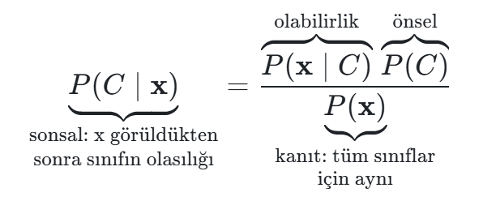
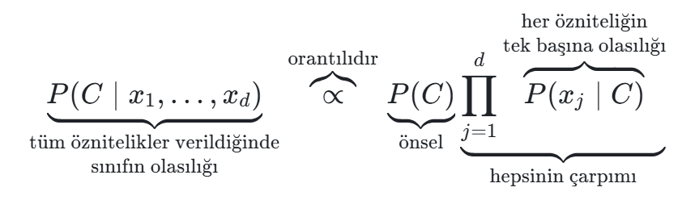
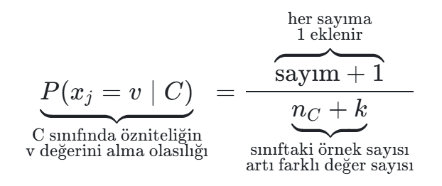
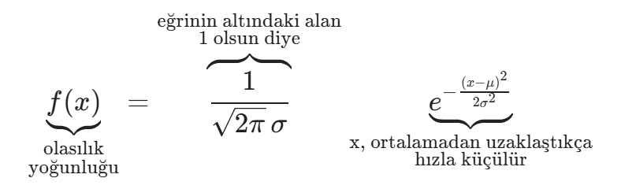

# 11. Naive Bayes

## 11.1 Bayes Teoremi

Naive Bayes, olasılık teorisine dayanan, hızlı ve şaşırtıcı derecede etkili bir sınıflandırıcıdır. Temeli **Bayes teoremidir**:

```math
P(C \mid \mathbf{x}) = \frac{P(\mathbf{x} \mid C)\; P(C)}{P(\mathbf{x})}
```

<p align="center"></p>

**Ne anlatıyor?** Bir sınıfın, gözlemler görüldükten **sonraki** olasılığı; sınıfın baştaki olasılığı ile o sınıfta bu gözlemlerin görülme olasılığının çarpımına eşittir. Paydadaki $P(\mathbf{x})$ tüm sınıflar için aynı olduğundan sınıfları karşılaştırırken çoğu zaman hesaplanmaz.

**Dikkat:** $P(C \mid \mathbf{x})$ ile $P(\mathbf{x} \mid C)$ farklı şeylerdir. "Yağmur yağıyorsa gökyüzü bulutludur" neredeyse kesindir; "Gökyüzü bulutluysa yağmur yağar" ise çok daha az olasıdır. Bayes teoremi bu ikisi arasında geçiş yapmayı sağlar.

| Sembol | Okunuşu | Anlamı |
| :---: | :--- | :--- |
| $C$ | "ce" | Bir sınıf (ör. "oynanır = yes") |
| $\mathbf{x}$ | "iks vektörü" | Örneğin öznitelikleri (ör. güneşli, serin, nemli, rüzgârlı) |
| $P(C \mid \mathbf{x})$ | "iks verildiğinde ce'nin olasılığı" | **Sonsal** (İng. *posterior*; Lat. *posterior*: "sonraki") **olasılık:** Bu gözlemler varken sınıfın olasılığı. **Aradığımız şey budur.** |
| $P(\mathbf{x} \mid C)$ | "ce verildiğinde iks'in olasılığı" | **Olabilirlik** (İng. *likelihood*): Bu sınıfta bu gözlemleri görme olasılığı |
| $P(C)$ | "ce'nin olasılığı" | **Önsel** (İng. *prior*; Lat. *prior*: "önceki") **olasılık:** Veri görmeden önce sınıfın genel sıklığı |
| $P(\mathbf{x})$ | "iks'in olasılığı" | **Kanıt (evidence):** Tüm sınıflar için aynı olduğundan karşılaştırmada ihmal edilebilir |

## 11.2 "Naive" (Saf) Varsayım

$P(\mathbf{x} \mid C)$'yi doğrudan tahmin etmek için her öznitelik kombinasyonundan bol örnek gerekir; bu pratikte imkânsızdır. Naive Bayes, **sınıf bilindiğinde özniteliklerin birbirinden bağımsız olduğunu** varsayar. Böylece olasılık, tek tek özniteliklerin olasılıklarının **çarpımına** dönüşür:

```math
P(C \mid x_1,\dots,x_d) \;\propto\; P(C)\prod_{j=1}^{d} P(x_j \mid C)
```

<p align="center"></p>

**Ne anlatıyor?** Bölüm 11.3'teki "yes" hesabı, $\frac{9}{14}\cdot\frac{2}{9}\cdot\frac{3}{9}\cdot\frac{3}{9}\cdot\frac{3}{9}$, tam olarak bu formüldür: Önsel çarpı dört özniteliğin olasılığı.

| Sembol | Okunuşu | Anlamı |
| :---: | :--- | :--- |
| $\propto$ | "orantılıdır" | Sabit bir çarpan, yani $1/P(\mathbf{x})$, dışında eşittir |
| $\prod_{j=1}^{d}$ | "pi, j birden d'ye" | $j=1$'den $d$'ye kadar tüm terimleri **çarp** |

Bu varsayım gerçekte nadiren doğrudur (hava sıcaklığı ile nem bağımsız değildir). Buna rağmen model sınıflar arasında **doğru sıralamayı** çoğu zaman bulduğu için pratikte iyi çalışır. Özellikle **metin sınıflandırmada** (spam filtresi) çok başarılıdır.

## 11.3 Elle Çözülmüş Örnek: Tenis Oynanır mı?

WEKA ile gelen `weather.nominal.arff` verisi ([`data/weather.nominal.arff`](https://github.com/erkanozhan/machinelearning/blob/main/data/weather.nominal.arff)) 14 günün hava koşullarını ve o gün tenis oynanıp oynanmadığını içerir. Öznitelikler: **outlook** (hava görünümü: sunny = güneşli, overcast = bulutlu, rainy = yağmurlu), **temperature** (sıcaklık: hot = sıcak, mild = ılık, cool = serin), **humidity** (nem: high = yüksek, normal), **windy** (rüzgâr: TRUE = var, FALSE = yok). Sınıf: **play** (oynanır mı: yes / no).

**Adım 0 – Veri:**

| Gün | outlook | temperature | humidity | windy | play |
| :---: | :--- | :--- | :--- | :---: | :---: |
| 1 | sunny | hot | high | FALSE | no |
| 2 | sunny | hot | high | TRUE | no |
| 3 | overcast | hot | high | FALSE | yes |
| 4 | rainy | mild | high | FALSE | yes |
| 5 | rainy | cool | normal | FALSE | yes |
| 6 | rainy | cool | normal | TRUE | no |
| 7 | overcast | cool | normal | TRUE | yes |
| 8 | sunny | mild | high | FALSE | no |
| 9 | sunny | cool | normal | FALSE | yes |
| 10 | rainy | mild | normal | FALSE | yes |
| 11 | sunny | mild | normal | TRUE | yes |
| 12 | overcast | mild | high | TRUE | yes |
| 13 | overcast | hot | normal | FALSE | yes |
| 14 | rainy | mild | high | TRUE | no |

> [!IMPORTANT]
> **Soru:** Aşağıdaki yeni günde tenis oynanır mı? Bu günün sınıfı (play) bilinmemektedir; yukarıdaki 14 günden öğrenilen olasılıklarla Naive Bayes yöntemiyle tahmin edilecektir.
>
> | Gün | outlook | temperature | humidity | windy | play |
> | :---: | :--- | :--- | :--- | :---: | :---: |
> | **15 (yeni gün)** | sunny | cool | high | TRUE | **?** |

**Adım 1 – Önsel olasılıklar:** 14 günün 9'unda oynanmış, 5'inde oynanmamıştır.

| Sınıf | Sayım | Önsel olasılık $P(C)$ |
| :---: | :---: | :---: |
| yes | 9 | 9/14 ≈ 0.643 |
| no | 5 | 5/14 ≈ 0.357 |

**Adım 2 – Her öznitelik için sayım ve koşullu olasılık tabloları:** Her hücrede önce sayım, sonra o sınıftaki gün sayısına bölünmüş olasılık verilir. Örneğin "sunny, yes = 2" şu anlama gelir: Oynanan 9 günün 2'si güneşlidir; dolayısıyla $P(\text{sunny} \mid \text{yes}) = 2/9$. Her sütunun toplamı 1'dir.

| outlook | yes (sayım) | no (sayım) | $P(\cdot \mid \text{yes})$ | $P(\cdot \mid \text{no})$ |
| :--- | :---: | :---: | :---: | :---: |
| sunny | 2 | 3 | 2/9 ≈ 0.222 | 3/5 = 0.600 |
| overcast | 4 | 0 | 4/9 ≈ 0.444 | 0/5 = 0 |
| rainy | 3 | 2 | 3/9 ≈ 0.333 | 2/5 = 0.400 |
| **Toplam** | **9** | **5** | **1** | **1** |

| temperature | yes (sayım) | no (sayım) | $P(\cdot \mid \text{yes})$ | $P(\cdot \mid \text{no})$ |
| :--- | :---: | :---: | :---: | :---: |
| hot | 2 | 2 | 2/9 ≈ 0.222 | 2/5 = 0.400 |
| mild | 4 | 2 | 4/9 ≈ 0.444 | 2/5 = 0.400 |
| cool | 3 | 1 | 3/9 ≈ 0.333 | 1/5 = 0.200 |
| **Toplam** | **9** | **5** | **1** | **1** |

| humidity | yes (sayım) | no (sayım) | $P(\cdot \mid \text{yes})$ | $P(\cdot \mid \text{no})$ |
| :--- | :---: | :---: | :---: | :---: |
| high | 3 | 4 | 3/9 ≈ 0.333 | 4/5 = 0.800 |
| normal | 6 | 1 | 6/9 ≈ 0.667 | 1/5 = 0.200 |
| **Toplam** | **9** | **5** | **1** | **1** |

| windy | yes (sayım) | no (sayım) | $P(\cdot \mid \text{yes})$ | $P(\cdot \mid \text{no})$ |
| :--- | :---: | :---: | :---: | :---: |
| TRUE | 3 | 3 | 3/9 ≈ 0.333 | 3/5 = 0.600 |
| FALSE | 6 | 2 | 6/9 ≈ 0.667 | 2/5 = 0.400 |
| **Toplam** | **9** | **5** | **1** | **1** |

> **Dikkat:** outlook tablosunda $P(\text{overcast} \mid \text{no}) = 0$'dır; bulutlu bir günde oynanmadığı hiç görülmemiştir. Bulutlu bir yeni gün için "no" sınıfının bütün çarpımı bu yüzden sıfır olur. Bu sorun ve çözümü (Laplace düzeltmesi) Bölüm 11.4'te ele alınmaktadır.

**Adım 3 – Yeni günün değerlerini tablolardan okumak:**

| Yeni günün değeri | $P(\cdot \mid \text{yes})$ | $P(\cdot \mid \text{no})$ |
| :--- | :---: | :---: |
| outlook = sunny | 2/9 | 3/5 |
| temperature = cool | 3/9 | 1/5 |
| humidity = high | 3/9 | 4/5 |
| windy = TRUE | 3/9 | 3/5 |

**Adım 4 – Her sınıf için önsel ile koşullu olasılıkları çarpmak:**

$$
\text{yes: } \tfrac{9}{14}\cdot\tfrac{2}{9}\cdot\tfrac{3}{9}\cdot\tfrac{3}{9}\cdot\tfrac{3}{9} = 0.643 \times 0.222 \times 0.333 \times 0.333 \times 0.333 \approx 0.0053
$$

$$
\text{no: } \tfrac{5}{14}\cdot\tfrac{3}{5}\cdot\tfrac{1}{5}\cdot\tfrac{4}{5}\cdot\tfrac{3}{5} = 0.357 \times 0.600 \times 0.200 \times 0.800 \times 0.600 \approx 0.0206
$$

Bu iki sayı olasılık değil, **skordur**; Bayes formülündeki ortak payda $P(\mathbf{x})$ henüz hesaba katılmamıştır. Karşılaştırma için yeterlidirler: "no" skoru daha büyüktür.

**Adım 5 – Normalizasyon:** Skorlar toplamlarına bölünerek olasılığa çevrilir.

$$
P(\text{no} \mid \mathbf{x}) = \frac{0.0206}{0.0053 + 0.0206} \approx 0.795, \qquad P(\text{yes} \mid \mathbf{x}) = \frac{0.0053}{0.0053 + 0.0206} \approx 0.205
$$

> [!TIP]
> **Cevap:** 15. günde tenis **oynanmaz (play = no)**; modelin bu karara güveni %79.5'tir.

**Kod:** Aynı hesabı hiçbir kütüphane kullanmadan yapan kod: [`codes/python/04_entropi_ve_naive_bayes_elle.py`](https://github.com/erkanozhan/machinelearning/blob/main/codes/python/04_entropi_ve_naive_bayes_elle.py)

## 11.4 Sıfır Frekans Sorunu ve Sayısal Öznitelikler (İleri Seviye)

- **Sıfır frekans:** Eğitim verisinde "outlook = overcast" hiç "no" ile görülmemiştir; $P(overcast \mid no) = 0/5 = 0$. Çarpımda tek bir sıfır tüm sonucu sıfırlar. Çözüm **Laplace düzeltmesidir**: her sayıma 1 eklenir, $P(x_j = v \mid C) = \frac{\text{sayım} + 1}{n_C + \lvert V_j \rvert}$ ($\lvert V_j \rvert$: $j$. özniteliğin alabileceği farklı değer sayısı). WEKA bunu otomatik yapar.

  

  **Ne anlatıyor?** Özniteliğin her değeri için baştan bir "sanal" gözlem eklenmiş gibi davranılır; böylece eğitimde hiç görülmemiş bir değer de küçük ama sıfır olmayan bir olasılık alır. Paydaya değer sayısı ($\lvert V_j \rvert$) eklenmesi, olasılıkların toplamının yine 1 olmasını sağlar.

  **Örnek:** outlook'un 3 değeri vardır ($\lvert V_j \rvert = 3$), "no" sınıfında 5 örnek bulunur: $P(\text{overcast} \mid \text{no}) = (0 + 1)/(5 + 3) = 0.125$. Olasılık artık sıfır değildir.
- **Sayısal öznitelikler:** Her sınıfta özniteliğin **normal (Gauss) dağıldığı** varsayılır ve olasılık yoğunluğu $\frac{1}{\sqrt{2\pi}\sigma}e^{-\frac{(x-\mu)^2}{2\sigma^2}}$ ile hesaplanır (Gaussian Naive Bayes). WEKA'da alternatif olarak `useKernelEstimator` veya `useSupervisedDiscretization` seçilebilir.

  

  **Ne anlatıyor?** Burada $\mu$ ve $\sigma$, özniteliğin **o sınıftaki** ortalaması ve standart sapmasıdır. Yoğunluk bir olasılık değildir ve 1'den büyük çıkabilir; ama Naive Bayes'te sınıfları karşılaştırmak için olasılık yerine kullanılabilir.

  **Örnek:** WEKA'nın `weather.numeric.arff` verisinde sıcaklık (`temperature`), "yes" sınıfında ortalama 73 ve standart sapma 6.2; "no" sınıfında ortalama 74.6 ve standart sapma 7.9'dur. Sıcaklığı 66 olan yeni bir gün için yoğunluklar "yes" için ≈ 0.0340, "no" için ≈ 0.0279 çıkar. Naive Bayes, bu değerleri kategorik özniteliklerin olasılıklarıyla aynı şekilde çarpıma katar.
- Çok sayıda küçük olasılığın çarpımı bilgisayarda sıfıra yuvarlanabilir (**underflow**); bu yüzden uygulamalarda çarpım yerine **logaritmaların toplamı** kullanılır.

**WEKA:** `bayes → NaiveBayes`. `NaiveBayesUpdateable` sürümü veriyi satır satır öğrenebilir ([Bölüm 23](23-weka-knowledgeflow.md)). **Python:** `GaussianNB` (sayısal), `MultinomialNB` (kelime sayıları), `CategoricalNB` (kategorik). Iris'te 10 katlı CV doğruluğu ≈ **0.953**.


## 11.5 Kısa Uygulama: Elle Yaptığımız Hesabı WEKA'ya Doğrulatmak

**WEKA**
1. [`data/weather.nominal.arff`](https://github.com/erkanozhan/machinelearning/blob/main/data/weather.nominal.arff) (WEKA klasöründe de vardır) → Classify → `bayes → NaiveBayes` → **Use training set** → **Start**.
2. Çıktıdaki sayım tablolarını inceleyin. Sayılar, elle hesapladığımızdan **birer fazladır** (ör. `outlook = sunny` için yes: 3, no: 4), çünkü WEKA sıfır frekans sorununu önlemek için **Laplace düzeltmesi** uygular.
3. Yeni günü tahmin edin: Test options → **Supplied test set** → [`data/weather_yeni_gun.arff`](https://github.com/erkanozhan/machinelearning/blob/main/data/weather_yeni_gun.arff) → **More options → Output predictions → PlainText** → Result list'te modele sağ tık → **Re-evaluate model on current test set**.
4. Tahmin `no` olmalıdır. Olasılık, Laplace düzeltmesi nedeniyle elle bulduğumuz 0.795'ten biraz düşük, yaklaşık **0.74** çıkar.

**Python**

```python
import pandas as pd                                             # Tablo işlemleri
from sklearn.naive_bayes import CategoricalNB                   # Kategorik öznitelikler için Naive Bayes
from sklearn.preprocessing import OrdinalEncoder                # Kategori → sayı dönüştürücü

veri = pd.DataFrame([["sunny","hot","high","false","no"], ["sunny","hot","high","true","no"],   # 14 günlük veri
    ["overcast","hot","high","false","yes"], ["rainy","mild","high","false","yes"], ["rainy","cool","normal","false","yes"],
    ["rainy","cool","normal","true","no"], ["overcast","cool","normal","true","yes"], ["sunny","mild","high","false","no"],
    ["sunny","cool","normal","false","yes"], ["rainy","mild","normal","false","yes"], ["sunny","mild","normal","true","yes"],
    ["overcast","mild","high","true","yes"], ["overcast","hot","normal","false","yes"], ["rainy","mild","high","true","no"]],
    columns=["outlook", "temperature", "humidity", "windy", "play"])   # Sütun adları
kod = OrdinalEncoder()                                          # Kategorileri 0, 1, 2… sayılarına çevirir
X, y = kod.fit_transform(veri.iloc[:, :4]), veri["play"]       # İlk 4 sütun öznitelik, play hedef
yeni = kod.transform(pd.DataFrame([["sunny", "cool", "high", "true"]], columns=veri.columns[:4]))   # Tahmin edilecek gün
for alfa in [1e-10, 1.0]:                                       # alpha: Laplace düzeltmesi (≈0: yok, 1: var)
    nb = CategoricalNB(alpha=alfa).fit(X, y)                    # Olasılık tablolarını öğren
    print(f"alpha={alfa}:", dict(zip(nb.classes_, nb.predict_proba(yeni)[0].round(3))))   # Sınıf olasılıkları
# alpha=1e-10 → no: 0.795 (elle hesapla aynı)   alpha=1.0 → no: 0.720
```

**Gözlem soruları**
- Laplace düzeltmesi olmadan `outlook = overcast` olan bir gün için `no` olasılığı ne çıkardı? Neden?
- Python'daki `alpha=1.0` sonucu (0.720) neden WEKA'nınkinden (≈ 0.74) biraz farklı? İpucu: WEKA önsel olasılıklara da düzeltme uygular.

---

[← 10. k-En Yakın Komşu (k-NN)](10-k-en-yakin-komsu.md) · [İçindekiler](../Ders_Notu.md) · [12. Karar Ağaçları →](12-karar-agaclari.md)
