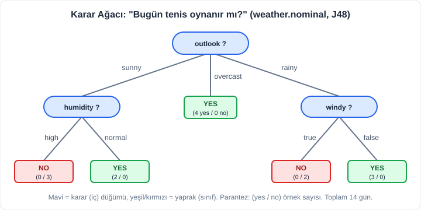
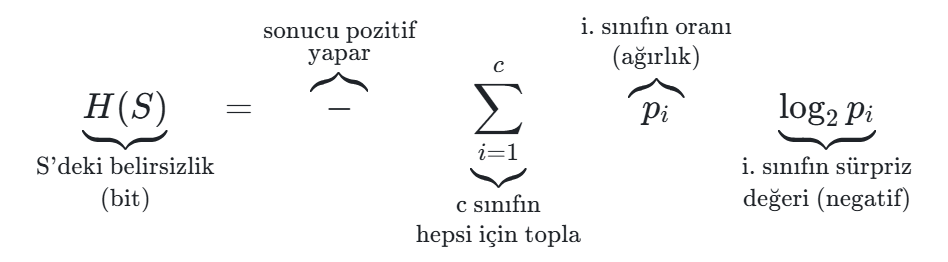
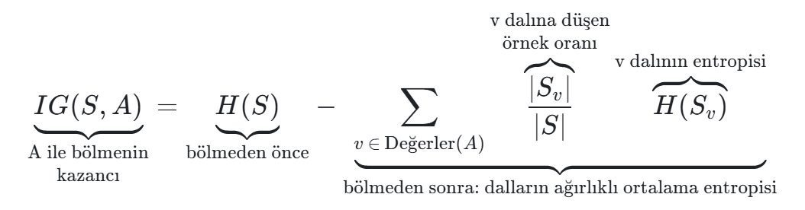
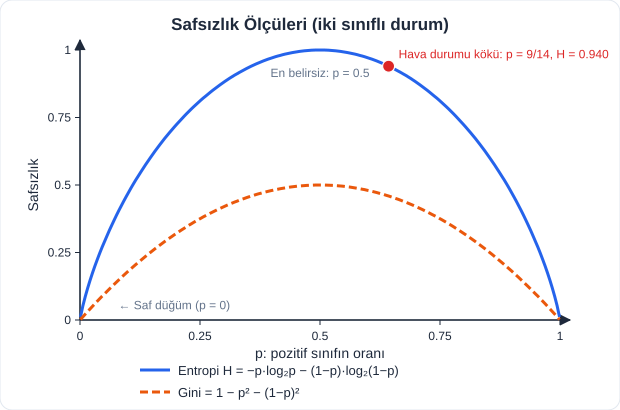
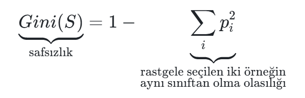

# 12. Karar Ağaçları

## 12.1 Temel Fikir

Karar ağacı, veriyi bir dizi **evet/hayır sorusuyla** parçalara ayıran, insanın düşünme biçimine çok yakın bir modeldir. Bir doktorun "Ateşi 38'in üstünde mi? → Evet → Öksürüğü var mı? → …" şeklinde ilerlemesi gibi.

<p align="center"></p>

- **Kök düğüm (root):** İlk soru (outlook).
- **İç düğüm:** Ara sorular (humidity, windy).
- **Dal (branch):** Bir sorunun olası cevabı (sunny, overcast, rainy).
- **Yaprak (leaf):** Sonuç / sınıf (yes, no).

Ağaç kökten yaprağa her yol bir **EĞER–İSE kuralıdır**: *"EĞER outlook = sunny VE humidity = high İSE play = no."* Bu yüzden karar ağaçları **açıklanabilir** modellerin başında gelir.

## 12.2 Hangi Soruyu Önce Sormalı? Entropi ve Bilgi Kazancı

Ağaç kurulurken her adımda, veriyi **en saf (homojen)** alt gruplara ayıran öznitelik seçilir. Saflığı ölçmek için **entropi** kullanılır:

$$
H(S) = -\sum_{i=1}^{c} p_i \log_2 p_i
$$

<p align="center"></p>

* $\log_2 p_i$: "2'nin kaçıncı kuvveti $p_i$ eder?" sorusunun cevabı. $p_i$ 1'den küçük olduğu için bu değer **negatiftir**. Sınıf ne kadar nadirse mutlak değeri o kadar büyüktür: Nadir bir sonuç gerçekleştiğinde daha çok "şaşırırız". Taban 2 olduğu için birim **bit**'tir.
* Baştaki eksi işareti negatif logaritmaları pozitife çevirir. Entropi, sınıf oranlarıyla ağırlıklandırılmış **ortalama sürprizdir**.
* Hiç örneği olmayan sınıf ($p_i = 0$) için $0 \cdot \log_2 0 = 0$ kabul edilir.

| Sembol | Okunuşu | Anlamı |
| :---: | :--- | :--- |
| $H(S)$ | "ha es" | $S$ kümesinin entropisi (belirsizliği), birimi **bit** |
| $c$ | "ce" | Sınıf sayısı |
| $p_i$ | "pe i" | $S$ içindeki örneklerin $i$. sınıfa ait olma oranı |
| $\log_2$ | "iki tabanında logaritma" | |

- Tüm örnekler aynı sınıftaysa $H = 0$ (**saf**, hiç belirsizlik yok).
- İki sınıf yarı yarıyaysa $H = 1$ (**en belirsiz**). Genel olarak $c$ sınıflı bir veride en büyük entropi $\log_2 c$'dir (Iris'te $\log_2 3 \approx 1.585$ bit).

**Bilgi Kazancı (Information Gain):** Bir $A$ özniteliğine göre bölmenin belirsizliği ne kadar azalttığı:

```math
IG(S, A) = H(S) - \sum_{v \,\in\, \text{Değerler}(A)} \frac{\lvert S_v \rvert}{\lvert S \rvert}\, H(S_v)
```

<p align="center"></p>

**Ne anlatıyor?** $v \in \text{Değerler}(A)$, "v, A'nın değerlerinden biri" diye okunur: A = outlook ise v sırasıyla sunny, overcast ve rainy olur. Buradaki dikey çizgiler mutlak değer değil, **kümenin eleman sayısıdır**: $\lvert S \rvert = 14$, $\lvert S_{\text{sunny}} \rvert = 5$.

| Sembol | Okunuşu | Anlamı |
| :---: | :--- | :--- |
| $IG(S,A)$ | "ay ci es a" | $A$ ile bölünce kazanılan bilgi |
| $S_v$ | "es ve" | $S$'nin, $A$ özniteliği $v$ değerini alan alt kümesi |
| $\lvert S_v \rvert / \lvert S \rvert$ | — | Alt kümenin ağırlığı (oranı) |

**Elle örnek (weather.nominal):** Kök: 9 yes, 5 no.

$H(S) = -\frac{9}{14}\log_2\frac{9}{14} - \frac{5}{14}\log_2\frac{5}{14} = 0.940$ bit

Entropi formülünün her parçası adım adım:

| Sınıf | $p_i$ | $\log_2 p_i$ (negatif; sürpriz $= -\log_2 p_i$) | $p_i \cdot \log_2 p_i$ |
| :--- | :---: | :---: | :---: |
| yes | 9/14 = 0.6429 | −0.6374 | −0.4098 |
| no | 5/14 = 0.3571 | −1.4854 | −0.5305 |
| **Toplam** | | | **−0.9403** |

Baştaki eksi işaretiyle entropi **0.940** bit olur. "no" sınıfı daha nadir olduğu için sürprizi daha büyüktür (1.485 bit) ama ağırlığı (0.357) daha küçüktür.

*outlook* ile bölersek: sunny (2 yes, 3 no) → $H = 0.971$; overcast (4 yes, 0 no) → $H = 0$; rainy (3 yes, 2 no) → $H = 0.971$

$IG = 0.940 - \left(\frac{5}{14}\cdot 0.971 + \frac{4}{14}\cdot 0 + \frac{5}{14}\cdot 0.971\right) = 0.9403 - 0.6935 \approx 0.247$

| Öznitelik | Bilgi Kazancı | Kazanç Oranı |
| :--- | :---: | :---: |
| **outlook** | **0.247** | **0.156** |
| humidity | 0.152 | 0.152 |
| windy | 0.048 | 0.049 |
| temperature | 0.029 | 0.019 |

En yüksek kazanç **outlook**'ta olduğundan **kök** olarak seçilir. İşlem her alt dal için tekrarlanır ve düğümler saf olunca (veya durma kriteri sağlanınca) durulur.

**İkinci düzey:** `outlook = sunny` dalında 5 gün vardır (2 yes, 3 no; $H = 0.971$). Bu dalda kalan özniteliklerin bilgi kazançları: humidity **0.971**, temperature 0.571, windy 0.020. Humidity bu daldaki belirsizliği tamamen giderir (high → no, normal → yes) ve bu yüzden seçilir. `overcast` dalı zaten saftır (4 gün, hepsi yes); `rainy` dalında aynı hesap tekrarlanır.

<p align="center"></p>

<details>
<summary><b>Derinleşme (İleri Seviye): Kazanç oranı, Gini ve sayısal öznitelikler</b></summary>

- **Kazanç Oranı (Gain Ratio):** Bilgi kazancı, çok sayıda farklı değeri olan özniteliklere (ör. müşteri numarası) haksız avantaj sağlar; her müşteri ayrı bir dal olur ve entropi sıfırlanır ama model hiçbir şey öğrenmemiştir. C4.5 algoritması (WEKA'da **J48**) bu yüzden kazancı bölmenin kendi entropisine böler:
  $GainRatio(S,A) = \frac{IG(S,A)}{SplitInfo(S,A)}$, $SplitInfo(S,A) = -\sum_v \frac{\lvert S_v\rvert}{\lvert S\rvert}\log_2\frac{\lvert S_v\rvert}{\lvert S\rvert}$
- **Gini Safsızlığı:** CART algoritması ve scikit-learn'ün varsayılanı: $Gini(S) = 1 - \sum_i p_i^2$. Entropiye çok benzer davranır, logaritma içermediği için biraz daha hızlıdır.

  

  **Ne anlatıyor?** Gini, yerine koyarak rastgele seçilen iki örneğin **farklı** sınıflardan çıkma olasılığıdır. Kök düğüm (9 yes, 5 no) için $1 - (9/14)^2 - (5/14)^2 = 1 - 0.413 - 0.128 \approx 0.459$ olur.
- **Sayısal öznitelikler:** Değerler sıralanır ve ardışık değerlerin ortasındaki eşikler denenir ("petal length ≤ 2.45?"). En yüksek kazancı veren eşik seçilir.
- **Algoritma ailesi:** ID3 (bilgi kazancı, yalnızca kategorik), C4.5/J48 (kazanç oranı, sayısal + eksik veri + budama), CART (Gini, ikili bölmeler, regresyon ağaçları da kurar).

</details>

## 12.3 Aşırı Öğrenme ve Budama (Pruning)

Sınırsız büyüyen bir ağaç, her eğitim örneği için ayrı bir yaprak oluşturup veriyi **ezberleyebilir** (eğitim doğruluğu %100, test doğruluğu düşük). Bunu önlemek için:
- **Ön budama (pre-pruning):** Ağacı erken durdur. Örneğin maksimum derinlik (`max_depth`), bir yapraktaki minimum örnek sayısı (WEKA: `minNumObj`, varsayılan 2).
- **Sonradan budama (post-pruning):** Ağacı tam büyüt, sonra genellemeye katkısı olmayan dalları kes. WEKA J48'de `confidenceFactor` (varsayılan 0.25; küçüldükçe budama artar), `unpruned=True` budamayı kapatır.

**Iris üzerinde öğrenilmiş ağaç** (scikit-learn, `criterion="entropy"`, `max_depth=3`, `random_state=42`; sınıf adları `class_names` parametresiyle yazdırılmıştır):

```text
|--- petal length (cm) <= 2.45            ← Tek soruyla tüm setosa'lar ayrıldı
|   |--- class: setosa
|--- petal length (cm) >  2.45
|   |--- petal width (cm) <= 1.75
|   |   |--- petal length (cm) <= 4.95
|   |   |   |--- class: versicolor
|   |   |--- petal length (cm) >  4.95
|   |   |   |--- class: virginica
|   |--- petal width (cm) >  1.75
|   |   |--- class: virginica
```

Gerçek çıktıda `petal width > 1.75` dalında bir bölme daha (`petal length <= 4.85`) bulunur; ancak iki yaprağı da virginica olduğu için karar değişmez ve burada gösterilmemiştir. Ağaç bu bölmeyi, yaprakların saflığını biraz artırdığı için yapmıştır.

Öznitelik önemleri: petal length 0.69, petal width 0.31, sepal ölçüleri **0**. Ağaç, sepal ölçülerini hiç kullanmadı. Bu durum [Bölüm 19](19-boyut-azaltma.md)'daki öznitelik seçimi sonuçlarıyla da tutarlıdır.

## 12.4 Avantajlar ve Dezavantajlar

| Avantajlar | Dezavantajlar |
| :--- | :--- |
| Yorumlanabilir (kurallar okunabilir) | Tek ağaç **kararsızdır**: veride küçük bir değişiklik bambaşka bir ağaç üretebilir (yüksek varyans) |
| Ölçekleme gerektirmez | Budanmazsa kolayca aşırı öğrenir |
| Sayısal ve kategorik veriyi birlikte işler | Eksenlere paralel (merdiven biçimli) sınırlar çizer; çapraz sınırları zor öğrenir |
| Öznitelik önemini doğrudan verir | Tek ağacın doğruluğu genellikle toplulukların gerisinde kalır |

Tek ağacın kararsızlığı, **Random Forest** ve **Gradient Boosting** gibi güçlü topluluk yöntemlerinin çıkış noktasıdır ([Bölüm 16](16-topluluk-ogrenmesi.md)).

**WEKA:** `trees → J48`. Sonucu görsel olarak görmek için Result list'te sağ tık → **Visualize tree**. **Python:** `DecisionTreeClassifier(criterion="entropy")`, kuralları yazdırmak için `export_text`.


## 12.5 Kısa Uygulama: Ağacı Görmek ve Budamanın Etkisi

**WEKA**
1. [`data/weather.nominal.arff`](https://github.com/erkanozhan/machinelearning/blob/main/data/weather.nominal.arff) → `trees → J48` → **Use training set** → **Start** → Result list'te sağ tık → **Visualize tree**. Ağacın, [şekildeki](12-karar-agaclari.md) ağaçla aynı olduğunu doğrulayın.
2. WEKA klasöründeki `data/diabetes.arff` → J48 → Cross-validation (10). Çıktıdaki `Number of Leaves`, `Size of the tree` ve doğruluk değerlerini not edin.
3. Aynı veride sırayla `unpruned = True`, sonra `minNumObj = 20` yapıp tekrar çalıştırın ve üç sonucu karşılaştırın.

**Python**

```python
from sklearn.datasets import load_breast_cancer                  # Meme kanseri verisi
from sklearn.model_selection import train_test_split             # Eğitim/test bölme
from sklearn.tree import DecisionTreeClassifier                  # Karar ağacı

X, y = load_breast_cancer(return_X_y=True)                       # 569 hasta, 30 öznitelik
X_tr, X_te, y_tr, y_te = train_test_split(X, y, test_size=0.3, stratify=y, random_state=0)   # %70 / %30
for d in [1, 2, 3, 5, 10, None]:                                # None: sınırsız derinlik
    a = DecisionTreeClassifier(max_depth=d, random_state=0).fit(X_tr, y_tr)   # d derinlikli ağaç
    print(f"max_depth={str(d):<4} eğitim={a.score(X_tr, y_tr):.3f} "         # Eğitim doğruluğu
          f"test={a.score(X_te, y_te):.3f} yaprak={a.get_n_leaves()}")       # Test doğruluğu, yaprak sayısı
```

| max_depth | 1 | 2 | 3 | 5 | 10 | sınırsız |
| :--- | :---: | :---: | :---: | :---: | :---: | :---: |
| Eğitim | 0.932 | 0.942 | 0.980 | 0.997 | **1.000** | **1.000** |
| Test | 0.889 | 0.906 | 0.901 | **0.912** | 0.906 | 0.906 |

**Gözlem soruları**
- Eğitim doğruluğu 1.000'e ulaşırken test doğruluğu neden artmadı? Bu durumun adı nedir ([Bölüm 8.1](08-model-degerlendirme.md))?
- WEKA'da budamasız ağaç daha mı büyük oldu? Doğruluğu arttı mı?

### Ek Uygulama: Karar Ağacı Çapraz Bir Sınırı Nasıl Öğrenir?

Notlar verisinde gerçek karar sınırı **çapraz bir doğrudur** (0.4·vize + 0.6·final = 60). Karar ağacı ise yalnızca "vize ≤ a" veya "final ≤ b" gibi **eksenlere paralel** sorular sorabilir. Veri: [`data/notlar.arff`](https://github.com/erkanozhan/machinelearning/blob/main/data/notlar.arff) / [`data/notlar.csv`](https://github.com/erkanozhan/machinelearning/blob/main/data/notlar.csv)

**WEKA:** `notlar.arff` → `trees → J48` → Cross-validation (10) → **Start** → doğruluğu ve `Size of the tree` değerini not edin → Result list'te sağ tık → **Visualize tree**.

**Python**

```python
import pandas as pd                                            # Tablo işlemleri
from sklearn.tree import DecisionTreeClassifier, export_text   # Karar ağacı ve kurallarını yazdırma

VERI = "https://raw.githubusercontent.com/erkanozhan/machinelearning/main/data/"   # Veri klasörünün adresi
df = pd.read_csv(VERI + "notlar.csv")                          # 200 öğrenci
agac = DecisionTreeClassifier(max_depth=3, random_state=0).fit(df[["vize", "final"]], df["durum"])   # En fazla 3 seviye
print(export_text(agac, feature_names=["vize", "final"]))     # Öğrenilen EĞER-İSE kuralları
```

Ağacın ilk sorusu **final ≤ 61.5** oluyor. Ardından vize'ye göre bölmeler geliyor. Ağaç, çapraz sınırı **merdiven** biçiminde basamaklarla yaklaşık olarak çiziyor.

**Gözlem soruları**
- J48'in 10 katlı CV doğruluğunu, lojistik regresyonunkiyle ([Bölüm 7.4](07-lojistik-regresyon.md), %99) karşılaştırın. Hangi model bu veriye daha uygun? Neden?
- Ağaçta, iki yaprağı da aynı sınıfı veren bölmeler var (ör. `vize ≤ 62.5` ve `> 62.5`'in ikisi de `kaldi`). Bu bölmeler neden yapılmış olabilir? Budama ([Bölüm 12.3](12-karar-agaclari.md)) bunları ne yapar?

## 12.6 Özet: k-NN, Naive Bayes ve Karar Ağacı

| Özellik | k-NN | Naive Bayes | Karar Ağacı |
| :--- | :--- | :--- | :--- |
| Eğitim | Çok hızlı (yalnızca veriyi saklar) | Çok hızlı (sayım ve ortalama) | Hızlı |
| Tahmin | Yavaş (tüm eğitim verisine mesafe hesaplanır) | Çok hızlı | Çok hızlı |
| Ölçekleme gerekir mi? | **Evet** | Hayır | Hayır |
| Yorumlanabilirlik | Orta (komşular gösterilebilir) | Orta (olasılık tabloları okunabilir) | **Yüksek** (kurallar okunur) |
| Kategorik veri | Sayıya dönüştürülmelidir | Doğrudan işler | Doğrudan işler (WEKA J48); scikit-learn'de sayıya dönüştürülür |
| Temel hiperparametre | $k$, mesafe ölçüsü | Laplace düzeltmesi | Derinlik, budama (`confidenceFactor`) |
| Zayıf yanı | Gereksiz özniteliklere ve ölçeğe duyarlıdır | Bağımsızlık varsayımı | Kararsızdır, aşırı öğrenmeye yatkındır |

---

[← 11. Naive Bayes](11-naive-bayes.md) · [İçindekiler](../Ders_Notu.md) · [13. Destek Vektör Makineleri (SVM) →](13-destek-vektor-makineleri.md)
