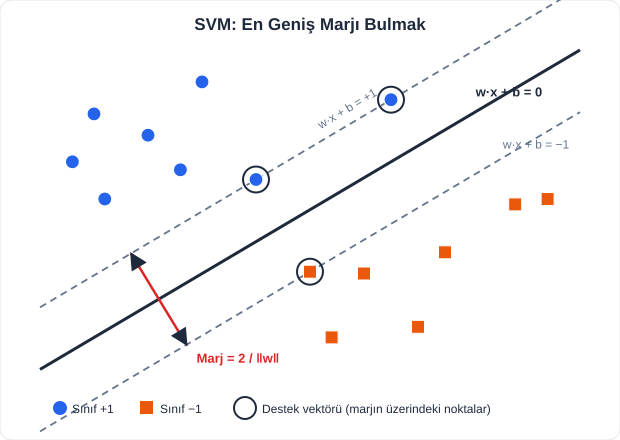
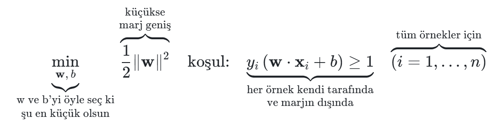
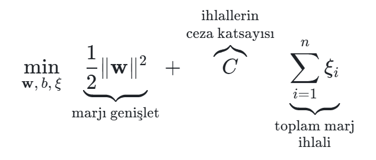
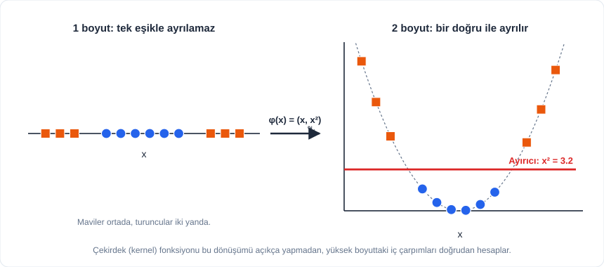

# 13. Destek Vektör Makineleri (Support Vector Machines – SVM)

## 13.1 Temel Fikir: En Geniş Yolu Bulmak

İki sınıfı ayıran bir çizgi çekmek istiyoruz. Veri doğrusal olarak ayrılabiliyorsa, bu işi yapan **sonsuz sayıda** çizgi vardır. Hangisi en iyisidir?

SVM'nin cevabı: **İki sınıfa da en uzak olan**, yani aradaki "güvenlik şeridini" (**marjı**) en geniş tutan çizgi. İki köy arasına yol yaptığımızı düşünelim: En güvenli yol, iki köyün de en yakın evlerine eşit ve olabildiğince uzak geçen yoldur. Böyle bir yol, gelecekte köylerin sınırlarında olacak küçük değişikliklerden en az etkilenir. Bu da **daha iyi genelleme** anlamına gelir.

<p align="center"></p>

- **Hiperdüzlem** (İng. *hyperplane*): Ayırıcı sınır. 2 boyutta doğru, 3 boyutta düzlem, daha yüksek boyutta hiperdüzlem.
- **Destek vektörleri** (İng. *support vectors*; Lat. *supportare*: "taşımak, desteklemek", *vector*: "taşıyıcı"): Marjın kenarında duran, sınıra en yakın örnekler. Sınırı **yalnızca bunlar** belirler; diğer noktalar silinse bile hiperdüzlem değişmez. Algoritmanın adı buradan gelir.
- **Marj** (İng. *margin*; Lat. *margo*: "kenar, sınır"): İki sınıfın en yakın noktaları arasındaki şeridin genişliği.

## 13.2 Matematiksel Formülasyon (İleri Seviye)

Hiperdüzlem $\mathbf{w}\cdot\mathbf{x} + b = 0$ ile tanımlanır. Sınıf etiketleri $y_i \in \lbrace -1, +1 \rbrace$ olsun. Marj sınırları $\mathbf{w}\cdot\mathbf{x}+b = \pm 1$ doğrularıdır ve aralarındaki uzaklık $\frac{2}{\lVert\mathbf{w}\rVert}$'dir. Marjı en büyük yapmak, $\lVert\mathbf{w}\rVert$'yi en küçük yapmakla aynı şeydir:

```math
\min_{\mathbf{w},\,b}\; \frac{1}{2}\lVert\mathbf{w}\rVert^2 \quad \text{koşul:}\quad y_i\,(\mathbf{w}\cdot\mathbf{x}_i + b) \ge 1 \quad (i = 1,\dots,n)
```

<p align="center"></p>

**Ne anlatıyor?** Marj genişliği $\frac{2}{\lVert\mathbf{w}\rVert}$ olduğundan $\lVert\mathbf{w}\rVert$'yi küçültmek marjı genişletir; kare ve $\frac{1}{2}$ yalnızca türevi kolaylaştırmak içindir. $y_i \in \lbrace -1, +1 \rbrace$ olduğu için çarpım, örnek doğru taraftaysa pozitif, yanlış taraftaysa negatif çıkar.

| Sembol | Okunuşu | Anlamı |
| :---: | :--- | :--- |
| $\mathbf{w}$ | "dabılyu vektörü" | Ağırlık vektörü; hiperdüzleme **dik** yön |
| $b$ | "be" | Sapma (bias); hiperdüzlemin orijinden kayması |
| $\mathbf{w}\cdot\mathbf{x}$ | "dabılyu nokta iks" | İç çarpım: $\sum_j w_j x_j$ |
| $\lVert\mathbf{w}\rVert$ | "dabılyu'nun normu" | Vektörün uzunluğu: $\sqrt{\sum_j w_j^2}$ |
| $y_i(\mathbf{w}\cdot\mathbf{x}_i+b) \ge 1$ | — | Her örnek kendi tarafında ve marjın dışında kalmalı |

## 13.3 Yumuşak Marj ve C Parametresi

Gerçek veride sınıflar genellikle iç içe geçer; hiçbir doğru onları kusursuz ayıramaz. **Yumuşak marj (soft margin)** yaklaşımında bazı örneklerin marjın içine düşmesine veya yanlış tarafta kalmasına izin verilir, ama her ihlal cezalandırılır:

```math
\min_{\mathbf{w},\,b,\,\xi}\; \frac{1}{2}\lVert\mathbf{w}\rVert^2 + C\sum_{i=1}^{n}\xi_i
```

<p align="center"></p>

**Ne anlatıyor?** Koşul da gevşer: $y_i(\mathbf{w}\cdot\mathbf{x}_i + b) \ge 1 - \xi_i$ ve $\xi_i \ge 0$. $\xi_i = 0$ ise örnek marjın dışında ve doğru taraftadır; $0 < \xi_i \le 1$ ise marjın içindedir ama hâlâ doğru taraftadır; $\xi_i > 1$ ise yanlış taraftadır.

| Sembol | Okunuşu | Anlamı |
| :---: | :--- | :--- |
| $\xi_i$ | "ksi i" | $i$. örneğin marjı ne kadar ihlal ettiği (gevşek değişken, slack) |
| $C$ | "ce" | **Ceza katsayısı:** geniş marj ile az hata arasındaki denge |

| Küçük $C$ (ör. 0.01) | Büyük $C$ (ör. 100) |
| :--- | :--- |
| Hatalara toleranslı, **geniş marj** | Hatalara toleranssız, **dar marj** |
| Daha çok destek vektörü | Eğitim verisine sıkı uyum |
| Eksik öğrenme riski | **Aşırı öğrenme** riski |

İç içe geçmiş iki sınıflı bir veride ölçülen değerler: $C = 0.01$ → 72 destek vektörü, marj 4.22; $C = 1$ → 45 destek vektörü, marj 2.53. ([`codes/python/09_svm.py`](https://github.com/erkanozhan/machinelearning/blob/main/codes/python/09_svm.py))

## 13.4 Çekirdek Hilesi (Kernel Trick)

Veri doğrusal olarak hiç ayrılamıyorsa ne olur? SVM'nin buradaki çözümü zarif bir fikre dayanır: Veriyi, doğrusal olarak **ayrılabileceği daha yüksek boyutlu bir uzaya** taşımak.

<p align="center"></p>

Şekilde tek boyutta mavi noktalar ortada, turuncular iki yandadır; tek bir eşikle ayrılamazlar. Her noktaya ikinci bir koordinat olarak $x^2$ eklersek, yani $\varphi(x) = (x, x^2)$ dönüşümünü uygularsak, iki boyutta **yatay bir doğru** onları mükemmel ayırır.

Bu dönüşümü açıkça yapmak çok pahalı olabilir (boyut sonsuza bile çıkabilir). **Çekirdek fonksiyonu**, dönüşümü hiç yapmadan yüksek boyuttaki iç çarpımı doğrudan hesaplar: $K(\mathbf{x}, \mathbf{z}) = \varphi(\mathbf{x})\cdot\varphi(\mathbf{z})$.

| Çekirdek | Formül | Kullanım |
| :--- | :--- | :--- |
| Lineer | $K(\mathbf{x},\mathbf{z}) = \mathbf{x}\cdot\mathbf{z}$ | Doğrusal ayrılabilir veri, çok yüksek boyutlu metin verisi |
| Polinom | $K(\mathbf{x},\mathbf{z}) = (\mathbf{x}\cdot\mathbf{z} + r)^{p}$ | Eğrisel sınırlar ($p$: derece) |
| RBF (Gauss) | $K(\mathbf{x},\mathbf{z}) = e^{-\gamma\lVert\mathbf{x}-\mathbf{z}\rVert^2}$ | En yaygın ve en esnek varsayılan seçim |

| Sembol | Okunuşu | Anlamı |
| :---: | :--- | :--- |
| $\varphi(\mathbf{x})$ | "fi iks" | Veriyi yüksek boyuta taşıyan (açıkça hesaplanmayan) dönüşüm |
| $\gamma$ | "gama" | RBF'de tek bir örneğin etki yarıçapının tersi. Büyük $\gamma$: dar etki, çok kıvrımlı sınır (aşırı öğrenme). Küçük $\gamma$: yumuşak sınır |
| $p$, $r$ | "pe", "ar" | Polinom derecesi ve sabit terimi |

**Deney:** İç içe iki halka biçimindeki veride 5 katlı CV doğruluğu: **lineer çekirdek 0.56** (yazı-turadan biraz iyi), **RBF çekirdek 1.00**.

> **Dikkat:** SVM mesafeye dayandığı için **öznitelikler mutlaka ölçeklenmelidir**. WEKA'nın SMO'su bunu varsayılan olarak yapar (`filterType = Normalize`). scikit-learn'de ise ölçeklemeyi sizin eklemeniz gerekir.

## 13.5 Uygulama

**WEKA (SMO):** WEKA'da SVM, çözümünde kullanılan *Sequential Minimal Optimization* algoritmasının adıyla **SMO** olarak geçer.
1. Explorer'da `iris.arff` dosyasını yükleyin.
2. Classify → Choose → `functions → SMO`.
3. Ayarlar (yazının üzerine tıklayın):
   - `c`: yumuşak marj ceza katsayısı $C$ (varsayılan 1.0).
   - `kernel`: varsayılan `PolyKernel` (üs = 1, yani lineer). `RBFKernel` seçip `gamma` değerini ayarlayabilirsiniz.
4. Cross-validation (10 kat) ile **Start**. Farklı `c` ve çekirdek seçeneklerini deneyip sonuçları karşılaştırın.

**Python:**

```python
from sklearn.datasets import load_iris                         # Iris verisi
from sklearn.pipeline import make_pipeline                     # Ölçekleme + model zinciri
from sklearn.preprocessing import StandardScaler               # Z-skoru ölçekleme
from sklearn.svm import SVC                                    # Support Vector Classifier
from sklearn.model_selection import cross_val_score            # Çapraz doğrulama

X, y = load_iris(return_X_y=True)                              # 150 çiçek, 4 öznitelik
model = make_pipeline(StandardScaler(),                        # SVM için ölçekleme şart
                      SVC(kernel="rbf", C=10, gamma=0.01))     # RBF çekirdek, C ve gamma
print(cross_val_score(model, X, y, cv=5).mean())               # ≈ 0.96 (5 katlı CV doğruluğu)
```

$C$ ve $\gamma$'nın en iyi değerleri **Grid Search** ile bulunur ([Bölüm 20](20-optimizasyon-hiperparametre.md)); Iris'te bulunan en iyi değerler $C = 10$, $\gamma = 0.01$'dir.

> **Çok sınıflı SVM:** SVM doğası gereği ikili bir sınıflandırıcıdır. Çok sınıflı problemlerde her sınıf çifti için ayrı bir model (**one-vs-one**, WEKA ve sklearn `SVC`'nin yöntemi) ya da her sınıf için "bu sınıf / diğerleri" modeli (**one-vs-rest**) kurulur. **Regresyon** için SVM'nin bir türevi olan SVR kullanılır (WEKA: `SMOreg`).

---

[← 12. Karar Ağaçları](12-karar-agaclari.md) · [İçindekiler](../Ders_Notu.md) · [14. Yapay Sinir Ağlarına Giriş →](14-yapay-sinir-aglari.md)
