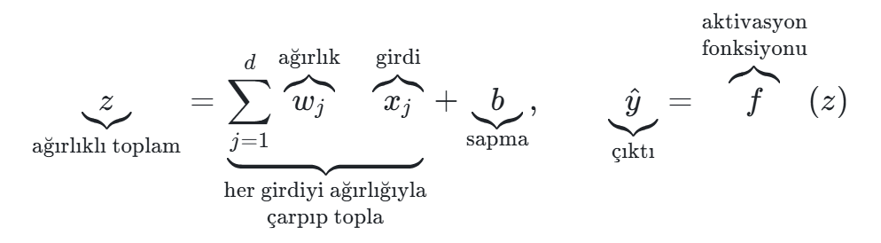
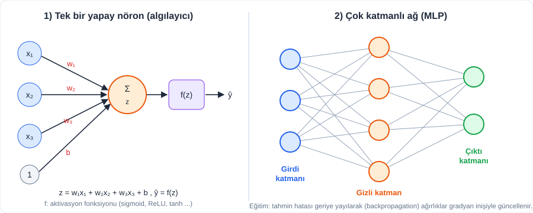

# 14. Yapay Sinir Ağlarına Giriş

## 14.1 Yapay Nöron

Beyindeki nöronlardan esinlenen **yapay nöron** (algılayıcı; İng. *perceptron*; Lat. *perceptio*: "algılama") girdileri ağırlıklarla çarpıp toplar, sonucu bir **aktivasyon fonksiyonundan** geçirir:

$$
z = \sum_{j=1}^{d} w_j x_j + b, \qquad \hat{y} = f(z)
$$

<p align="center"></p>

**Ne anlatıyor?** Yapı lineer regresyonla aynıdır: $\theta_j$ yerine $w_j$, $\theta_0$ yerine $b$ yazılmıştır. Örnek: $\mathbf{x} = (2, 3)$, $\mathbf{w} = (0.5, -0.2)$, $b = 0.1$ ise $z = 1 - 0.6 + 0.1 = 0.5$ olur. ReLU ile çıktı $\max(0, 0.5) = 0.5$, sigmoid ile $\sigma(0.5) \approx 0.62$'dir.

| Sembol | Okunuşu | Anlamı |
| :---: | :--- | :--- |
| $w_j$ | "dabılyu j" | $j$. girdinin ağırlığı (öğrenilen parametre) |
| $b$ | "be" | Sapma (bias) |
| $f$ | "ef" | Aktivasyon fonksiyonu (İng. *activation function*; Lat. *activus* < *agere*: "harekete geçirmek") |

<p align="center"></p>

> **İpucu:** Aktivasyon fonksiyonu **sigmoid** seçilirse tek bir nöron tam olarak **lojistik regresyondur** ([Bölüm 7](07-lojistik-regresyon.md)).

**Yaygın aktivasyon fonksiyonları:** Sigmoid $\frac{1}{1+e^{-z}}$ (0–1 arası), tanh (−1 ile 1 arası), **ReLU** $\max(0, z)$ (derin ağlarda en yaygın olanı).

## 14.2 Çok Katmanlı Algılayıcı (MLP)

Tek bir nöron yalnızca doğrusal sınırlar çizebilir (ünlü XOR problemini çözemez). Nöronları **katmanlar** hâlinde dizersek (girdi → gizli katman(lar) → çıktı) ağ, doğrusal olmayan çok karmaşık ilişkileri öğrenebilir. **Derin öğrenme**, çok sayıda gizli katmanı olan ağlarla yapılan öğrenmedir.

**XOR problemi:** XOR ("özel veya"), iki girdiden **yalnızca biri** 1 olduğunda 1 sonucunu verir:

| $x_1$ | $x_2$ | XOR |
| :---: | :---: | :---: |
| 0 | 0 | 0 |
| 0 | 1 | 1 |
| 1 | 0 | 1 |
| 1 | 1 | 0 |

Bu dört nokta düzlemde çizildiğinde 1'ler bir köşegende, 0'lar diğer köşegende yer alır; tek bir doğru ile ayrılamazlar. İki gizli nöronlu bir ağ ise problemi çözer: Birinci nöron "girdilerden en az biri 1 mi?" (OR), ikinci nöron "ikisi de 1 mi?" (AND) sorusunu öğrenir. Çıktı nöronu, "OR doğru ama AND yanlış" durumunu 1 olarak işaretler. Gizli katman, veriyi doğrusal olarak ayrılabilecek yeni bir gösterime dönüştürmüş olur.

**Eğitim nasıl olur?**
1. **İleri yayılım (forward pass):** Girdi ağdan geçer, tahmin üretilir.
2. **Hata hesabı:** Tahmin gerçek değerle karşılaştırılır (ör. log-loss).
3. **Geri yayılım** (İng. *backpropagation*; Lat. *propagare*: "yaymak, çoğaltmak"): Zincir kuralıyla her ağırlığın hataya katkısı (gradyanı) hesaplanır.
4. **Güncelleme:** Ağırlıklar gradyan inişiyle güncellenir ([Bölüm 6.4](06-lineer-regresyon.md)).

Tüm eğitim verisinin bir kez ağdan geçmesine **epoch** (Yun. *epokhē*: "dönem, devir") denir. Güncellemenin kaç örnekte bir yapıldığı ise **batch (yığın) boyutudur**.

**Örnek:** 1000 örnekli bir veri, batch boyutu 100 ile eğitilirse her epoch'ta $1000 / 100 = 10$ güncelleme yapılır. Her bir güncellemeye **iterasyon** denir. 50 epoch süren bir eğitim, toplam 500 iterasyon demektir.

| Avantajlar | Dezavantajlar |
| :--- | :--- |
| Çok karmaşık, doğrusal olmayan ilişkileri öğrenebilir | Çok veri ve hesaplama gücü ister |
| Görüntü, ses, metin gibi ham veride çok başarılıdır | Çok sayıda hiperparametre vardır (katman, nöron, öğrenme oranı…) |
| | Kararlarını açıklamak zordur (kara kutu) |
| | Kolayca aşırı öğrenir; erken durdurma ve düzenlileştirme gerekir ([Bölüm 20](20-optimizasyon-hiperparametre.md)) |

**WEKA:** `functions → MultilayerPerceptron`. Önemli parametreler: `hiddenLayers` (ör. `a` = (öznitelik+sınıf)/2 nöron, `5,3` = iki gizli katman), `learningRate` (0.3), `momentum` (0.2; önceki adımın yönünü kısmen koruyarak ilerleme, yokuştan inen bir topun kazandığı hız gibi), `trainingTime` (epoch sayısı, 500). `GUI = True` ile ağı görsel olarak izleyebilirsiniz. Bu depodaki [`application/`](https://github.com/erkanozhan/machinelearning/tree/main/application) uygulamaları, WEKA'da eğitilip `MLP_iris_model.model` olarak kaydedilmiş bir MLP modelini kullanır.

**Python:** `make_pipeline(StandardScaler(), MLPClassifier(hidden_layer_sizes=(10,), max_iter=2000))` → Iris'te 10 katlı CV doğruluğu ≈ **0.960**. Derin öğrenme için **PyTorch**, **TensorFlow/Keras** gibi kütüphaneler kullanılır.


## 14.3 Kısa Uygulama: Ağın Büyüklüğünü Değiştirmek

**WEKA**
1. WEKA klasöründeki `data/iris.arff` → Classify → `functions → MultilayerPerceptron`.
2. Ayarlarda `GUI = True` yapıp **Start**'a basın. Açılan pencerede ağın yapısını (girdi, gizli ve çıktı katmanları) görün, **Start** ile eğitimi başlatıp **Accept** ile bitirin.
3. `GUI = False` yapın. `hiddenLayers` değerini sırayla `1`, `a` (varsayılan), `10`, `10,10` yapıp 10 katlı CV doğruluklarını karşılaştırın.
4. `trainingTime` (epoch sayısı) değerini 50 ve 2000 yaparak eğitim süresinin etkisine bakın.

**Python**

```python
from sklearn.datasets import load_iris                             # Iris verisi
from sklearn.neural_network import MLPClassifier                   # Çok katmanlı yapay sinir ağı
from sklearn.pipeline import make_pipeline                         # Ölçekleme + model zinciri
from sklearn.preprocessing import StandardScaler                   # Z-skoru ölçekleme
from sklearn.model_selection import cross_val_score                # Çapraz doğrulama

X, y = load_iris(return_X_y=True)                                  # 150 çiçek, 4 öznitelik
for gizli in [(1,), (3,), (10,), (10, 10)]:                        # (10, 10): iki gizli katman, her birinde 10 nöron
    m = make_pipeline(StandardScaler(),                            # Önce ölçekle
                      MLPClassifier(hidden_layer_sizes=gizli, max_iter=3000, random_state=0))   # Sonra ağı eğit
    # 10 katlı CV doğruluğunu yazdır
    print(f"gizli katman={str(gizli):<8} doğruluk={cross_val_score(m, X, y, cv=10).mean():.3f}")
# (1,): 0.953   (3,): 0.973   (10,): 0.960   (10, 10): 0.967
```

**Gözlem soruları**
- Tek nöronlu bir gizli katman bile neden bu kadar başarılı? Iris problemi ne kadar "zor"?
- Daha büyük ağ her zaman daha iyi sonuç verdi mi? Küçük bir veri setinde büyük ağın riski nedir?

---

[← 13. Destek Vektör Makineleri (SVM)](13-destek-vektor-makineleri.md) · [İçindekiler](../Ders_Notu.md) · [15. WEKA ile Uçtan Uca Uygulama: Iris →](15-weka-iris-uygulamasi.md)
