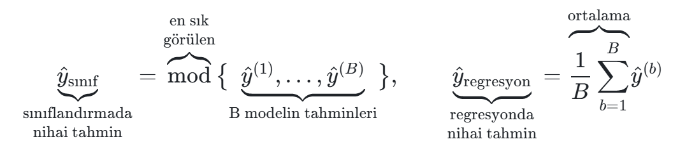
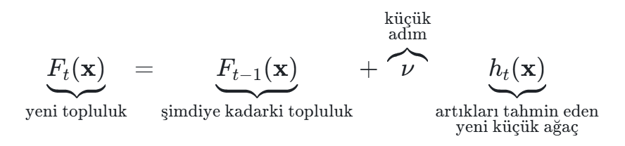

# 16. Topluluk Öğrenmesi (Ensemble Learning)

## 16.1 Birlikten Kuvvet Doğar

Bir kavanozdaki bilye sayısını tahmin edeceğiz. Tek bir kişinin tahmini çok hatalı olabilir. Ama 100 kişinin tahminlerinin **ortalaması** genellikle şaşırtıcı derecede isabetlidir, çünkü bireysel hatalar birbirini dengeler ("kalabalıkların bilgeliği").

Topluluk öğrenmesi (İng. *ensemble learning*; Fr. *ensemble*, Lat. *insimul*: "bir arada"), birden çok modelin tahminlerini birleştirerek tek bir modelden **daha doğru ve daha kararlı** tahminler elde eder. Temel koşul, modellerin **farklı hatalar** yapmasıdır: Hepsi aynı hatayı yapıyorsa birleştirmek işe yaramaz.

**Sayısal örnek:** Her biri %70 doğru olan ve birbirinden **bağımsız** hata yapan üç model düşünelim. Çoğunluk oyu, en az ikisi doğru olduğunda doğru sonucu verir: $0.7^3 + 3 \cdot 0.7^2 \cdot 0.3 = 0.343 + 0.441 = 0.784$. Topluluk %78.4 doğruluğa ulaşır. Üç model de hep aynı örneklerde yanılıyorsa çoğunluk oyu hiçbir şey kazandırmaz ve doğruluk %70'te kalır.

| Yöntem | Modeller nasıl eğitilir? | Temel olarak neyi azaltır? | Örnekler |
| :--- | :--- | :--- | :--- |
| **Bagging** | Paralel, birbirinden bağımsız | **Varyans** | Bagging, Random Forest |
| **Boosting** | Sıralı, her biri öncekinin hatasına odaklanır | **Yanlılık** (ve varyans) | AdaBoost, Gradient Boosting, XGBoost, LightGBM, CatBoost |
| **Stacking** | Farklı türde modeller + bir meta-model | Her ikisi | Stacking |

## 16.2 Bagging (Bootstrap Aggregating)

1. Orijinal veriden **bootstrap** ile (yerine koyarak) $B$ adet yeni eğitim seti çekilir ([Bölüm 8.9](08-model-degerlendirme.md)).
2. Her set üzerinde **aynı türden** bir model (genellikle derin, budanmamış karar ağacı) bağımsız olarak eğitilir.
3. Tahminler birleştirilir: **Sınıflandırmada çoğunluk oyu**, **regresyonda ortalama**.

<p align="center"></p>

$$
\hat{y}_{\text{sınıf}} = \mathrm{mod}\big\lbrace \hat{y}^{(1)}, \dots, \hat{y}^{(B)} \big\rbrace, \qquad \hat{y}_{\text{regresyon}} = \frac{1}{B}\sum_{b=1}^{B}\hat{y}^{(b)}
$$

<p align="center"></p>

**Dikkat:** $\hat{y}^{(b)}$'deki parantezli üst indis bir kuvvet değil, $b$. modelin tahminidir. Örnek: Beş ağacın oyları (A, B, A, A, B) ise sınıf tahmini A olur; üç ağacın fiyat tahminleri 210, 230 ve 250 ise regresyon tahmini 230 olur.

| Sembol | Okunuşu | Anlamı |
| :---: | :--- | :--- |
| $B$ | "be" | Topluluktaki model sayısı |
| $\hat{y}^{(b)}$ | "ye şapka üst b" | $b$. modelin tahmini |
| $\mathrm{mod}$ | "mod" | En sık görülen değer (çoğunluk oyu) |

**Random Forest (Rastgele Orman):** Bagging'e ek olarak, her düğümde bölme yapılırken özniteliklerin yalnızca **rastgele bir alt kümesi** (sınıflandırmada genellikle $\sqrt{d}$ tane) değerlendirilir. Bu sayede ağaçlar birbirine daha az benzer (**daha az ilişkili**) hâle gelir ve ortalamanın varyans azaltma etkisi güçlenir. Hem sınıflandırma hem regresyonda çok güçlü ve az ayar gerektiren bir modeldir. OOB skoru ve öznitelik önemi de verir.

## 16.3 Boosting (Güçlendirme)

Zor bir problemi sırayla çözen bir uzmanlar ekibi düşünün: İlk uzman genel bir çözüm önerir. İkincisi, ilkinin **hata yaptığı** noktalara odaklanır. Üçüncüsü, hâlâ çözülemeyen kısımlarla uğraşır… Sonunda bu sıralı ve odaklı çaba, tek bir uzmanın ulaşabileceğinden çok daha iyi bir sonuç verir.

Boosting, **zayıf öğrenicileri** (rastgele tahminden biraz daha iyi, basit modeller; ör. tek soruluk **karar kütüğü / decision stump**) **sıralı** olarak eğitip güçlü bir model oluşturur.

<p align="center"></p>

- **AdaBoost:** Her turda yanlış sınıflandırılan örneklerin **ağırlığı artırılır**. Böylece bir sonraki model onlara odaklanır. Her modelin oyu, doğruluğuna göre ağırlıklandırılır.
- **Gradient Boosting:** Her yeni ağaç, önceki modellerin toplamının **artıklarını (residuals)**, yani hâlâ açıklanamayan kısmı tahmin etmeyi öğrenir. Bu, kayıp fonksiyonu üzerinde gradyan inişinin fonksiyon uzayındaki karşılığıdır. `learning_rate` her ağacın katkısını küçültür.
- **XGBoost, LightGBM, CatBoost:** Gradient Boosting'in hızlı ve düzenlileştirilmiş uygulamaları. Tablo verisi yarışmalarında (Kaggle) çok sık kazanan modellerdir.

<details>
<summary><b>Derinleşme (İleri Seviye): Gradient Boosting'in güncelleme adımı</b></summary>

$\displaystyle F_t(\mathbf{x}) = F_ {t-1}(\mathbf{x}) + \nu \thinspace  h_t(\mathbf{x}), \qquad h_t \approx \text{argmin}_ h \sum_i \big(r_ {i}^{(t)} - h(\mathbf{x}_ i)\big)^2, \quad r_i^{(t)} = -\frac{\partial L(y_i, F)}{\partial F}\Big\vert_ {F = F_ {t-1}(\mathbf{x}_ i)}$

| Sembol | Okunuşu | Anlamı |
| :---: | :--- | :--- |
| $F_t$ | "ef te" | $t$ ağaçtan sonraki topluluk modeli |
| $h_t$ | "ha te" | $t$. turda eklenen küçük ağaç |
| $\nu$ | "nü" | Öğrenme oranı (shrinkage), ör. 0.1 |
| $r_i^{(t)}$ | "ar i" | Sözde artık: kaybın negatif gradyanı. Karesel kayıpta tam olarak $y_i - F_{t-1}(\mathbf{x}_i)$, yani gerçek artıktır |



**Ne anlatıyor?** $h_t \approx \text{argmin}_ h \dots$ ise "artıklarla ağacın tahminleri arasındaki farkların karelerinin toplamını en küçük yapan ağaç h" diye okunur: argmin en küçük **değeri** değil, o değeri veren **ağacın kendisini** döndürür. Örnek (karesel kayıp): Gerçek değer 100, mevcut tahmin $F_{t-1} = 80$ ise artık $r = 20$'dir. Yeni ağaç bu 20'yi tam tahmin etse bile $\nu = 0.1$ ile tahmin yalnızca $80 + 0.1 \cdot 20 = 82$'ye çıkar. Bu, gradyan inişindeki küçük adımın fonksiyonlar dünyasındaki karşılığıdır.

</details>

> **Dikkat:** Boosting, gürültülü veride ve çok fazla turda **aşırı öğrenebilir**. Tur sayısı ve öğrenme oranı birlikte ayarlanmalı, gerekirse erken durdurma kullanılmalıdır.

## 16.4 Stacking (Yığınlama)

Bir inşaat projesinde mimar, statik mühendisi ve şehir plancısı ayrı raporlar sunar. Deneyimli bir proje yöneticisi bu raporları girdi olarak alır ve **hangi uzmana hangi konuda ne kadar güveneceğini** zamanla öğrenerek nihai kararı verir.

- **Seviye-0 (temel modeller):** Genellikle **farklı türde** modeller (SVM, Naive Bayes, karar ağacı…).
- **Seviye-1 (meta-model):** Temel modellerin tahminlerini **yeni öznitelikler** olarak alıp nihai kararı veren, genellikle basit bir model (lojistik/lineer regresyon).
- **Veri sızıntısını önlemek için** meta-modelin eğitim verisi, temel modellerin **eğitimde görmediği** katlardaki tahminlerinden (**out-of-fold**) üretilir. scikit-learn'deki `cv=5` parametresi bunu otomatik yapar.

<p align="center"></p>

## 16.5 Deney Sonuçları

Aynı 10 katlı tabakalı CV bölmeleriyle ölçülen doğruluklar ([`codes/python/08_topluluk_ogrenmesi.py`](https://github.com/erkanozhan/machinelearning/blob/main/codes/python/08_topluluk_ogrenmesi.py)):

| Model | Iris (150 örnek) | Meme kanseri (569 örnek) |
| :--- | :---: | :---: |
| Tek karar ağacı | 0.933 ± 0.052 | 0.926 ± 0.023 |
| Bagging (10 ağaç) | 0.940 ± 0.047 | 0.944 ± 0.031 |
| Random Forest (100 ağaç) | 0.953 ± 0.052 | 0.956 ± 0.024 |
| AdaBoost (100 karar kütüğü) | 0.953 ± 0.052 | **0.972 ± 0.018** |
| Gradient Boosting | 0.947 ± 0.050 | 0.960 ± 0.025 |
| Stacking (SVM + NB + Ağaç → LR) | 0.953 ± 0.052 | 0.965 ± 0.016 |

Regresyon (diyabet verisi, 10 katlı CV):

| Model | MAE | RMSE | $R^2$ |
| :--- | :---: | :---: | :---: |
| Tek karar ağacı (derinlik 5) | 52.88 | 66.23 | 0.205 |
| **Lineer regresyon** | **44.48** | **54.86** | **0.465** |
| Random Forest | 47.37 | 58.01 | 0.404 |
| Gradient Boosting | 47.15 | 57.42 | 0.410 |
| Stacking | 45.38 | 55.66 | 0.446 |

**Yorum:**
- Bu deneylerde topluluklar tek ağaçtan daha doğru çıktı. Ancak ± değerleri her durumda daha düşük değildir; topluluk, ortalama başarıyı artırırken sonuçların oynaklığını her zaman azaltmaz.
- Iris çok kolay bir veri seti olduğu için modeller arasındaki farklar standart sapmanın içinde kalıyor; **istatistiksel olarak anlamlı değil** ([Bölüm 24](24-weka-experimenter.md)).
- Diyabet verisinde en iyi model **basit lineer regresyon** çıktı. Karmaşık model her zaman kazanmaz; ilişki doğrusala yakınsa ve veri azsa basit modeller güçlüdür. Bu yüzden her projede **basit bir referans modelle (baseline)** başlanmalıdır.

## 16.6 WEKA'da Topluluk Öğrenmesi

Topluluk algoritmaları Classify → Choose → **`meta`** klasöründedir.

**Sınıflandırma (`iris.arff`, 10 katlı CV):** Önce referans olarak tek bir `trees → J48` çalıştırın (≈ %96).
1. **Bagging:** `meta → Bagging`. Ayarlarda `classifier = J48` (varsayılan REPTree), `numIterations = 10` (model sayısı), `bagSizePercent = 100`.
2. **AdaBoost:** `meta → AdaBoostM1`. `classifier = DecisionStump` (varsayılan; tek soruluk zayıf öğrenici), `numIterations` = tur sayısı.
3. **Random Forest:** `trees → RandomForest`. `numIterations` = ağaç sayısı (varsayılan 100).
4. **Stacking:** `meta → Stacking`. `classifiers` listesine `J48`, `NaiveBayes`, `IBk` ekleyin; `metaClassifier = functions → Logistic`.
5. **Vote:** `meta → Vote`. Farklı modellerin basit çoğunluk oyu (meta-model yok).

**Regresyon (`cpu.arff`):** Referans `trees → M5P`. Ardından `meta → Bagging` (classifier = M5P veya REPTree), `meta → AdditiveRegression` (regresyon için boosting; classifier = DecisionStump veya REPTree), `meta → Stacking` (base: LinearRegression + M5P, meta: LinearRegression). MAE, RMSE ve korelasyon değerlerini bir tabloda karşılaştırın.

**Python:**

```python
from sklearn.ensemble import RandomForestClassifier, AdaBoostClassifier, StackingClassifier   # Topluluk modelleri
from sklearn.tree import DecisionTreeClassifier                 # Temel öğrenici: karar ağacı
from sklearn.linear_model import LogisticRegression             # Meta-model
from sklearn.naive_bayes import GaussianNB                      # Temel öğrenici: Naive Bayes

rf = RandomForestClassifier(n_estimators=100, random_state=42)             # 100 ağaçlık orman
ada = AdaBoostClassifier(estimator=DecisionTreeClassifier(max_depth=1),    # Zayıf öğrenici: karar kütüğü
                         n_estimators=100, random_state=42)                 # (eski sürümlerde 'base_estimator')
stack = StackingClassifier(                                                 # Yığınlama modeli
    estimators=[("svc", make_pipeline(StandardScaler(), SVC(probability=True))),     # Seviye-0: farklı
                ("nb", GaussianNB()), ("dt", DecisionTreeClassifier(max_depth=4))],  # türde temel modeller
    final_estimator=LogisticRegression(max_iter=1000),                                # Seviye-1
    cv=5)                                                                             # Out-of-fold tahminler
```

---

[← 15. WEKA ile Uçtan Uca Uygulama: Iris](15-weka-iris-uygulamasi.md) · [İçindekiler](../Ders_Notu.md) · [17. Kümeleme →](17-kumeleme.md)
