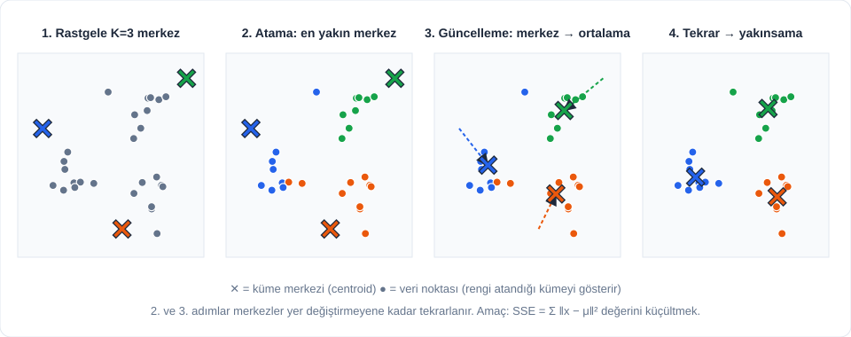
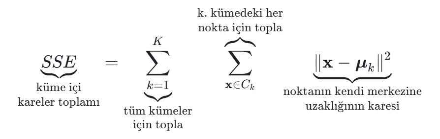
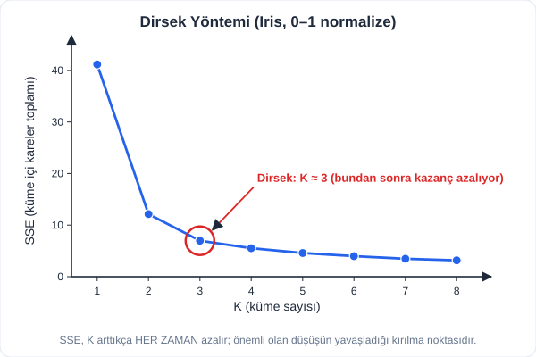
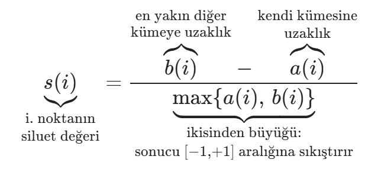
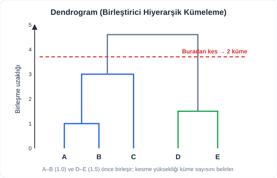
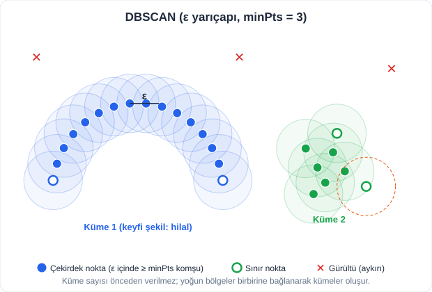

# 17. Kümeleme (Clustering)

Kümeleme **denetimsiz** öğrenmenin en temel tekniğidir: Etiket yoktur; amaç veriyi, **küme içinde benzer**, **kümeler arasında farklı** gruplara ayırmaktır. Kullanım alanları: müşteri segmentasyonu, belge gruplama, görüntü sıkıştırma, anomali tespiti, gen ifadesi analizi.

> **Dikkat:** Kümeleme mesafeye dayanır → **öznitelikler ölçeklenmelidir** ([Bölüm 5.8](05-veri-ve-oznitelikler.md)). WEKA'nın SimpleKMeans'i bunu otomatik yapar (0–1 normalizasyonu).

## 17.1 K-Means (K-Ortalamalar)

Adındaki **K**, kaç küme istediğimizi belirten ve **önceden verilmesi gereken** bir parametredir.

**Algoritma:**
1. **Başlangıç:** $K$ adet küme merkezi (**centroid**; Lat. *centrum*: "merkez") seçilir (genellikle rastgele veri noktaları).
2. **Atama:** Her nokta, **en yakın** merkezin kümesine atanır (Öklid mesafesi).
3. **Güncelleme:** Her merkez, kendi kümesindeki noktaların **ortalamasına** taşınır.
4. **Tekrar:** Hiçbir nokta küme değiştirmeyene (veya merkezler yer değiştirmeyene) kadar 2–3 tekrarlanır.

<p align="center"></p>

> **Animasyon 1, algoritmayı adım adım anlamak için:** Her noktanın üç merkeze olan uzaklığının tek tek hesaplandığını, noktanın en yakın merkeze atandığını ve 12 nokta bittiğinde merkezlerin kendi noktalarının ortalamasına kaydığını izleyin → [K-Means Şeffaf Algoritma Simülasyonu](https://erkanozhan.github.io/machinelearning/animation/k-means_interactive_animation.html)
>
> **Animasyon 2, deney yapmak için:** K sayısını ve gerçek grup sayısını değiştirin; rastgele başlangıç ile k-means++ başlangıcını karşılaştırın; kötü bir başlangıcın algoritmayı **yerel minimuma** nasıl hapsettiğini ve SSE'nin her adımda nasıl azaldığını görün → [K-Means Deney Ortamı](https://erkanozhan.github.io/machinelearning/animation/kmeans_animasyonu.html)

**Elle örnek (tek boyut):** Veri $\lbrace 1, 2, 3, 8, 9, 10 \rbrace$, $K = 2$, başlangıç merkezleri 1 ve 2 olsun.

| Tekrar | Atama | Yeni merkezler | SSE |
| :---: | :--- | :---: | :---: |
| 1 | $\lbrace 1 \rbrace$ ve $\lbrace 2, 3, 8, 9, 10 \rbrace$ | 1 ve 6.4 | 53.2 |
| 2 | $\lbrace 1, 2, 3 \rbrace$ ve $\lbrace 8, 9, 10 \rbrace$ | 2 ve 9 | 4.0 |
| 3 | Değişiklik yok → **dur** | 2 ve 9 | 4.0 |

Kötü bir başlangıca rağmen algoritma iki tekrarda doğal gruplara ulaşmış ve SSE 53.2'den 4.0'a düşmüştür.

K-Means'in en küçük yapmaya çalıştığı amaç fonksiyonu **küme içi kareler toplamıdır** (SSE / WCSS / inertia):

```math
SSE = \sum_{k=1}^{K}\;\sum_{\mathbf{x}\in C_k}\lVert \mathbf{x} - \boldsymbol{\mu}_k \rVert^2
```

<p align="center"></p>

**Ne anlatıyor?** İç içe iki toplam, iç içe iki döngü gibidir: Dıştaki kümeleri, içteki o kümenin noktalarını dolaşır. $\mathbf{x} \in C_k$, "iks, ce alt ka'nın elemanı" diye okunur. Örnek (tek boyut): $C_1 = \lbrace 1, 2, 3 \rbrace$ (merkez 2) ve $C_2 = \lbrace 8, 10 \rbrace$ (merkez 9) ise $SSE = (1 + 0 + 1) + (1 + 1) = 4$.

| Sembol | Okunuşu | Anlamı |
| :---: | :--- | :--- |
| $K$ | "ka" | Küme sayısı |
| $C_k$ | "ce ka" | $k$. kümedeki noktalar kümesi |
| $\boldsymbol{\mu}_k$ | "mü ka" | $k$. kümenin merkezi (noktalarının ortalaması) |
| $\lVert\mathbf{x}-\boldsymbol{\mu}_k\rVert^2$ | "normun karesi" | Noktanın merkezine olan Öklid mesafesinin karesi |

Iris üzerinde elle yazılmış K-Means'te SSE'nin adım adım düşüşü: **20.31 → 9.83 → 7.09 → 7.00 → 6.98 → 6.98** (6. adımda yakınsadı).

**Önemli özellikler:**
- Her adımda SSE **azalır veya aynı kalır**; algoritma her zaman durur. Ancak bulunan çözüm **yerel minimum** olabilir: Kötü başlangıç merkezleri kötü kümelere götürebilir. Çözüm: algoritmayı farklı başlangıçlarla birçok kez çalıştırıp en düşük SSE'li sonucu seçmek (sklearn `n_init=10`) ve merkezleri birbirinden uzak seçen **k-means++** başlangıcını kullanmak (WEKA: `initializationMethod = k-means++`).
- **Küresel ve benzer büyüklükte** kümeleri iyi bulur; hilal, halka gibi şekillerde ve çok farklı yoğunluklarda başarısızdır.
- Aykırı değerler merkezleri kendilerine doğru çeker.

### K Nasıl Seçilir? Dirsek Yöntemi ve Siluet Skoru

**Dirsek yöntemi (Elbow method):** $K = 1, 2, \dots$ için SSE hesaplanıp çizilir. $K$ arttıkça (en iyi çözümde) SSE **artmaz**; $K = n$ olursa SSE = 0 olur. Aranan nokta, düşüşün belirgin biçimde **yavaşladığı** kırılma noktasıdır ("dirsek").

<p align="center"></p>

**Siluet skoru (Silhouette)** (İleri Seviye): Her nokta için "kendi kümesine ne kadar yakın, en yakın komşu kümeye ne kadar uzak?" sorusunu ölçer:

```math
s(i) = \frac{b(i) - a(i)}{\max\lbrace a(i),\, b(i) \rbrace}
```

<p align="center"></p>

Örnek: $a(i) = 2$ ve $b(i) = 8$ ise $s = (8 - 2)/8 = 0.75$; nokta doğru kümededir. Tersine $a(i) = 8$ ve $b(i) = 2$ ise $s = (2 - 8)/8 = -0.75$; nokta komşu kümeye daha yakındır.

| Sembol | Okunuşu | Anlamı |
| :---: | :--- | :--- |
| $a(i)$ | "a i" | $i$. noktanın **kendi kümesindeki** diğer noktalara ortalama uzaklığı |
| $b(i)$ | "be i" | $i$. noktanın **en yakın diğer kümedeki** noktalara ortalama uzaklığı |
| $s(i)$ | "es i" | $-1$ ile $+1$ arası. $+1$'e yakın: doğru ve net kümelenmiş; $0$: iki kümenin sınırında; negatif: muhtemelen yanlış kümede |

Tüm noktaların ortalama siluet değeri en yüksek olan $K$ tercih edilir.

| K | 1 | 2 | 3 | 4 | 5 | 6 |
| :--- | :---: | :---: | :---: | :---: | :---: | :---: |
| SSE (Iris) | 41.17 | 12.13 | 6.98 | 5.52 | 4.58 | 3.98 |
| Siluet | – | **0.630** | 0.505 | 0.445 | 0.347 | 0.350 |

Siluet $K = 2$'yi öneriyor, çünkü setosa diğer iki türden çok belirgin biçimde ayrıktır; versicolor ve virginica ise birbirine çok yakındır. Dirsek $K = 3$ civarında. **Yöntemler her zaman aynı cevabı vermez**; son karar alan bilgisiyle verilir (biyolojik olarak 3 tür olduğunu biliyoruz).

## 17.2 Hiyerarşik Kümeleme

Küme sayısını önceden vermeyi gerektirmez; veriden bir **küme ağacı** oluşturur.

- **Birleştirici (agglomerative, aşağıdan yukarı):** Her nokta başta ayrı bir kümedir. Her adımda **en yakın iki küme** birleştirilir; sonunda tek küme kalır. En yaygın türdür.
- **Bölücü (divisive, yukarıdan aşağı):** Tüm noktalar tek kümede başlar, adım adım bölünür.

Sonuç bir **dendrogram** (Yun. *dendron*: "ağaç" + *gramma*: "çizim") ile gösterilir. Ağaç istenen bir yükseklikten **kesilerek** istenen sayıda küme elde edilir.

<p align="center"></p>

**İki kümenin uzaklığı nasıl ölçülür? (Bağlantı / linkage)** (İleri Seviye)

| Yöntem | Tanım | Özellik |
| :--- | :--- | :--- |
| **Tek bağlantı (single)** | En yakın iki nokta arasındaki uzaklık | Uzun, zincir biçimli kümeler üretir |
| **Tam bağlantı (complete)** | En uzak iki nokta arasındaki uzaklık | Sıkı, küresel kümeler |
| **Ortalama bağlantı (average)** | Tüm nokta çiftlerinin ortalama uzaklığı | İkisinin arası |
| **Ward** | Birleşince SSE'yi en az artıran çift | K-Means'e benzer sonuçlar; en sık kullanılanlardan |

WEKA: Cluster → `HierarchicalClusterer` (`linkType`, `numClusters`). Sonuç ağacı için Result list → sağ tık → **Visualize tree**.

## 17.3 DBSCAN (Yoğunluk Tabanlı Kümeleme)

K-Means küresel kümeleri iyi bulur. Peki kümeler hilal ya da halka biçimindeyse? **DBSCAN** (*Density-Based Spatial Clustering of Applications with Noise*) merkezlere değil **yoğunluğa** (İng. *density*; Lat. *densitas*: "sıklık") bakar: Yoğun bölgeleri birbirine bağlayarak kümeler oluşturur.

**Parametreler:**
- **$\varepsilon$ (epsilon):** Bir noktanın komşuluk yarıçapı.
- **minPts:** Bir noktanın "yoğun bölgede" sayılması için $\varepsilon$ yarıçapında bulunması gereken en az nokta sayısı (kendisi dahil).

**Nokta türleri:**
- **Çekirdek nokta (core):** $\varepsilon$ komşuluğunda (kendisi dahil) en az minPts nokta var.
- **Sınır noktası (border):** Kendisi çekirdek değil, ama bir çekirdek noktanın komşuluğunda.
- **Gürültü (noise):** İkisi de değil → hiçbir kümeye atanmaz (**aykırı değer**).

<p align="center"></p>

Algoritma bir çekirdek noktadan başlar ve $\varepsilon$ komşuluğu üzerinden **ulaşılabilen** tüm noktaları aynı kümeye ekler; küme genişleyemeyince yeni bir çekirdek noktadan devam eder.

| | K-Means | DBSCAN |
| :--- | :--- | :--- |
| Küme sayısı | Önceden verilmeli | Otomatik bulunur |
| Küme şekli | Küresel | **Keyfi** (hilal, halka…) |
| Aykırı değerler | Kümelere zorla dahil edilir | **Gürültü** olarak etiketlenir |
| Zayıf yönü | Başlangıca duyarlı | $\varepsilon$ seçimi zor; yoğunluğu çok farklı kümelerde zorlanır |

**Deney** (iki hilal biçimli küme, ARI = gerçek gruplarla örtüşme, 1 = mükemmel): **K-Means ARI = 0.47**, **DBSCAN ARI = 0.99**. DBSCAN 2 kümeyi doğru buldu ve 1 noktayı gürültü olarak işaretledi.

WEKA: Cluster → `DBSCAN` (WEKA 3.8'de Package Manager'dan `optics_dbScan` paketi kurulmalıdır).

## 17.4 Kümelemenin Değerlendirilmesi

| Tür | Ne zaman? | Ölçütler |
| :--- | :--- | :--- |
| **İçsel (internal)** | Gerçek etiketler **yok** (gerçek hayatın çoğu) | SSE, siluet, Davies–Bouldin |
| **Dışsal (external)** | Gerçek etiketler **var** (eğitim amaçlı deneyler) | Yanlış kümelenen oran, Adjusted Rand Index (ARI), saflık |

## 17.5 WEKA ile Iris'in Kümelenmesi

Amaç: Bilgisayara çiçek türlerini söylemeden, sadece ölçülere bakarak 150 çiçeği gruplara ayırmasını istemek ve sonucu gerçek türlerle karşılaştırmak.

1. Explorer → Preprocess → `iris.arff`.
2. **Cluster** sekmesi → Choose → `SimpleKMeans`.
3. Ayarlar: `numClusters = 3`. `initializationMethod`'u deneyerek (Random / k-means++) sonuçların nasıl değiştiğine bakın; `seed` değerini değiştirmek farklı başlangıçlar verir.
4. **Cluster mode:** `Classes to clusters evaluation` → `(Nom) class`. *(Bu seçenekte WEKA, kümelemeyi yaparken sınıf özniteliğini kullanmaz; sadece sonuçta karşılaştırır.)*
5. **Start.**

**Çıktı – Küme merkezleri:**

```text
                           Cluster#
Attribute      Full Data          0          1          2
                 (150.0)     (61.0)     (50.0)     (39.0)
=========================================================
sepallength       5.8433     5.8885      5.006     6.8462
sepalwidth         3.054     2.7377      3.418     3.0821
petallength       3.7587     4.3967      1.464     5.7026
petalwidth        1.1987      1.418      0.244     2.0795
```

- **Cluster 1:** Petal ölçüleri çok küçük (1.46 / 0.24) → *Iris-setosa*.
- **Cluster 2:** En büyük petal ölçüleri (5.70 / 2.08) → *Iris-virginica*.
- **Cluster 0:** Ara değerler → *Iris-versicolor*.

> **Not:** Yukarıdaki çıktı WEKA 3.8'in varsayılan ayarlarıyla (`initializationMethod = Random`, `seed = 10`) elde edilmiştir. Küme numaraları başlangıç noktalarına bağlıdır; `seed` veya başlangıç yöntemi değiştirildiğinde aynı kümeler farklı numaralarla gelebilir. Önemli olan numara değil, kümenin hangi türle eşleştiğidir.

**Çıktı – Kümeler ve sınıflar:**

```text
  0  1  2  <-- assigned to cluster
  0 50  0 | Iris-setosa
 47  0  3 | Iris-versicolor
 14  0 36 | Iris-virginica

Cluster 0 <-- Iris-versicolor
Cluster 1 <-- Iris-setosa
Cluster 2 <-- Iris-virginica

Incorrectly clustered instances :   17.0    11.3333 %
Within cluster sum of squared errors: 6.998114004826762
```

**Yorum:**
- Setosa'nın 50'si de doğru kümede (hata %0): Diğerlerinden çok belirgin biçimde ayrılıyor.
- Versicolor'ın 3'ü, virginica'nın 14'ü karışmış. Toplam 17 hata (**%11.3**). Bu iki türün ölçüleri uzayda iç içe geçtiği için %100 ayrım mümkün değildir.
- **Incorrectly clustered instances** dışsal bir ölçüttür: "Doğru bildin mi?" Gerçek hayatta etiketler olmadığında bakılamaz.
- **Within cluster sum of squared errors (SSE)** içsel bir ölçüttür: "Gruplama ne kadar sıkı?" Etiket olmasa da her zaman hesaplanır. Küçük değer, noktaların merkezlerinin etrafında sıkı toplandığını gösterir.
- Görselleştirme: Result list → sağ tık → **Visualize cluster assignments**. Eksenlere `petallength` ve `petalwidth` seçin, **Color: Cluster** yapın.

> **Kümeleri yeni öznitelik olarak kullanmak:** Preprocess → `filters → unsupervised → attribute → AddCluster` filtresi, her örneğe bulunduğu kümeyi yeni bir sütun olarak ekler. Bu yöntem [Bölüm 25](25-proje-odevi.md)'teki ödevde kullanılır.

**Kod:** K-Means'in sıfırdan yazılışı, dirsek/siluet, dendrogram ve DBSCAN: [`codes/python/10_kumeleme.py`](https://github.com/erkanozhan/machinelearning/blob/main/codes/python/10_kumeleme.py)

## 17.6 Kısa Uygulama: Müşteri Segmentasyonu

Bir mağaza zinciri müşterilerini gruplara ayırıp her gruba farklı kampanya yapmak istiyor. Veri: [`data/musteri_segmentleri.arff`](https://github.com/erkanozhan/machinelearning/blob/main/data/musteri_segmentleri.arff) (WEKA) ve [`data/musteri_segmentleri.csv`](https://github.com/erkanozhan/machinelearning/blob/main/data/musteri_segmentleri.csv) (Python, R). 300 müşteri; `yas`, `yillik_gelir_bin_tl`, `harcama_puani` (1–100). **Etiket yok**: kaç grup olduğunu biz bulacağız.

**WEKA**
1. `musteri_segmentleri.arff` → **Cluster** → `SimpleKMeans` → `numClusters` değerini 2'den 7'ye kadar değiştirerek her seferinde **Start**'a basın. `Within cluster sum of squared errors` değerlerini bir tabloya yazın ve dirseği bulun.
2. Seçtiğiniz K ile çıktıdaki **Final cluster centroids** tablosunu inceleyin: Her kümenin ortalama yaşı, geliri ve harcaması nedir?
3. Result list → sağ tık → **Visualize cluster assignments** → X: `yillik_gelir_bin_tl`, Y: `harcama_puani`, Color: `Cluster`.

**Python**

```python
import pandas as pd                                           # Tablo işlemleri
from sklearn.cluster import KMeans                            # K-Means kümeleme
from sklearn.metrics import silhouette_score                  # Siluet skoru
from sklearn.preprocessing import StandardScaler              # Z-skoru ölçekleme

VERI = "https://raw.githubusercontent.com/erkanozhan/machinelearning/main/data/"   # Veri klasörünün adresi
df = pd.read_csv(VERI + "musteri_segmentleri.csv")            # 300 müşteri, etiket yok
X = StandardScaler().fit_transform(df)                        # Gelir (yüzler) yaşı (onlar) ezmesin

for k in range(2, 8):                                         # Dirsek ve siluet ile K seçimi
    km = KMeans(n_clusters=k, n_init=10, random_state=0).fit(X)   # 10 farklı başlangıç, en iyisi
    print(f"K={k}  SSE={km.inertia_:7.1f}  siluet={silhouette_score(X, km.labels_):.3f}")   # SSE ve siluet

df["kume"] = KMeans(n_clusters=5, n_init=10, random_state=0).fit_predict(X)   # Seçilen K=5 ile etiketle
print(df.groupby("kume").mean().round(0))                     # Her segmentin ortalama profili
```

| K | 2 | 3 | 4 | **5** | 6 | 7 |
| :--- | :---: | :---: | :---: | :---: | :---: | :---: |
| SSE | 492.2 | 319.1 | 171.9 | **78.2** | 72.3 | 67.6 |
| Siluet | 0.410 | 0.462 | 0.555 | **0.632** | 0.537 | 0.467 |

K = 5'ten sonra SSE'nin düşüşü belirgin biçimde yavaşlar (dirsek) ve siluet en yüksektir. Bulunan beş segment:

| Segment | Yaş | Yıllık gelir (bin TL) | Harcama puanı | Olası yorum |
| :---: | :---: | :---: | :---: | :--- |
| A | 25 | 307 | 77 | Genç, düşük gelirli ama çok harcayan |
| B | 37 | 1092 | 83 | Yüksek gelirli, çok harcayan (en değerli müşteri) |
| C | 47 | 1050 | 17 | Yüksek gelirli ama az harcayan (kampanya fırsatı) |
| D | 40 | 653 | 51 | Ortalama müşteri |
| E | 63 | 372 | 21 | Emekli, düşük gelirli, az harcayan |

**R**

```r
VERI <- "https://raw.githubusercontent.com/erkanozhan/machinelearning/main/data/"
m <- read.csv(paste0(VERI, "musteri_segmentleri.csv"))
X <- scale(m)                                       # Standartlaştırma (ortalama 0, std 1)
set.seed(1)                                         # Rastgele başlangıç tekrarlanabilir olsun
sse <- sapply(2:8, function(k) kmeans(X, centers = k, nstart = 10)$tot.withinss)
plot(2:8, sse, type = "b", xlab = "K", ylab = "SSE")  # Dirsek grafiği
km <- kmeans(X, centers = 5, nstart = 10)           # nstart = 10: 10 farklı başlangıç, en iyisi
aggregate(m, by = list(kume = km$cluster), FUN = mean)  # Segment profilleri
```

**Gözlem soruları**
- Standartlaştırma yapmadan K-Means çalıştırırsanız hangi öznitelik kümeleri belirler? Deneyin ve sonuçları karşılaştırın.
- C segmentine (yüksek gelir, düşük harcama) nasıl bir pazarlama stratejisi önerirsiniz? Kümeleme sonucunu yorumlamak neden alan bilgisi gerektirir?

---

[← 16. Topluluk Öğrenmesi](16-topluluk-ogrenmesi.md) · [İçindekiler](../Ders_Notu.md) · [18. Birliktelik Kuralları →](18-birliktelik-kurallari.md)
