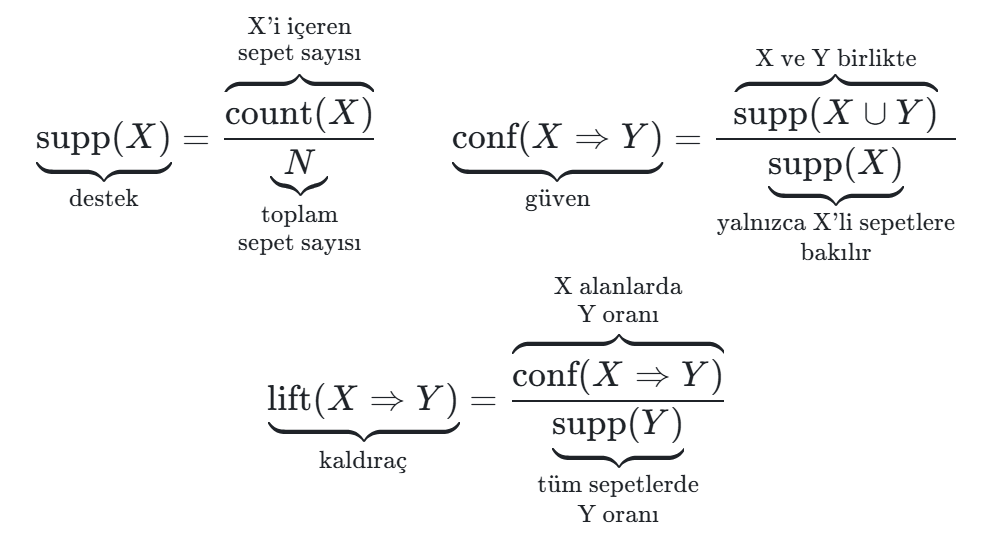

# 18. Birliktelik Kuralları (Association Rules)

## 18.1 Sepet Analizi

"Ekmek alan müşterilerin çoğu tereyağı da alıyor." Bu tür **"EĞER X İSE Y"** kurallarını büyük işlem verilerinden otomatik bulmaya **birliktelik kuralı madenciliği** (İng. *association rule mining*) denir. Marketlerde ürün yerleşimi ve kampanya tasarımı, e-ticarette "Bunu alanlar şunu da aldı" önerileri, web kullanım analizi ve tıpta birlikte görülen belirtilerin tespiti tipik uygulamalarıdır.

Örnek veri (8 alışveriş sepeti):

| Sepet | Ürünler |
| :---: | :--- |
| 1 | ekmek, süt |
| 2 | ekmek, tereyağı, yumurta |
| 3 | süt, tereyağı, çay |
| 4 | ekmek, süt, tereyağı |
| 5 | ekmek, süt, tereyağı, çay |
| 6 | süt, çay |
| 7 | ekmek, tereyağı |
| 8 | ekmek, süt, yumurta |

## 18.2 Destek, Güven ve Kaldıraç (Lift)

Bir kural $X \Rightarrow Y$ biçimindedir ($X$: öncül / antecedent, $Y$: sonuç / consequent).

$$
\text{supp}(X) = \frac{\text{count}(X)}{N}, \qquad \text{conf}(X \Rightarrow Y) = \frac{\text{supp}(X \cup Y)}{\text{supp}(X)}, \qquad \text{lift}(X \Rightarrow Y) = \frac{\text{conf}(X\Rightarrow Y)}{\text{supp}(Y)}
$$

<p align="center"></p>

**Dikkat:** Buradaki $X \cup Y$ "X veya Y" anlamına gelmez; sepetin $X$'teki ve $Y$'deki ürünlerin **hepsini birlikte** içermesi gerekir. Güven, $P(Y \mid X)$'tir: $X$'i içermeyen sepetler bir kenara bırakılır, yalnızca $X$'i içeren sepetlere bakılır.

| Sembol / Terim | Okunuşu | Anlamı |
| :---: | :--- | :--- |
| $\text{count}(X)$ | "kaunt iks" | $X$'teki ürünlerin hepsini içeren sepet sayısı |
| $N$ | "en" | Toplam işlem (sepet) sayısı |
| $\text{supp}$ | "sapport" | Destek (support) |
| $\text{conf}$ | "konfidans" | Güven (confidence) |
| $X \cup Y$ | "iks birleşim ye" | $X$ ve $Y$'deki ürünlerin **hepsini** içeren sepetler |
| **Destek (support)** | | Kuralın ne kadar **yaygın** olduğu |
| **Güven** (İng. *confidence*; Lat. *confidentia*: "güven", *fidere*: "güvenmek") | | $X$ alındığında $Y$'nin de alınma olasılığı: $P(Y \mid X)$ |
| **Kaldıraç (lift)** | | $X$'in varlığı $Y$'nin olasılığını kaç kat artırıyor? **> 1:** pozitif ilişki · **= 1:** bağımsız · **< 1:** negatif ilişki (birlikte beklenenden az görülüyor) |

**Örnek: {çay} ⇒ {süt}**
- destek(çay) = 3/8 = 0.375 (sepet 3, 5, 6)
- destek(çay ∪ süt) = 3/8 = 0.375 (üç sepette de süt var)
- güven = 0.375 / 0.375 = **1.00** → çay alan herkes süt de almış.
- destek(süt) = 6/8 = 0.75 → lift = 1.00 / 0.75 = **1.33** → çay alanların süt alma olasılığı genel ortalamanın 1.33 katı.

**Örnek: {ekmek} ⇒ {süt}:** güven = 0.500 / 0.750 = 0.667 ama lift = 0.667 / 0.75 = **0.89 < 1**. Güven yüksek görünse de ekmek almak süt alma olasılığını **artırmıyor** (süt zaten çok popüler). **Sadece güvene bakmak yanıltıcıdır; lift'e de bakılmalıdır.**

## 18.3 Apriori Algoritması

Tüm ürün kombinasyonlarını denemek imkânsızdır: 1000 ürün için $2^{1000}$ alt küme vardır. **Apriori ilkesi** (Lat. *a priori*: "önceden gelenden"; algoritma, önceki seviyede bulunan bilgiyi kullandığı için bu adı alır) arama uzayını büyük ölçüde budar:

> **"Bir öğe kümesi sık değilse, onu içeren hiçbir büyük küme de sık olamaz."** (Az kişi {çay, yumurta} alıyorsa, {çay, yumurta, ekmek} alan daha da azdır.)

**Adımlar** (min. destek = 0.25, min. güven = 0.60):
1. **Seviye 1:** Tek ürünlerin desteği hesaplanır; eşiğin altındakiler elenir. (Burada hepsi geçti; yumurta tam 0.25.)
2. **Seviye 2:** Sık tekli kümelerden ikili adaylar üretilir. {yumurta, tereyağı} (0.125), {yumurta, süt} (0.125), {çay, yumurta} (0), {çay, ekmek} (0.125) **elenir**.
3. **Seviye 3:** Sadece **tüm alt kümeleri sık olan** üçlüler aday olur: {ekmek, süt, tereyağı} (0.25, sık), {süt, tereyağı, çay} (0.25, sık).
4. **Kural üretimi:** Her sık kümeden kurallar türetilir, güven eşiğini geçenler raporlanır. Lift, raporlanan kuralları ilginçliklerine göre sıralamak için kullanılır.

Seçilmiş kurallar (karşılaştırma için düşük lift'li bir kural da eklenmiştir):

| Kural | Destek | Güven | Lift |
| :--- | :---: | :---: | :---: |
| {çay} ⇒ {süt, tereyağı} | 0.250 | 0.667 | **1.78** |
| {süt, tereyağı} ⇒ {çay} | 0.250 | 0.667 | **1.78** |
| {yumurta} ⇒ {ekmek} | 0.250 | 1.000 | 1.33 |
| {çay} ⇒ {süt} | 0.375 | 1.000 | 1.33 |
| {ekmek} ⇒ {süt} | 0.500 | 0.667 | 0.89 |

**Kod:** Ek kütüphane gerektirmeyen Apriori kodu: [`codes/python/11_birliktelik_kurallari_apriori.py`](https://github.com/erkanozhan/machinelearning/blob/main/codes/python/11_birliktelik_kurallari_apriori.py). Hazır kütüphane (`mlxtend`) ile Apriori ve FP-Growth: [`codes/python/11b_apriori_ve_fpgrowth_mlxtend.py`](https://github.com/erkanozhan/machinelearning/blob/main/codes/python/11b_apriori_ve_fpgrowth_mlxtend.py)

## 18.4 FP-Growth Algoritması

Apriori'nin iki maliyeti vardır: Çok sayıda **aday küme** üretir ve her seviye için **veritabanını baştan tarar**. **FP-Growth** (İng. *Frequent Pattern Growth*: "sık örüntü büyütme"; Han, Pei ve Yin, 2000) aday üretmez ve veritabanını yalnızca **iki kez** tarar. Fikir, sepetleri ortak önekleri paylaşan sıkıştırılmış bir ağaçta, **FP-ağacında** (İng. *FP-tree*) saklamak ve sık kümeleri bu ağaçtan "büyüterek" bulmaktır.

**Adım 1: İlk tarama.** Her ürünün desteği sayılır, eşiğin altındakiler atılır ve kalanlar **desteği azalan sırada** dizilir. 8 sepette (min. destek = 0.25, yani 2 sepet): ekmek 6, süt 6, tereyağı 5, çay 3, yumurta 2. Hepsi eşiği geçer. Eşit desteklerde sabit bir sıra seçilir (burada önce ekmek).

**Adım 2: İkinci tarama ve ağacın kurulması.** Her sepet bu sıraya göre dizilip ağaca bir yol olarak eklenir. Aynı önekle başlayan sepetler aynı düğümleri paylaşır, yalnızca sayaçlar artar:

| Sepet | Sıralanmış ürünler |
| :---: | :--- |
| 1 | ekmek, süt |
| 2 | ekmek, tereyağı, yumurta |
| 3 | süt, tereyağı, çay |
| 4 | ekmek, süt, tereyağı |
| 5 | ekmek, süt, tereyağı, çay |
| 6 | süt, çay |
| 7 | ekmek, tereyağı |
| 8 | ekmek, süt, yumurta |

```text
(kök)
├── ekmek:6
│   ├── süt:4
│   │   ├── tereyağı:2
│   │   │   └── çay:1
│   │   └── yumurta:1
│   └── tereyağı:2
│       └── yumurta:1
└── süt:2
    ├── tereyağı:1
    │   └── çay:1
    └── çay:1
```

8 sepetteki 22 ürün kaydı 11 düğüme sığdı. Gerçek market verisinde sepetlerin çoğu ortak ürünlerle başladığından sıkıştırma çok daha belirgindir. Ağacın yanında, her ürünün ağaçtaki tüm düğümlerini birbirine bağlayan bir **başlık tablosu** (İng. *header table*) tutulur.

**Adım 3: Ağaçtan sık kümeleri çıkarma.** En seyrek üründen başlanır. Her ürün için, köke kadar uzanan yolların öneklerinden **koşullu örüntü tabanı** (İng. *conditional pattern base*) toplanır ve bu tabanda eşiği geçen ürünler o ürünle birleştirilir:

| Ürün | Koşullu örüntü tabanı | Tabandaki sayımlar | Bulunan sık kümeler |
| :--- | :--- | :--- | :--- |
| yumurta | {ekmek, süt}: 1, {ekmek, tereyağı}: 1 | ekmek 2, süt 1, tereyağı 1 | {ekmek, yumurta} (2) |
| çay | {ekmek, süt, tereyağı}: 1, {süt, tereyağı}: 1, {süt}: 1 | süt 3, tereyağı 2, ekmek 1 | {süt, çay} (3), {tereyağı, çay} (2), {süt, tereyağı, çay} (2) |
| tereyağı | {ekmek, süt}: 2, {ekmek}: 2, {süt}: 1 | ekmek 4, süt 3 | {ekmek, tereyağı} (4), {süt, tereyağı} (3), {ekmek, süt, tereyağı} (2) |
| süt | {ekmek}: 4 | ekmek 4 | {ekmek, süt} (4) |
| ekmek | (kökün hemen altında, öneki yok) | | |

Sonuç, Apriori'nin Seviye 2 ve 3'te bulduğu kümelerin aynısıdır: 6 ikili, 2 üçlü küme. Fark, bunlara **aday üretmeden** ve veriyi **yalnızca iki kez okuyarak** ulaşılmasıdır. Büyük veride her koşullu örüntü tabanından küçük bir **koşullu FP-ağacı** kurulur ve aynı işlem özyinelemeli olarak tekrarlanır.

| | **Apriori** | **FP-Growth** |
| :--- | :--- | :--- |
| Aday üretimi | Var (seviye seviye) | Yok |
| Veritabanı taraması | Her seviye için bir kez | 2 kez |
| Bellek | Aday kümeler | FP-ağacı (veri belleğe sığmazsa sorun) |
| Güçlü olduğu durum | Az ürün, yüksek destek eşiği | Çok ürün, düşük destek eşiği, uzun örüntüler |
| Sonuç | Aynı sık kümeler, aynı kurallar | Aynı sık kümeler, aynı kurallar |

Spark MLlib gibi büyük veri kütüphaneleri bu yüzden Apriori'yi değil, FP-Growth'u sunar.

## 18.5 WEKA ile Birliktelik Kuralları

1. Explorer → Preprocess → `weather.nominal.arff` (veya büyük bir örnek için `supermarket.arff`). Apriori **kategorik** veri ister; sayısal öznitelikler varsa önce `Discretize` filtresi uygulanmalıdır.
2. **Associate** sekmesi → Choose → `Apriori`.
3. Önemli parametreler: `lowerBoundMinSupport` (min. destek; WEKA desteği `upperBoundMinSupport` = 1.0'dan başlatıp `delta` = 0.05 adımlarla bu sınıra kadar düşürür ve `numRules` kadar kural bulunca durur), `metricType` (Confidence / Lift / Leverage / Conviction), `minMetric` (ör. güven için 0.9), `numRules` (kaç kural listelensin, varsayılan 10).
4. **Start.** Çıktı şu biçimdedir:

```text
 1. outlook=overcast 4 ==> play=yes 4    <conf:(1)> lift:(1.56) lev:(0.1) conv:(1.43)
```

Okunuşu: "outlook = overcast olan 4 günün 4'ünde de play = yes; güven = 1, lift = 1.56."

5. **FP-Growth için:** Choose → `FPGrowth`. Parametreler Apriori'ninkilere benzer (`lowerBoundMinSupport`, `minMetric`, `metricType`, `numRulesToFind`). Belirli bir destek eşiğindeki **tüm** kuralları görmek için `findAllRulesForSupportLevel = True` yapın. Çıktıda ürünler köşeli parantez içinde yazılır:

```text
 1. [yumurta=t, zeytin=t]: 59 ==> [peynir=t]: 51   <conf:(0.86)> lift:(3.07) lev:(0.09) conv:(4.71)
```

> **Dikkat:** WEKA'nın `FPGrowth`'u yalnızca **sepet biçimli** (ikili) verilerle çalışır: Her öznitelik ya tek değerli (`{t}`, yoksa `?`) ya da iki değerli olmalıdır. `weather.nominal.arff` gibi çok değerli nominal veride *"Cannot handle multi-valued nominal attributes!"* hatası verir. Bu yüzden FP-Growth'u aşağıdaki `market_sepeti.arff` ile deneyin.

## 18.6 Kısa Uygulama: Market Sepeti Analizi

Veri: [`data/market_sepeti.arff`](https://github.com/erkanozhan/machinelearning/blob/main/data/market_sepeti.arff) (WEKA) ve [`data/market_sepeti.csv`](https://github.com/erkanozhan/machinelearning/blob/main/data/market_sepeti.csv) (Python). 391 alışveriş sepeti, 12 ürün. Veride birkaç **gizli** birliktelik vardır; bunları bulmaya çalışın.

**WEKA**
1. `market_sepeti.arff` → **Associate** → `Apriori`. Ayarlar: `lowerBoundMinSupport = 0.1`, `minMetric = 0.6` (güven), `numRules = 20` → **Start**.
2. Bulunan kuralları inceleyin. Sonra `metricType = Lift`, `minMetric = 1.5` yapıp tekrar çalıştırın; listede hangi kurallar kaldı?
3. Aynı veride Choose → `FPGrowth` seçin: `lowerBoundMinSupport = 0.1`, `minMetric = 0.6`, `findAllRulesForSupportLevel = True` → **Start**. FPGrowth **22 kural** bulur. Apriori'de `numRules = 100` yaparsanız **23 kural** görürsünüz (`numRules` küçükken Apriori, istenen sayıda kural bulduğu anda durduğu için bazı kurallar listelenmez).

> **Bir kurallık fark nereden geliyor?** Apriori çıktısının başında *"Minimum support: 0.1 (39 instances)"* yazar: 0.1 × 391 = 39.1 sepet, Apriori'de 39'a yuvarlanır. FPGrowth (ve Python'daki `mlxtend`) ise desteğin gerçekten en az 0.1 olmasını, yani en az 40 sepet ister. {ekmek, süt, domates} tam 39 sepette geçer (destek 0.0997). Bu yüzden {süt, domates} → ekmek kuralı yalnızca Apriori'nin listesinde çıkar. Eşiğin tam sınırındaki kümelerde araçlar böyle küçük farklar gösterebilir; algoritmaların kendisi aynı sonucu üretir.

**Python** (iki ürünlü tüm kuralları hesaplar)

```python
import pandas as pd                                           # Tablo işlemleri
from itertools import combinations                            # İkili kombinasyonlar üretmek için

VERI = "https://raw.githubusercontent.com/erkanozhan/machinelearning/main/data/"   # Veri klasörünün adresi
S = pd.read_csv(VERI + "market_sepeti.csv")                   # Her satır bir sepet, 1 = ürün alındı

kurallar = []                                                 # Bulunan kurallar burada birikir
for a, b in combinations(S.columns, 2):                       # Tüm ürün çiftleri
    for x, y in [(a, b), (b, a)]:                             # İki yönlü kural: x → y
        destek = (S[x] & S[y]).mean()                         # supp(x ∪ y)
        guven = destek / S[x].mean()                          # conf(x → y)
        lift = guven / S[y].mean()                            # lift(x → y)
        kurallar.append((f"{x} → {y}", destek, guven, lift))  # Kuralı listeye ekle
tablo = pd.DataFrame(kurallar, columns=["kural", "destek", "guven", "lift"])   # Kuralları tabloya çevir
# Destek ≥ 0.05 ve güven ≥ 0.6 olanları, lift'e göre büyükten küçüğe yazdır
print(tablo[(tablo.destek >= 0.05) & (tablo.guven >= 0.6)].sort_values("lift", ascending=False).round(3))
```

| Kural | Destek | Güven | Lift |
| :--- | :---: | :---: | :---: |
| salca → makarna | 0.156 | 0.726 | **3.30** |
| makarna → salca | 0.156 | 0.709 | **3.30** |
| seker → cay | 0.156 | 0.656 | 2.59 |
| peynir → zeytin | 0.187 | 0.664 | 2.52 |
| domates → ekmek | 0.276 | 0.675 | 1.08 |
| peynir → ekmek | 0.174 | 0.618 | **0.99** |

**Python: mlxtend ile Apriori ve FP-Growth** (üç ürünlü kurallar dahil; tam kod: [`codes/python/11b_apriori_ve_fpgrowth_mlxtend.py`](https://github.com/erkanozhan/machinelearning/blob/main/codes/python/11b_apriori_ve_fpgrowth_mlxtend.py))

```python
import pandas as pd                                                    # Tablo işlemleri
from mlxtend.frequent_patterns import apriori, fpgrowth, association_rules   # pip install mlxtend

VERI = "https://raw.githubusercontent.com/erkanozhan/machinelearning/main/data/"   # Veri klasörünün adresi
S = pd.read_csv(VERI + "market_sepeti.csv").astype(bool)               # mlxtend True/False tablo ister

sik_a = apriori(S, min_support=0.10, use_colnames=True)                # Apriori: seviye seviye aday üretir
sik_f = fpgrowth(S, min_support=0.10, use_colnames=True)               # FP-Growth: FP-ağacı kurar, aday üretmez
print(len(sik_a), len(sik_f), set(sik_a.itemsets) == set(sik_f.itemsets))   # 42 42 True → aynı sık kümeler

kurallar = association_rules(sik_f, num_itemsets=len(S),               # Sık kümelerden kural üret
                             metric="confidence", min_threshold=0.6)   # Güven ≥ 0.6 → 22 kural
print(kurallar[["antecedents", "consequents", "support", "confidence", "lift"]]
      .sort_values("lift", ascending=False).round(3))                  # Lift'e göre büyükten küçüğe
```

İki algoritma aynı 42 sık kümeyi (12 tekli, 26 ikili, 4 üçlü) ve WEKA `FPGrowth` ile aynı 22 kuralı bulur. İlk Python kodunun göremediği üç ürünlü kurallar:

| Kural | Destek | Güven | Lift |
| :--- | :---: | :---: | :---: |
| {yumurta, zeytin} → peynir | 0.130 | 0.864 | **3.07** |
| {peynir, yumurta} → zeytin | 0.130 | 0.810 | **3.07** |
| {ekmek, peynir} → zeytin | 0.128 | 0.735 | 2.79 |
| {ekmek, zeytin} → peynir | 0.128 | 0.781 | 2.78 |
| {peynir, zeytin} → yumurta | 0.130 | 0.699 | 1.79 |
| {peynir, zeytin} → ekmek | 0.128 | 0.685 | 1.09 |

**Gözlem soruları**
- `peynir → ekmek` kuralının güveni (%62) yüksek görünüyor, ama lift'i 1'in altında. Bu kural market için neden **değersizdir**? (İpucu: Sepetlerin %63'ünde zaten ekmek var.)
- Bulduğunuz kurallara göre market raflarını veya kampanyalarını nasıl düzenlersiniz?
- Üç ürünlü kural `{peynir, zeytin} → yumurta`'yı WEKA buldu mu? İlk Python kodu neden bulamıyor, `mlxtend` neden buluyor?
- Apriori ve FP-Growth aynı kuralları bulduğuna göre FP-Growth'u hangi durumlarda tercih edersiniz?

---

[← 17. Kümeleme](17-kumeleme.md) · [İçindekiler](../Ders_Notu.md) · [19. Boyut Azaltma: PCA ve Öznitelik Seçimi →](19-boyut-azaltma.md)
