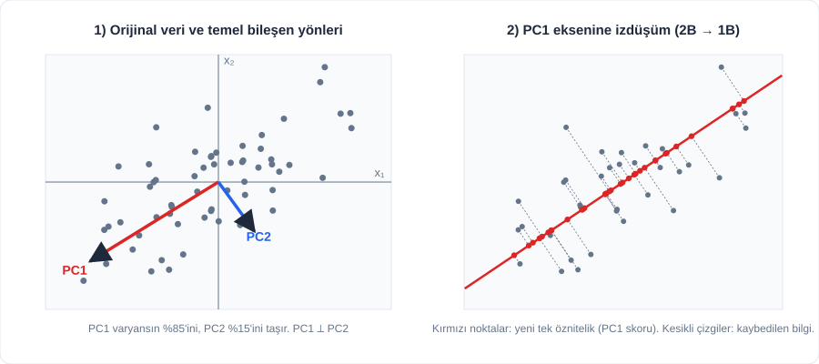
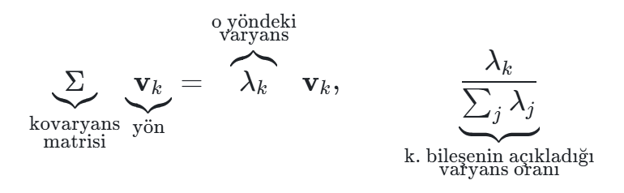

# 19. Boyut Azaltma: PCA ve Öznitelik Seçimi

## 19.1 Neden Boyut Azaltırız?

"Veri ne kadar çoksa o kadar iyi" düşüncesi **öznitelik sayısı** için her zaman doğru değildir. Yüzlerce, binlerce öznitelikle karşılaşıldığında **boyut laneti (curse of dimensionality)** ortaya çıkar: Boyut arttıkça veri uzayda seyrekleşir, mesafe ve benzerlik ölçüleri anlamını yitirir ve model gürültüyü ezberlemeye başlar.

Boyut azaltmanın amaçları:
- **Performans:** Gürültüyü ve gereksiz öznitelikleri atıp modelin "sinyale" odaklanmasını sağlamak.
- **Verimlilik:** Eğitim süresini, bellek ve depolama ihtiyacını azaltmak.
- **Yorumlanabilirlik ve görselleştirme:** 2–3 boyuta indirip veriyi gözle incelemek.

İki temel yol vardır:

| **Öznitelik Seçimi (Feature Selection)** | **Öznitelik Çıkarımı (Feature Extraction)** |
| :--- | :--- |
| Mevcut özniteliklerin **bir alt kümesi seçilir** | Öznitelikler matematiksel olarak birleştirilip **yeni öznitelikler üretilir** |
| Özniteliklerin anlamı korunur (yorumlanabilir) | Yeni özniteliklerin doğrudan fiziksel anlamı yoktur |
| Örnek: Bilgi kazancı ile sıralama, CFS, RFE, Lasso | Örnek: **PCA**, LDA, t-SNE, UMAP, otokodlayıcılar |

## 19.2 Temel Bileşen Analizi (PCA)

PCA, birbiriyle **ilişkili (korelasyonlu)** çok sayıdaki değişkeni, aralarında ilişki olmayan ve verideki **değişimi (varyansı) en iyi açıklayan** daha az sayıda yeni değişkene dönüştürür. Bu yeni değişkenlere **temel bileşenler** (İng. *principal components*; Lat. *principalis*: "birincil", *componere*: "bir araya koymak") denir.

> **İpucu:** Bir fotoğrafçı, 3 boyutlu bir heykelin **en çok ayrıntısını** gösterecek tek bir 2 boyutlu fotoğraf çekmek ister ve bunun için en uygun açıyı arar. PCA matematiksel olarak tam bunu yapar: Veriyi en az bilgi kaybıyla daha az boyuta yansıtan "açıyı" bulur.

1. **PC1 (birinci bileşen):** Verinin **en çok yayıldığı** yön.
2. **PC2:** Kalan varyansın en büyük olduğu yön; PC1'e **dik (ortogonal)** olmak zorundadır. Böylece PC1'in taşıdığı bilgiyi tekrar etmez.
3. Bu şekilde orijinal öznitelik sayısı kadar bileşen bulunabilir. Genellikle toplam varyansın büyük kısmını (ör. %95) açıklayan **ilk birkaç bileşen** tutulur, gerisi atılır.

<p align="center"></p>

<details>
<summary><b>Derinleşme (İleri Seviye): PCA'nın matematiği</b></summary>

1. Veri **standartlaştırılır** (her sütun ortalama 0, std 1).
2. **Kovaryans** (İng. *covariance*; Lat. *co-*: "birlikte" + *variantia*: "değişim") **matrisi** hesaplanır: $\Sigma = \frac{1}{n-1}X^{T}X$ ($d \times d$).
3. $\Sigma$'nın **özdeğer–özvektör** (İng. *eigenvalue–eigenvector*; Alm. *eigen*: "kendine özgü") ayrışımı yapılır: $\Sigma\thinspace \mathbf{v}_k = \lambda_k\thinspace \mathbf{v}_k$.
4. Özvektörler özdeğere göre büyükten küçüğe sıralanır. İlk $k$ özvektör bir $W_k$ matrisi oluşturur ve veri bu yönlere izdüşürülür: $Z = X W_k$.
5. $k$. bileşenin açıkladığı varyans oranı: $\frac{\lambda_k}{\sum_j \lambda_j}$.

| Sembol | Okunuşu | Anlamı |
| :---: | :--- | :--- |
| $\Sigma$ | "büyük sigma" | Kovaryans matrisi (toplam sembolüyle karıştırmayın) |
| $\mathbf{v}_k$ | "ve ka" | $k$. özvektör = $k$. temel bileşenin yönü. Elemanlarına **yük (loading)** denir |
| $\lambda_k$ | "lamda ka" | $k$. özdeğer = o yöndeki varyans miktarı |
| $Z$ | "zet" | Yeni koordinatlardaki veri (bileşen skorları) |

**Iris için:** Özdeğerler $[2.938,\ 0.920,\ 0.148,\ 0.021]$ → açıklanan varyans [%72.96, %22.85, %3.67, %0.52]. PC1 yükleri: sepal length −0.52, sepal width +0.27, petal length −0.58, petal width −0.56. PC1 esas olarak **"çiçeğin genel büyüklüğü"** eksenidir.



**Ne anlatıyor?** $\Sigma$ ile çarpıldığında yönü değişmeyen, yalnızca $\lambda_k$ kat uzayan vektör bir özvektördür. Buradaki $\Sigma$ toplam değil, kovaryans matrisidir; toplam sembolü paydadaki $\sum_j$'dir. Iris için PC1: $2.938 / (2.938 + 0.920 + 0.148 + 0.021) = 2.938 / 4.027 \approx 0.7296$, yani %72.96.

</details>

> **Sık yapılan yanılgı:** PC1 "en önemli öznitelik" değildir; tüm orijinal özniteliklerin ağırlıklı bir karışımıdır. PCA öznitelik **seçmez**: Yeni bir çiçeğin bileşen skorlarını hesaplamak için yine dört ölçümün hepsine ihtiyaç vardır. Bu nedenle veri toplama maliyetini düşürmek isteniyorsa PCA değil, öznitelik seçimi ([Bölüm 19.3](19-boyut-azaltma.md)) kullanılmalıdır.

> **PCA'dan önce standartlaştırma şarttır.** PCA varyansa bakar. Bir sütun 1–10, diğeri 1000–5000 aralığındaysa PCA büyük sayılı sütunu "daha önemli" sanır.
>
> **Dikkat:** PCA **denetimsizdir**: Sınıf etiketine bakmaz. En çok varyansı taşıyan yön, sınıfları ayıran yön olmayabilir. Ayrıca **doğrusal** bir yöntemdir; eğrisel yapılarda (İsviçre rulosu gibi) **t-SNE** veya **UMAP** gibi doğrusal olmayan yöntemler gerekir. Bu yöntemler daha çok görselleştirme için kullanılır.

### WEKA ile PCA

Hipotez: *Öznitelik sayısını azaltsak da sınıflandırma başarısı fazla düşmemeli.*
1. **Referans:** `iris.arff` → Classify → `J48`, 10 katlı CV → doğruluk ≈ **%96**.
2. **PCA:** Preprocess → Filter → `unsupervised → attribute → PrincipalComponents`. Önemli parametre: `varianceCovered = 0.95`, yani "varyansın %95'ini açıklayan en az sayıda bileşeni tut". WEKA verileri varsayılan olarak kendisi standartlaştırır. **Apply** → 4 öznitelik yerine **2 yeni öznitelik** gelir (kümülatif varyans %95.8).
3. Aynı J48'i bu 2 bileşenle çalıştırın.

**Yorum:** Doğruluk genellikle bir miktar **düşer** (scikit-learn karar ağacıyla yapılan Python deneyinde 0.933 → 0.913; WEKA'daki J48 sonuçları farklı olabilir). Atılan bileşenler tamamen "gereksiz" değildi. PCA yalnızca varyansa baktığı için sınıf ayrımına yarayan küçük ayrıntıları atabilir. **Karar bir takastır:** Öznitelik sayısını yarıya indirmek, küçük bir doğruluk kaybına değer mi? Iris'te öznitelik zaten az olduğu için muhtemelen hayır; binlerce öznitelikli bir veride ise genellikle evet. Bu durumda başvurulacak ikinci yol **öznitelik seçimidir**.

> **Dikkat:** Preprocess'te PCA uygulayıp **sonra** CV yapmak küçük bir veri sızıntısıdır (PCA test katlarını da görmüştür). Doğrusu: `meta → FilteredClassifier` (filter = PrincipalComponents, classifier = J48) ([Bölüm 21](21-veri-sizintisi.md)).

### Python ile PCA

```python
from sklearn.datasets import load_iris                      # Iris verisi
from sklearn.preprocessing import StandardScaler            # Z-skoru ölçekleme
from sklearn.decomposition import PCA                       # Temel bileşen analizi

X, y = load_iris(return_X_y=True)                           # 150 çiçek, 4 öznitelik
X_std = StandardScaler().fit_transform(X)                   # 1) Standartlaştır (PCA için şart)
pca = PCA(n_components=2).fit(X_std)                        # 2) İlk 2 bileşeni bul
X_pca = pca.transform(X_std)                                # 3) 4 boyut → 2 boyut
print(pca.explained_variance_ratio_)                        # [0.7296 0.2285] → toplam %95.8 bilgi korundu
```

**Kod:** PCA'nın sıfırdan (özdeğer ayrışımıyla) hesaplanması, görselleştirme ve sızıntısız Pipeline karşılaştırması: [`codes/python/12_pca_ve_oznitelik_secimi.py`](https://github.com/erkanozhan/machinelearning/blob/main/codes/python/12_pca_ve_oznitelik_secimi.py)

## 19.3 Öznitelik Seçimi

Burada öznitelikleri dönüştürmek yerine **eleğe** koyarız: "Hangi sütun işe yarıyor, hangisi kalabalık yapıyor?"

| Yaklaşım | Nasıl çalışır? | Örnek | Hız |
| :--- | :--- | :--- | :--- |
| **Filtre (filter)** | Her özniteliği modelden bağımsız bir istatistikle puanlar | Bilgi kazancı, ki-kare, korelasyon, karşılıklı bilgi | Çok hızlı |
| **Sarmalayıcı (wrapper)** | Öznitelik alt kümelerini **bir modeli eğitip test ederek** değerlendirir | İleri/geri seçim, RFE, WEKA `WrapperSubsetEval` | Yavaş ama genellikle daha isabetli |
| **Gömülü (embedded)** | Seçim, modelin eğitimi sırasında kendiliğinden yapılır | Lasso (L1), karar ağacı öznitelik önemi | Orta |

### WEKA: "Select attributes" Sekmesi

Bu sekmede birbiriyle uyumlu çalışması gereken iki bileşen vardır:
1. **Attribute Evaluator (değerlendirici, "jüri"):** Öznitelik veya öznitelik kümesine puan verir.
2. **Search Method (arama yöntemi, "izci"):** Olası öznitelik kümeleri arasında nasıl dolaşılacağını belirler.

**Senaryo 1 – Tek tek puanlama (sıralama):**
- Evaluator: `InfoGainAttributeEval` (bilgi kazancı: "Sadece bu özniteliği bilseydim, sınıf hakkındaki belirsizliğim ne kadar azalırdı?" [Bölüm 12](12-karar-agaclari.md)). WEKA arama yöntemini `Ranker` yapmanızı ister; onaylayın.
- Attribute Selection Mode: **Use full training set** → **Start**:

```text
Ranked attributes:
 1.418  3 petallength
 1.378  4 petalwidth
 0.698  1 sepallength
 0.376  2 sepalwidth
```

`petallength` ve `petalwidth` sınıf hakkında en çok bilgiyi taşıyor; `sepalwidth` en zayıf. *(Cross-validation modu seçilirse çıktı, katlar boyunca ortalama puan ve ortalama sıra (`average merit`, `average rank`) biçiminde verilir. Bu, sıralamanın ne kadar **kararlı** olduğunu gösterir.)*

**Senaryo 2 – En iyi alt kümeyi seçme:**
- Evaluator: `CfsSubsetEval` (korelasyon tabanlı öznitelik seçimi). İlkesi şudur: *"İyi bir alt kümedeki öznitelikler sınıfla **yüksek**, birbirleriyle **düşük** korelasyonlu olmalıdır."* Aynı bilgiyi tekrar eden iki öznitelik istenmez.
- Search: `BestFirst` (öznitelik kombinasyonlarını akıllıca dener) → **Start**:

```text
Selected attributes: 3,4 : 2
                     petallength
                     petalwidth
```

Bireysel olarak iyi öznitelikleri bir araya getirmek her zaman en iyi takımı kurmak anlamına gelmez; önemli olan birlikte ne kadar iyi çalıştıklarıdır. CFS, iki sepal ölçüsünün **ek bilgi getirmediğine** karar verdi.

**Python karşılıkları** (aynı kod dosyasında): Filtre → `mutual_info_classif` (Iris: petal length 0.99, petal width 0.98, sepal length 0.47, sepal width 0.29); sarmalayıcı → `RFE`; gömülü → `LogisticRegression(penalty="l1", solver="liblinear")` (varsayılan `lbfgs` çözücüsü L1 cezasını desteklemez). Meme kanseri verisinde L1 cezası 30 katsayının 23'ünü **tam sıfır** yaptı ve 7 öznitelik bıraktı.

| | **PCA** | **Öznitelik Seçimi** |
| :--- | :--- | :--- |
| Ne yapar? | Eksenleri **döndürerek** veriyi yeni (doğrusal) eksenlere taşır | Orijinal sütunlardan **işe yarayanları seçer** |
| Yorumlanabilirlik | Düşük (PC1 = karışım) | Yüksek (hangi ölçüm önemli, açıkça görülür) |
| Sınıf etiketini kullanır mı? | Hayır | Genellikle evet |

> **İpucu:** Bir projeye başlarken yüzlerce sütunu doğrudan modele vermek yerine önce bu analizi yapmak, kurulacak modelin başarısını doğrudan etkileyen **stratejik** bir adımdır. Ayrıca veri toplama maliyetini de düşürür: Gereksiz bir ölçüm artık yapılmayabilir.

---

[← 18. Birliktelik Kuralları](18-birliktelik-kurallari.md) · [İçindekiler](../Ders_Notu.md) · [20. Optimizasyon ve Hiperparametre Ayarlama →](20-optimizasyon-hiperparametre.md)
