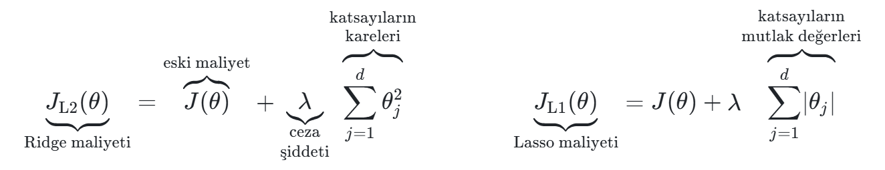
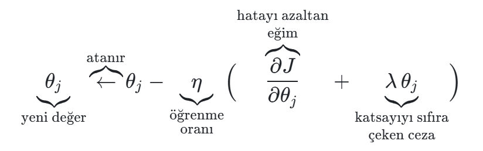
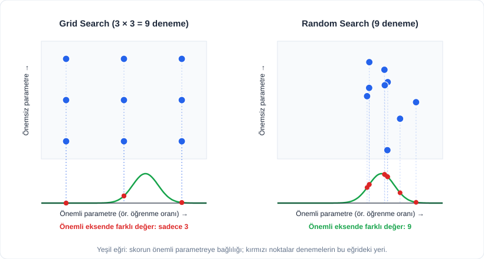
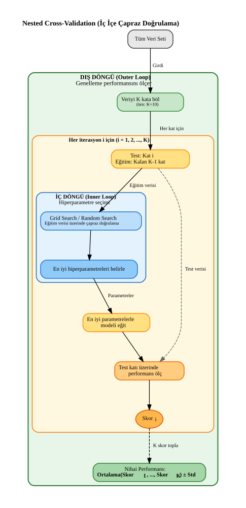

# 20. Optimizasyon ve Hiperparametre Ayarlama

## 20.1 Model Nasıl Öğrenir? Optimizasyon

Eğitim sırasında cevaplanan soru şudur: *"Veriye en iyi uyan parametre değerleri nedir?"* Bunun için bir **maliyet fonksiyonu** $J(\theta)$ tanımlanır ([Bölüm 6.2](06-lineer-regresyon.md)) ve en küçük değeri aranır. Bu işleme **optimizasyon** denir (İng. *optimization*; Lat. *optimus*: "en iyi").

En yaygın yöntem **gradyan inişidir** ([Bölüm 6.4](06-lineer-regresyon.md)). Varyantları:

| Varyant | Her güncellemede kullanılan veri | Özellik |
| :--- | :--- | :--- |
| Batch GD | Tüm eğitim verisi | Kararlı ama büyük veride yavaş |
| **Stokastik GD (SGD)** | Tek bir örnek | Hızlı, gürültülü adımlar (yerel minimumlardan kaçmaya yardım eder) |
| Mini-batch GD | Küçük bir grup (ör. 32–256 örnek) | Derin öğrenmede standart |
| Momentum, RMSProp, **Adam** | — | Adım yönünü ve büyüklüğünü geçmiş gradyanlara göre uyarlar |

## 20.2 Öğrenme Oranı ve Zamanlaması

**Öğrenme oranı** ($\alpha$ veya $\eta$) her adımın büyüklüğüdür. Çok büyükse model hedefi atlar ve ıraksayabilir; çok küçükse öğrenme çok yavaş olur ([şekil, Bölüm 6.4](06-lineer-regresyon.md)).

**Öğrenme oranı zamanlaması (learning rate scheduling):** Eğitimin başında büyük adımlar atılır, ilerledikçe adımlar küçültülür. Yeni bir şehre taşındığınızda önce hızlıca genel bir keşif yapar, sonra ayrıntılara inersiniz.
- **Step decay:** Belirli aralıklarla sabit bir oranda düşürülür.
- **Exponential decay:** $\alpha_t = \alpha_0\thinspace e^{-kt}$
- **Uyarlamalı yöntemler (Adam vb.):** Her parametre için öğrenme oranını otomatik ayarlar.

## 20.3 Ölçeklendirme ve Gradyan İnişi

Bir öznitelik 0–1, diğeri 0–10 000 aralığındaysa maliyet yüzeyi çok uzamış bir vadi gibidir ve gradyan inişi zikzaklar çizerek çok yavaş ilerler. Ölçeklendirilmemiş veriyle gradyan inişi, bir bacağı uzun, diğeri kısa olan birinin yürümeye benzer. Standardizasyon ($z = \frac{x-\mu}{\sigma}$) veya normalizasyon ($\frac{x - x_{\min}}{x_{\max}-x_{\min}}$) yüzeyi yuvarlaklaştırır ve yakınsamayı hızlandırır ([Bölüm 5.8](05-veri-ve-oznitelikler.md)).

## 20.4 Düzenlileştirme (Regularization): Modeli Dizginlemek

Aşırı öğrenmeyi önlemenin bir yolu, maliyet fonksiyonuna **parametrelerin büyüklüğünü cezalandıran** bir terim eklemektir (**düzenlileştirme**, [Bölüm 5](05-veri-ve-oznitelikler.md)):

$$
J_{\text{L2}}(\theta) = J(\theta) + \lambda\sum_{j=1}^{d}\theta_j^2 \qquad\qquad J_{\text{L1}}(\theta) = J(\theta) + \lambda\sum_{j=1}^{d}\lvert\theta_j\rvert
$$

<p align="center"></p>

**Ne anlatıyor?** Toplam $j = 1$'den başlar; sabit terim $\theta_0$ cezalandırılmaz. Örnek: $\theta_1 = 4$, $\theta_2 = 0.5$ için L2 cezası $16 + 0.25 = 16.25$, L1 cezası $4 + 0.5 = 4.5$'tir. L2, büyük katsayıyı orantısız biçimde cezalandırır (4 → 16) ama küçüğe neredeyse dokunmaz (0.5 → 0.25).

| Sembol | Okunuşu | Anlamı |
| :---: | :--- | :--- |
| $\lambda$ | "lamda" | Cezanın şiddeti. 0 → düzenlileştirme yok; çok büyük → tüm katsayılar sıfıra yaklaşır (eksik öğrenme) |
| $\sum_j \theta_j^2$ | | L2 normunun karesi (sabit terim $\theta_0$ genellikle cezalandırılmaz) |
| $\sum_j \lvert\theta_j\rvert$ | | L1 normu |

- **L2 (Ridge):** Katsayıları **küçültür** ama sıfırlamaz. Model daha yumuşak ve kararlı hâle gelir; çoklu doğrusallığa karşı iyi çalışır.
- **L1 (Lasso):** Bazı katsayıları **tam sıfır** yapar ve böylece otomatik **öznitelik seçimi** yapar ([Bölüm 19.3](19-boyut-azaltma.md)).
- **Elastic Net:** İkisinin karışımı.

> **İpucu:** L2 bütçedeki tüm kalemleri biraz kısar; L1 bazı kalemleri tamamen siler.
>
> **Neden tam sıfır?** L2 cezasının katsayıyı sıfıra doğru itme kuvveti katsayının kendisiyle orantılıdır ($2\lambda\theta_j$): Katsayı küçüldükçe itme de zayıflar ve katsayı sıfıra yalnızca yaklaşır. L1'in itme kuvveti ise katsayının büyüklüğünden bağımsızdır ($\lambda$): Katsayı ne kadar küçülürse küçülsün aynı kuvvetle itilir ve tam sıfıra ulaşır. Örneğin $\theta_j = 0.01$ iken L2'nin itmesi $0.02\lambda$, L1'inki ise yine $\lambda$'dır.

L2 ile gradyan inişi güncellemesi (sabitler $\lambda$'nın içine katılarak):

```math
\theta_j \leftarrow \theta_j - \eta\left(\frac{\partial J}{\partial \theta_j} + \lambda\,\theta_j\right)
```

<p align="center"></p>

**Ne anlatıyor?** Gradyan sıfır olsa bile her adımda $\theta_j$, $(1 - \eta\lambda)$ ile çarpılarak biraz küçülür. $\eta = 0.1$ ve $\lambda = 0.01$ ise her adımda katsayının binde biri silinir.

Her adımda iki kuvvet dengelenir: hatayı azaltmak isteyen gradyan ve parametreleri sıfıra doğru çeken ceza (**ağırlık sönümü, weight decay**).

> **Dikkat:** Kütüphanelerde adlandırma farklıdır: scikit-learn `Ridge`/`Lasso`/`SGD*` modellerinde `alpha` = $\lambda$'dır. `LogisticRegression` ve `SVC`'de ise **`C` = $1/\lambda$**'dır; yani **büyük C = az düzenlileştirme**.

## 20.5 Erken Durdurma (Early Stopping)

Eğitim sırasında hem **eğitim hatası** hem de ayrı bir **doğrulama hatası** izlenir. Eğitim hatası genellikle sürekli düşer. Doğrulama hatası ise bir noktadan sonra düşmeyi bırakır, hatta yükselmeye başlar. O nokta, modelin **ezberlemeye başladığı** andır ([şekil, Bölüm 8.2](08-model-degerlendirme.md)). Erken durdurma eğitimi orada keser ve en iyi doğrulama skorundaki parametreleri kullanır. Özellikle sinir ağları ve gradyan artırmada etkilidir.

**Deney** (MLP, meme kanseri): Erken durdurma **olmadan** 92 epoch, eğitim doğruluğu 1.000, test 0.953. Erken durdurma **ile** 23 epoch, eğitim 0.995, test **0.959**. Dört kat daha kısa eğitimle aynı veya biraz daha iyi genelleme elde edildi.

## 20.6 Izgara Araması (Grid Search)

Hiperparametre kavramı [Bölüm 8.4](08-model-degerlendirme.md)'te tanımlanmıştı. Izgara aramasında her hiperparametre için aday değerler belirlenir ve **tüm kombinasyonlar** çapraz doğrulamayla denenir.

Örnek: $\eta \in \lbrace 0.001, 0.01, 0.1 \rbrace$, $\lambda \in \lbrace 0.1, 0.5 \rbrace$ → $3 \times 2 = 6$ kombinasyon; 5 katlı CV ile $6 \times 5 = 30$ eğitim.

```text
              λ = 0.1      λ = 0.5
           ┌───────────┬───────────┐
η = 0.001  │  Deney 1  │  Deney 2  │
           ├───────────┼───────────┤
η = 0.01   │  Deney 3  │  Deney 4  │
           ├───────────┼───────────┤
η = 0.1    │  Deney 5  │  Deney 6  │
           └───────────┴───────────┘
```

Hiperparametre sayısı arttıkça kombinasyon sayısı **çarpımsal olarak** (üstel) büyür: her biri 5 değer alan 4 hiperparametre için $5^4 = 625$ kombinasyon gerekir. Buna **kombinatorik patlama** denir.

**Python:**

```python
from sklearn.datasets import load_breast_cancer          # Meme kanseri verisi
from sklearn.pipeline import Pipeline                    # İsimli adımlardan oluşan zincir
from sklearn.preprocessing import StandardScaler         # Z-skoru ölçekleme
from sklearn.svm import SVC                              # Destek vektör sınıflandırıcı
from sklearn.model_selection import GridSearchCV         # Izgara araması + çapraz doğrulama

X, y = load_breast_cancer(return_X_y=True)               # 569 hasta, 30 öznitelik
pipe = Pipeline([("olcek", StandardScaler()),            # Ölçekleme her CV katında yeniden öğrenilir
                 ("svm", SVC(kernel="rbf"))])            # RBF çekirdekli SVM
izgara = {"svm__C": [0.1, 1, 10, 100],                   # 'adımadı__parametre' söz dizimi
          "svm__gamma": [0.001, 0.01, 0.1, 1]}           # 4 x 4 = 16 kombinasyon
arama = GridSearchCV(pipe, izgara, cv=5, scoring="accuracy").fit(X, y)   # 16 x 5 = 80 eğitim
print(arama.best_params_, arama.best_score_)             # {'svm__C': 10, 'svm__gamma': 0.01} 0.982
```

## 20.7 Rastgele Arama (Random Search)

Tüm ızgara yerine, belirlenen **dağılımlardan rastgele** $N$ kombinasyon denenir. Aynı bütçeyle genellikle Grid Search kadar, geniş arama uzaylarında ondan **daha iyi** sonuç verir (Bergstra & Bengio, 2012). Nedeni şudur: Genellikle hiperparametrelerin yalnızca birkaçı gerçekten önemlidir. Izgara, önemli eksende sadece birkaç farklı değer dener; rastgele arama ise her denemede farklı bir değer dener.

<p align="center"></p>

```python
from scipy.stats import loguniform                      # Log ölçekte düzgün dağılım (C, gamma, lambda için ideal)
from sklearn.model_selection import RandomizedSearchCV  # Rastgele arama + çapraz doğrulama

dagilim = {"svm__C": loguniform(1e-2, 1e3),              # 0.01 – 1000 arası
           "svm__gamma": loguniform(1e-4, 1e1)}          # 0.0001 – 10 arası
rand = RandomizedSearchCV(pipe, dagilim, n_iter=16, cv=5, random_state=0).fit(X, y)   # 16 rastgele deneme
print(rand.best_params_, rand.best_score_)               # ≈ C=4.07, gamma=0.0118 → 0.981
```

> **İleri seviye:** Daha gelişmiş yöntemler: **Bayesçi optimizasyon** (önceki denemelerden öğrenerek bir sonraki aday noktayı seçer; ör. `Optuna`, `scikit-optimize`) ve **Successive Halving / Hyperband** (kötü adayları erken eler).

## 20.8 İç İçe Çapraz Doğrulama (Nested Cross-Validation)

**Sık yapılan hata:** Grid Search'ün bulduğu `best_score_` değerini modelin performansı olarak raporlamak. Bu skor, **en iyiyi seçmek için kullanılan** veride ölçülmüştür; seçimin kendisi iyimser bir yanlılık yaratır.

> **Benzetme:** On altı koşucunun tek bir yarışta koşturulduğunu ve birincinin seçildiğini düşünelim. Birincinin o yarıştaki derecesi, gelecekteki performansı için iyimser bir tahmindir; çünkü seçim sırasında yalnızca yetenek değil, o günkü şans da seçilmiştir. Kazananın gerçek düzeyini görmek için yeni bir yarış gerekir. İç içe çapraz doğrulamadaki **dış kat**, bu yeni yarıştır.

**Çözüm:** Hiperparametre seçimi ile performans ölçümünü birbirinden ayırmak.
- **Dış döngü (outer loop, ör. 10 kat):** Genelleme performansını ölçer. Her turda bir kat **test** için ayrılır.
- **İç döngü (inner loop, ör. 5 kat):** **Yalnızca dış döngünün eğitim kısmında** Grid Search yapar.

<p align="center"></p>

Dış döngüdeki her turun kendi bağımsız hiperparametre araması vardır. Raporlanan skor, **hiperparametre seçiminin etkisinden arındırılmış** tarafsız bir tahmindir.

> **Animasyon:** [Nested Cross-Validation Animasyonu](https://erkanozhan.github.io/machinelearning/animation/nested_cv_animation.html)

```python
from sklearn.model_selection import cross_val_score, StratifiedKFold   # Dış CV ve tabakalı bölme

ic_cv = StratifiedKFold(n_splits=5, shuffle=True, random_state=1)     # İç döngü
dis_cv = StratifiedKFold(n_splits=10, shuffle=True, random_state=2)   # Dış döngü
ic_arama = GridSearchCV(pipe, izgara, cv=ic_cv)                       # GridSearch nesnesi bir "model" gibi davranır
skorlar = cross_val_score(ic_arama, X, y, cv=dis_cv)                  # 10 dış katın her birinde ayrı arama
print(f"{skorlar.mean():.4f} ± {skorlar.std():.4f}")                  # 0.9754 ± 0.0296
```

**Sonuç:** Grid Search `best_score_` = 0.982 (iyimser) ↔ Nested CV = **0.975 ± 0.030** (tarafsız). Fark bu örnekte küçüktür, ama çok sayıda hiperparametre ve az veri olduğunda çok büyüyebilir.

**Kod:** Grid, random, nested CV ve erken durdurma: [`codes/python/14_hiperparametre_optimizasyonu.py`](https://github.com/erkanozhan/machinelearning/blob/main/codes/python/14_hiperparametre_optimizasyonu.py) · R (`caret`) sürümleri: [`codes/R/grid_ve_random_search.R`](https://github.com/erkanozhan/machinelearning/blob/main/codes/R/grid_ve_random_search.R), [`codes/R/nested_cv.R`](https://github.com/erkanozhan/machinelearning/blob/main/codes/R/nested_cv.R)

## 20.9 WEKA'da Hiperparametre Optimizasyonu

**`meta → CVParameterSelection`**: Bir sınıflandırıcının parametrelerini iç çapraz doğrulamayla tarar.
1. `diabetes.arff` → Classify → `meta → CVParameterSelection`.
2. `classifier` = optimize edilecek algoritma (ör. `trees → J48` veya `functions → SGD`).
3. `CVParameters` → **Add** ile arama tanımı: `parametre_harfi alt_sınır üst_sınır adım_sayısı`
   - J48 için: `C 0.1 0.5 5` → budama güveni `-C` 0.1'den 0.5'e 5 değerle.
   - J48 için: `M 1 10 10` → yapraktaki en az örnek `-M` 1'den 10'a.
   - SGD için: `L 0.001 0.1 5` → öğrenme oranı `-L`.
4. `numFolds` = iç CV kat sayısı. **Start.**
5. Çıktıda seçilen değerler `Classifier Options: -C 0.2 -M 4` biçiminde görünür.

> **İpucu:** Test options'ta 10 katlı CV seçiliyken CVParameterSelection çalıştırıldığında, her dış katta ayrı bir iç arama yapılır. Yani WEKA bu durumda **zaten iç içe çapraz doğrulama** yapmaktadır ve raporlanan doğruluk tarafsızdır.

WEKA'da ayrıca `meta → GridSearch` (iki parametreyi birlikte tarar, Package Manager'dan) ve `Auto-WEKA` paketi (algoritma ve hiperparametreyi birlikte otomatik seçer) bulunur.

---

[← 19. Boyut Azaltma: PCA ve Öznitelik Seçimi](19-boyut-azaltma.md) · [İçindekiler](../Ders_Notu.md) · [21. Veri Sızıntısı →](21-veri-sizintisi.md)
