# 21. Veri Sızıntısı (Data Leakage): Modelin Sınav Sorularını Önceden Görmesi

## 21.1 Nedir?

Bir öğrenciye konuları öğretip (eğitim), sonra **daha önce görmediği** sorularla sınava sokarız (test). Bu, gerçek başarıyı ölçmenin adil yoludur. Ama öğrenci sınav sorularının bir kısmını, hatta sadece "sınavın ortalamasının kaç olacağını" önceden öğrenmişse, aldığı yüksek not konuyu anladığını göstermez.

**Veri sızıntısı** (İng. *data leakage*), test verisine (veya gelecekte karşılaşılacak veriye) ait herhangi bir bilginin **eğitim veya ön işleme** sırasında modele ulaşmasıdır. Sonuç: Performans metrikleri yapay olarak şişer, model gerçek dünyada beklenenden çok daha kötü çalışır. Makine öğrenmesindeki **en sinsi ve en yaygın** hatalardan biridir.

## 21.2 Çarpıcı Bir Deney

Tamamen **rastgele** 10 000 öznitelik ve **rastgele** etiketlerden oluşan 100 örneklik bir veri üretelim. Öğrenilecek hiçbir şey yoktur; gerçek başarı %50 (yazı-tura) olmalıdır.

| Yöntem | 5 katlı CV doğruluğu |
| :--- | :---: |
| **Yanlış:** En iyi 20 özniteliği **tüm veriye** bakarak seç, sonra CV yap | **0.870** (sahte başarı) |
| **Doğru:** Öznitelik seçimini Pipeline içine koy (her katta yalnızca eğitim kısmına bakar) | **0.470** (≈ şans) |

Yanlış yöntemde seçici, etiketlere bakarken test katlarını da gördü ve **tesadüfen** test etiketleriyle ilişkili görünen gürültü sütunlarını seçti.

**Kod:** [`codes/python/15_veri_sizintisi.py`](https://github.com/erkanozhan/machinelearning/blob/main/codes/python/15_veri_sizintisi.py)

## 21.3 Sızıntının Yaygın Kaynakları

1. **Ön işlemi bölmeden önce tüm veriye uygulamak:** Normalize/Standardize (min, max, ortalama test verisinden de hesaplanır), PCA, Discretize, eksik değer doldurma (ortalama test verisini de içerir), öznitelik seçimi, SMOTE/oversampling ([Bölüm 22](22-dengesiz-veri.md)) (kopyalanan örneklerin eşleri hem eğitimde hem testte yer alabilir).
2. **Hedefi dolaylı olarak içeren öznitelikler (target leakage):** "Hastalık var mı?" tahmininde "bu hastalık için ilaç kullanıyor mu?" sütunu. Bu bilgi tahmin anında elde yoktur.
3. **Zaman sızıntısı:** Zaman serilerinde gelecekteki verilerle eğitip geçmişi test etmek. Zamana bağlı verilerde bölme mutlaka **kronolojik** yapılmalıdır (`TimeSeriesSplit`).
4. **Aynı varlığın tekrarları:** Aynı hastanın farklı günlerdeki kayıtları hem eğitimde hem testte. Böyle durumlarda bölme **hasta bazında** yapılmalıdır (`GroupKFold`).
5. **Test setine bakarak model/hiperparametre seçmek** ([Bölüm 8.5](08-model-degerlendirme.md), [20.8](20-optimizasyon-hiperparametre.md)).

## 21.4 Doğru Yol: Pipeline

- **Python:** Tüm ön işleme adımlarını `Pipeline` / `make_pipeline` içine koyun ve pipeline'ı bir bütün olarak `cross_val_score`'a veya `GridSearchCV`'ye verin. Her katta ön işleme yalnızca eğitim kısmından öğrenilir.
- **WEKA Explorer:** Preprocess sekmesinde uygulanan filtre tüm veriyi değiştirir. Değerlendirme için **`meta → FilteredClassifier`** (filtre + sınıflandırıcı), öznitelik seçimi için **`meta → AttributeSelectedClassifier`** kullanın.
- **WEKA KnowledgeFlow:** Filtre bileşenlerini `CrossValidationFoldMaker`'dan **sonra** yerleştirin ([Bölüm 23](23-weka-knowledgeflow.md)).

> **Kural:** Bir ön işlem **veriden bir şey öğreniyorsa** (ortalama, min/max, bileşenler, seçilen sütunlar, küme merkezleri…) o bir **modelin parçasıdır** ve yalnızca eğitim verisinden öğrenilmelidir.

## 21.5 Kısa Uygulama: WEKA'da Sızıntıyı Görmek

**WEKA**
1. WEKA klasöründeki `data/diabetes.arff` → Preprocess → Filter → `supervised → attribute → Discretize` → **Apply**. *(Bu filtre, aralık sınırlarını belirlerken **sınıf etiketine** bakar.)*
2. Classify → `bayes → NaiveBayes` → Cross-validation (10) → **Start** → doğruluğu not edin (**yanlış yöntem**).
3. Preprocess'te **Undo** ile filtreyi geri alın.
4. Classify → `meta → FilteredClassifier` → `filter = supervised → attribute → Discretize`, `classifier = NaiveBayes` → aynı CV ile **Start** (**doğru yöntem**).
5. İki doğruluğu karşılaştırın. Yanlış yöntemde aralık sınırları test katlarının etiketleri de görülerek belirlendiği için sonuç genellikle **biraz daha iyimser** çıkar.

**Python:** [Bölüm 21.2](21-veri-sizintisi.md)'deki deney ve [`codes/python/15_veri_sizintisi.py`](https://github.com/erkanozhan/machinelearning/blob/main/codes/python/15_veri_sizintisi.py)

**Gözlem soruları**
- Aradaki fark büyük müydü? Öznitelik sayısı çok, örnek sayısı az olsaydı fark nasıl değişirdi?
- Preprocess sekmesinde **unsupervised** `Normalize` uygulamak da sızıntı mıdır? Neden etkisi daha küçüktür?

---

[← 20. Optimizasyon ve Hiperparametre Ayarlama](20-optimizasyon-hiperparametre.md) · [İçindekiler](../Ders_Notu.md) · [22. Dengesiz Veri ve Maliyete Duyarlı Öğrenme →](22-dengesiz-veri.md)
