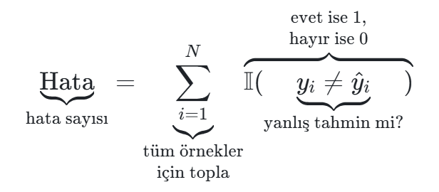
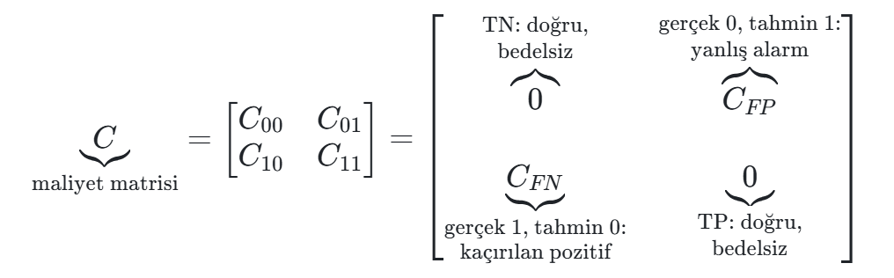
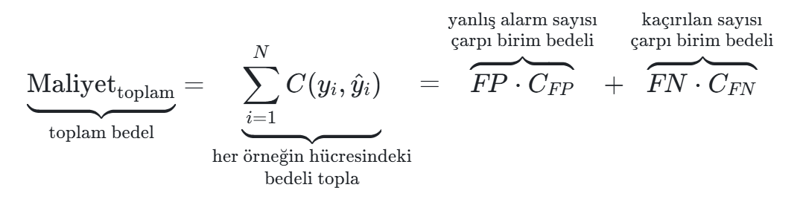
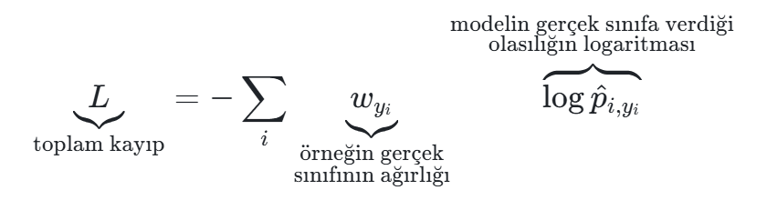
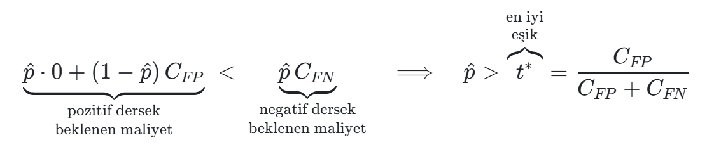

# 22. Dengesiz Veri ve Maliyete Duyarlı Öğrenme

## 22.1 Her Hatanın Bedeli Aynı Değildir

Standart algoritmalar tüm hataların **eşit maliyetli** olduğunu varsayar ve toplam hata sayısını en aza indirir:

$$
\text{Hata} = \sum_{i=1}^{N} \mathbb{I}(y_i \neq \hat{y}_i)
$$

<p align="center"></p>

**Ne anlatıyor?** Yanlış tahminler sayılır. Bölüm 9.1'deki örnekte $FP + FN = 250 + 150 = 400$ hata vardır; hangisinin daha pahalı olduğu hesaba girmez.

| Sembol | Okunuşu | Anlamı |
| :---: | :--- | :--- |
| $\mathbb{I}(\cdot)$ | "gösterge fonksiyonu" | İçindeki koşul doğruysa 1, değilse 0 |
| $y_i \neq \hat{y}_i$ | "ye i eşit değil ye şapka i" | Yanlış tahmin |

Oysa gerçek hayatta:
- Hasta birine "sağlıklısın" demek (**FN**) hastanın tedavi şansını yok edebilir. Sağlıklı birine "bir test daha yapalım" demek (**FP**) ise yalnızca zaman ve para kaybıdır.
- Geri ödenmeyecek bir krediyi onaylamak (banka anaparayı kaybeder), iyi bir müşteriyi reddetmekten (potansiyel kâr kaybı) çok daha pahalıdır.

Bu durum özellikle **dengesiz veri setlerinde** (dolandırıcılık %0.1, nadir hastalık %1, üretim hattındaki kusurlu parça %0.5) kritiktir. Algoritma nadir ama önemli sınıfı görmezden gelip çoğunluk sınıfını tahmin ederek yüksek doğruluk elde edebilir ([Bölüm 9.2](09-performans-olcutleri.md)).

## 22.2 Maliyet Matrisi

Karışıklık matrisindeki her hücreye bir **maliyet** atanır. Satırlar **gerçek**, sütunlar **tahmin edilen** sınıftır:

```math
C = \begin{bmatrix} C_{00} & C_{01} \\ C_{10} & C_{11} \end{bmatrix} = \begin{bmatrix} 0 & C_{FP} \\ C_{FN} & 0 \end{bmatrix}
```

<p align="center"></p>

**Ne anlatıyor?** Alt indisin ilk rakamı gerçek sınıfı (satır), ikinci rakamı tahmini (sütun) gösterir; 0 negatif, 1 pozitif sınıftır. **Dikkat:** Bölüm 9.1'deki karışıklık matrisinde pozitif sınıf ilk satırdaydı; burada sınıf 0 (negatif) ilk satırdadır.

Amaç artık hata **sayısını** değil, **toplam maliyeti** en aza indirmektir:

$$
\text{Maliyet}_{\text{toplam}} = \sum_{i=1}^{N} C(y_i, \hat{y}_i) = FP \cdot C_{FP} + FN \cdot C_{FN}
$$

<p align="center"></p>

Örnek (Bölüm 22.4'teki standart lojistik regresyon): $FP = 2$, $FN = 65$, $C_{FP} = 1$, $C_{FN} = 10$ → $2 \cdot 1 + 65 \cdot 10 = 652$.

| Sembol | Okunuşu | Anlamı |
| :---: | :--- | :--- |
| $C_{jk}$ | "ce je ka" | Gerçek sınıf $j$ iken $k$ tahmin etmenin maliyeti |
| $C_{FP}$, $C_{FN}$ | "ce ef pe", "ce ef en" | Sahte pozitif ve sahte negatif hatalarının maliyeti. Doğru tahminlerin maliyeti genellikle 0 alınır |
| $C(y_i, \hat{y}_i)$ | | $i$. örnek için ödenen bedel |

**Dikkat:** Hangi hatanın FP, hangisinin FN olduğu **pozitif sınıfın hangisi seçildiğine** bağlıdır. Raporlarda pozitif sınıfı her zaman açıkça belirtin.

## 22.3 Çözüm Yaklaşımları

1. **Veri seviyesi – yeniden örnekleme:**
   - **Aşırı örnekleme (oversampling):** Azınlık sınıfının örnekleri çoğaltılır. **SMOTE**, iki komşu azınlık örneği arasında **yapay yeni örnekler** üretir.
   - **Alt örnekleme (undersampling):** Çoğunluk sınıfından örnek atılır.
   - **Dikkat:** Yeniden örnekleme **yalnızca eğitim verisine** uygulanır; test verisi gerçek dünyayı temsil etmeli ve olduğu gibi kalmalıdır ([Bölüm 21](21-veri-sizintisi.md)).
2. **Algoritma seviyesi – sınıf ağırlıkları:** Kayıp fonksiyonunda pahalı sınıfın hataları daha ağır sayılır:
   $L = -\sum_{i} w_{y_i} \log \hat{p}_{i,y_i}$. Burada $w$, örneğin gerçek sınıfının ağırlığı; $\hat{p}$ ise modelin gerçek sınıfa verdiği olasılıktır. scikit-learn: `class_weight={0: 1, 1: 10}` veya `class_weight="balanced"`. `"balanced"` seçeneği ağırlıkları $w_c = n / (K \cdot n_c)$ ile hesaplar ($n$: örnek sayısı, $K$: sınıf sayısı, $n_c$: $c$ sınıfındaki örnek sayısı). %95 / %5 oranlı bir veride pozitif sınıfın ağırlığı, negatif sınıfınkinin yaklaşık 19 katı olur; bu yüzden aşağıdaki deneyde `"balanced"`, 10 katlık ağırlıktan daha güçlü bir etki yapar.

   

   **Ne anlatıyor?** Bu, Bölüm 7.3'teki log-loss'un sınıf ağırlıklı hâlidir. Pozitif sınıfın ağırlığı 10 ise, modelin gerçek sınıfa yalnızca 0.1 olasılık verdiği bir pozitif örneğin cezası $-\log 0.1 \approx 2.30$ yerine $10 \cdot 2.30 = 23.0$ olur.
3. **Karar eşiğini kaydırma (threshold moving):** Model eğitildikten sonra 0.5 eşiği değiştirilir. Olasılıklar iyi **kalibre** edilmişse (yani model "%10" dediği örneklerin gerçekten yaklaşık %10'u pozitifse), pozitif demenin beklenen maliyeti negatif demenin beklenen maliyetinden küçük olduğunda pozitif denmelidir:

```math
\hat{p}\cdot 0 + (1-\hat{p})\,C_{FP} \;<\; \hat{p}\,C_{FN} \quad\Longrightarrow\quad \hat{p} > t^{*} = \frac{C_{FP}}{C_{FP} + C_{FN}}
```

<p align="center"></p>

**Ne anlatıyor?** Sol taraf: Pozitif dersek örnek $\hat{p}$ olasılıkla gerçekten pozitiftir (bedel 0), $1 - \hat{p}$ olasılıkla negatiftir (bedel $C_{FP}$). Sağ taraf: Negatif dersek $\hat{p}$ olasılıkla bir pozitifi kaçırırız (bedel $C_{FN}$). $\Longrightarrow$ "ise" diye okunur. İki hata eşit pahalıysa ($C_{FP} = C_{FN}$) $t^* = 0.5$ olur.

| Sembol | Okunuşu | Anlamı |
| :---: | :--- | :--- |
| $\hat{p}$ | "pe şapka" | Modelin pozitif sınıf olasılığı (yukarıdaki ağırlıklı log-loss'taki $\hat{p}_{i,y_i}$'den farklı olarak burada her zaman **pozitif** sınıfın olasılığıdır) |
| $t^{*}$ | "te yıldız" | Maliyeti en küçük yapan eşik |

   **Örnek:** $C_{FP} = 1$, $C_{FN} = 10$ → $t^* = 1/11 \approx 0.09$. Model bir işlem için "yalnızca %10 ihtimalle dolandırıcılık" dese bile işlemi şüpheli olarak işaretlemek toplam maliyeti düşürür. Pratikte eşik, **doğrulama seti** üzerinde maliyeti en küçük yapacak şekilde de aranabilir (test setinde **değil**).

   > **Dikkat:** Sınıf ağırlıkları ve aşırı örnekleme, modelin olasılıklarını pozitif sınıf lehine kaydırır; olasılıklar artık kalibre değildir. Bu nedenle $t^*$ formülü bu yöntemlerle **birlikte** uygulanmamalıdır; yöntemlerden biri seçilmelidir.

## 22.4 Deney

%95 negatif / %5 pozitif veri, $C_{FP} = 1$, $C_{FN} = 10$, test seti (1200 örnek; 66'sı pozitif, recall değerleri bu 66'ya göre hesaplanır):

| Yöntem | FP | FN | Recall | Toplam maliyet |
| :--- | :---: | :---: | :---: | :---: |
| Standart lojistik regresyon (eşik 0.5) | 2 | 65 | 0.02 | 652 |
| `class_weight={0:1, 1:10}` | 195 | 44 | 0.33 | 635 |
| `class_weight="balanced"` | 382 | 22 | 0.67 | 602 |
| Rastgele aşırı örnekleme (eğitimde) | 379 | 23 | 0.65 | 609 |
| **Teorik eşik** $t^{\ast} = 0.091$ | 166 | 41 | 0.38 | **576** |
| Doğrulama setinde seçilen eşik (0.10) | 140 | 46 | 0.30 | 600 |

**Yorum:** Standart model neredeyse hiçbir pozitifi yakalamıyor (recall 0.02). Doğruluğu çok yüksek görünür (~%94.4), ama maliyeti en yüksek olan odur. Maliyete duyarlı tüm yöntemler doğruluğu **düşürürken** toplam maliyeti **azaltıyor**. **Mühendislikte hedef en yüksek doğruluk değil, problemi en düşük toplam maliyetle çözmektir.**

**Kod:** [`codes/python/13_maliyete_duyarli_ogrenme.py`](https://github.com/erkanozhan/machinelearning/blob/main/codes/python/13_maliyete_duyarli_ogrenme.py) (Kod, rastgele aşırı örneklemeyi kendisi yapar; SMOTE'u denemek için: `pip install imbalanced-learn`)

## 22.5 WEKA ile Maliyete Duyarlı Öğrenme

WEKA'da `meta → CostSensitiveClassifier` bir **meta-sınıflandırıcıdır**: Kendi başına karar vermez, J48 veya NaiveBayes gibi bir temel sınıflandırıcıyı sarmalayarak ona maliyet bilinci kazandırır.

**Veri:** WEKA klasöründeki `data/credit-g.arff` (Alman kredi verisi; 1000 başvuru, sınıflar `good` ve `bad`). Veri setinin kendi belgelerinde önerilen maliyet: kötü bir müşteriyi iyi sanmak, iyi bir müşteriyi reddetmekten **5 kat** pahalıdır.

1. Explorer → `credit-g.arff` → Classify → `meta → CostSensitiveClassifier`.
2. `classifier = trees → J48`.
3. `costMatrix` → 2×2 matris. Sınıf sırası `good, bad`; **satır = gerçek, sütun = tahmin**:

```text
             tahmin: good   tahmin: bad
gerçek good      0.0           1.0        ← iyi müşteriyi reddetmek (maliyet 1)
gerçek bad       5.0           0.0        ← kötü müşteriye kredi vermek (maliyet 5, kritik hata)
```

4. `minimizeExpectedCost`:
   - `False` (varsayılan) → **Yeniden ağırlıklandırma (reweighting):** Pahalı sınıfın örneklerine eğitimde daha fazla ağırlık verilir.
   - `True` → **Beklenen maliyeti en küçük yapma:** Model normal eğitilir; tahmin anında en olası sınıf yerine **beklenen maliyeti en düşük** sınıf seçilir (eşik kaydırmanın genel hâli).
5. **More options → Cost-sensitive evaluation** → aynı matrisi girin. Çıktıda `Total Cost` ve `Average Cost` satırları görünür.
6. Karşılaştırma: Önce tek başına J48, sonra CostSensitiveClassifier. Genellikle **doğruluk biraz düşer**, `bad` sınıfının recall değeri artar ve **toplam maliyet azalır**. Model, pahalı hatayı önlemek için karar sınırlarını daha temkinli hâle getirmiştir.

> **İpucu:** Dengesiz veri için WEKA'da ayrıca `supervised → instance → SMOTE` (Package Manager'dan kurulur), `ClassBalancer` ve `Resample` filtreleri vardır. Bunları sızıntısız kullanmak için `FilteredClassifier` içine yerleştirin.

## 22.6 Kısa Uygulama: Kredi Başvurularında Maliyete Duyarlı Model

Veri: [`data/kredi_basvurulari.arff`](https://github.com/erkanozhan/machinelearning/blob/main/data/kredi_basvurulari.arff) / [`data/kredi_basvurulari.csv`](https://github.com/erkanozhan/machinelearning/blob/main/data/kredi_basvurulari.csv). Varsayım: Yüksek riskli bir başvuruyu kaçırmak (FN), düşük riskli birini reddetmekten (FP) **5 kat** pahalıdır.

**WEKA**
1. `kredi_basvurulari.arff` → Classify → `meta → CostSensitiveClassifier` → `classifier = functions → Logistic`.
2. `costMatrix` (sınıf sırası `dusuk, yuksek`; satır = gerçek, sütun = tahmin): `[0 1; 5 0]`.
3. **More options → Cost-sensitive evaluation** ile aynı matrisi girin, 10 katlı CV ile **Start**. `Total Cost` değerini, tek başına `Logistic`'in toplam maliyetiyle karşılaştırın.

**Python**

```python
import pandas as pd                                           # Tablo işlemleri
from sklearn.compose import make_column_transformer          # Sütun türüne göre ön işleme
from sklearn.impute import SimpleImputer                     # Eksik değer doldurma
from sklearn.linear_model import LogisticRegression          # Sınıflandırıcı
from sklearn.metrics import confusion_matrix                 # Karışıklık matrisi
from sklearn.model_selection import cross_val_predict        # CV ile her örneğe tahmin
from sklearn.pipeline import make_pipeline                   # Adımları zincirleme
from sklearn.preprocessing import OneHotEncoder, StandardScaler   # One-hot ve Z-skoru

VERI = "https://raw.githubusercontent.com/erkanozhan/machinelearning/main/data/"   # Veri klasörünün adresi
df = pd.read_csv(VERI + "kredi_basvurulari.csv")              # 600 başvuru
X, y = df.drop(columns="risk"), (df["risk"] == "yuksek").astype(int)   # Pozitif sınıf: yüksek risk
on_isleme = make_column_transformer(                          # Eksik doldurma + ölçekleme + one-hot
    (make_pipeline(SimpleImputer(strategy="median"), StandardScaler()),   # Sayısal: medyan + ölçek
     ["yas", "aylik_gelir", "borc_gelir_orani", "calisma_yili"]),          # Sayısal sütunlar
    (make_pipeline(SimpleImputer(strategy="most_frequent"), OneHotEncoder()), ["sehir", "gecmis_gecikme"]))   # Kategorik

C_FP, C_FN = 1, 5                                             # Riskliyi kaçırmak 5 kat pahalı
for agirlik in [None, {0: C_FP, 1: C_FN}]:                    # Standart vs maliyete duyarlı
    model = make_pipeline(on_isleme, LogisticRegression(max_iter=1000, class_weight=agirlik))   # Sınıf ağırlıklı model
    tahmin = cross_val_predict(model, X, y, cv=10)            # Her başvuru, görmediği katta tahmin edilir
    TN, FP, FN, TP = confusion_matrix(y, tahmin).ravel()      # Karışıklık matrisinin 4 hücresi
    # Hata sayılarını ve toplam maliyeti yazdır
    print(f"class_weight={agirlik}: FP={FP} FN={FN} → toplam maliyet = {FP * C_FP + FN * C_FN}")
```

| Model | FP | FN | Toplam maliyet |
| :--- | :---: | :---: | :---: |
| Standart lojistik regresyon | 18 | 80 | 418 |
| Maliyete duyarlı (`class_weight = {0: 1, 1: 5}`) | 161 | 29 | **306** |

**Gözlem soruları**
- Maliyete duyarlı model çok daha fazla başvuruyu reddediyor (FP 18 → 161). Buna rağmen toplam maliyet neden düştü?
- Maliyet oranı 5 yerine 2 olsaydı sonuç nasıl değişirdi? Kodu değiştirip deneyin.

---

[← 21. Veri Sızıntısı](21-veri-sizintisi.md) · [İçindekiler](../Ders_Notu.md) · [23. WEKA KnowledgeFlow →](23-weka-knowledgeflow.md)
