# 23. WEKA KnowledgeFlow

## 23.1 Nedir? Explorer'dan Farkı

**KnowledgeFlow**, veri madenciliği sürecini **sürükle-bırak** bileşenlerden oluşan bir **akış** (İng. *flow*) olarak tasarlamayı sağlayan WEKA arayüzüdür. Her kutu (WEKA 3.8'de **step**, eski sürümlerde **bean**) bir işlemi temsil eder: veri yükleme, filtre, sınıflandırıcı, değerlendirme, görselleştirme. Oklar ise verinin akış yolunu gösterir. Veri akışı (data-flow) programlamada bir bileşen, girdisi hazır olduğunda çalışır. Bu yüzden birbirinden bağımsız dallar **paralel** yürütülebilir.

| Özellik | Explorer | KnowledgeFlow |
| :--- | :--- | :--- |
| Veri işleme | Yalnızca toplu (batch): tüm veri belleğe yüklenir | Toplu **ve artımlı (incremental)**: veri satır satır akabilir |
| Bellek | Büyük veride `OutOfMemory` riski | Artımlı modda çok büyük dosyalar işlenebilir |
| Süreç tasarımı | Sekmeler arası elle geçiş | Görsel akış; dallanan ve paralel akışlar |
| Tekrar kullanım | Her seferinde elle yapılır | Akış `.kf` dosyası olarak kaydedilip yeniden çalıştırılır |
| Model karşılaştırma | Modeller sırayla çalıştırılır | Birden fazla modelin ROC eğrisi aynı grafikte |

## 23.2 Bileşen Kategorileri

| Kategori | Örnek bileşenler | Görevi |
| :--- | :--- | :--- |
| **DataSources** | `ArffLoader`, `CSVLoader`, `DatabaseLoader` | Veriyi okur |
| **DataSinks** | `ArffSaver`, `SerializedModelSaver` | Veriyi veya modeli kaydeder |
| **Filters** | `Normalize`, `Discretize`, `Remove`, `PrincipalComponents` | Ön işleme |
| **Classifiers** | `J48`, `NaiveBayes`, `RandomForest`, `NaiveBayesUpdateable` | Öğrenme |
| **Evaluation** | `ClassAssigner`, `ClassValuePicker`, `CrossValidationFoldMaker`, `TrainTestSplitMaker`, `ClassifierPerformanceEvaluator`, `IncrementalClassifierEvaluator` | Sınıfı belirleme, veriyi bölme, performans hesaplama |
| **Visualization** | `TextViewer`, `GraphViewer`, `ModelPerformanceChart`, `StripChart` | Sonuçları gösterir |

**Bağlantı türleri** (kaynak bileşene sağ tık → *Connections* altından seçilir):

| Bağlantı | Taşıdığı şey |
| :--- | :--- |
| `dataSet` | Tüm veri seti (toplu) |
| `instance` | Tek tek örnekler (artımlı akış) |
| `trainingSet` / `testSet` | Bölünmüş eğitim ve test verisi |
| `batchClassifier` | Eğitilmiş model + ilgili test verisi (toplu) |
| `incrementalClassifier` | Artımlı model güncellemeleri |
| `text` | Metin sonuçları (özet, karışıklık matrisi) |
| `graph` | Ağaç/graf yapısı |
| `thresholdData` | ROC eğrisi için eşik verileri |
| `chart` | Canlı grafik verisi |

## 23.3 Uygulama 1: J48 ile 10 Katlı Çapraz Doğrulama

1. GUI Chooser → **KnowledgeFlow**. Solda bileşen paleti, sağda tasarım tuvali (canvas) bulunur.
2. **DataSources → ArffLoader** tuvale bırakılır. Sağ tık (veya çift tık) → **Configure** → `iris.arff`. *(Yükleyici dosyayı hemen okumaz, akış başlayınca okur.)*
3. **Evaluation → ClassAssigner** eklenir. ArffLoader'a sağ tık → **dataSet** → ClassAssigner'a bağlanır. Configure → sınıf özniteliği (`class` veya *last*). *(WEKA varsayılan olarak son sütunu sınıf kabul eder; bu bileşen bunu açıkça belirtir.)*
4. **Evaluation → CrossValidationFoldMaker** eklenir. ClassAssigner → **dataSet** → CrossValidationFoldMaker. Configure: `Folds = 10`, `Seed = 1` (tekrarlanabilirlik için sabit tutulur).
5. **Classifiers → trees → J48** eklenir. CrossValidationFoldMaker'dan J48'e **iki bağlantı** yapılır: **trainingSet** ve **testSet**. J48 her katta önce eğitim verisiyle modeli kurar, sonra test verisinde tahmin üretir.
6. **Evaluation → ClassifierPerformanceEvaluator** eklenir. J48 → **batchClassifier** → değerlendirici.
7. **Visualization → TextViewer**: Değerlendirici → **text** → TextViewer.
8. **Visualization → GraphViewer**: **J48 → graph** → GraphViewer. *(Bu bağlantı değerlendiriciden değil doğrudan J48'den alınır, çünkü gösterilecek şey modelin kendisidir.)*
9. Araç çubuğundaki **Run** (oynat) düğmesine basılır. Alttaki *Status* alanında ilerleme izlenir.
10. TextViewer → sağ tık → **Show results**: doğruluk, Kappa, karışıklık matrisi. GraphViewer → sağ tık → **Show plots**: karar ağacının görüntüsü.

> **İpucu:** J48, C4.5 algoritmasının Java uygulamasıdır. Bölmeleri **kazanç oranına** (gain ratio) göre seçer ve budama yapar ([Bölüm 12](12-karar-agaclari.md)).

## 23.4 Uygulama 2: J48 ve Random Forest'ın ROC Karşılaştırması

1. Uygulama 1'deki akışta ClassAssigner ile CrossValidationFoldMaker arasındaki bağlantıyı silin (bağlantıya sağ tık → **Delete**). Araya **Evaluation → ClassValuePicker** ekleyin: ClassAssigner → **dataSet** → ClassValuePicker → **dataSet** → CrossValidationFoldMaker. ClassValuePicker'ın ayarlarında ROC için **pozitif sınıfı** seçin (ör. `weather.nominal` için `yes`, `iris` için `Iris-versicolor`). ROC analizi bir sınıfın diğerlerine karşı ayrılmasına dayanır.
2. **Classifiers → trees → RandomForest** ekleyin. CrossValidationFoldMaker'dan RandomForest'a da **trainingSet** ve **testSet** bağlantıları yapın. *(Bir kaynaktan çıkan veri birden çok hedefe paralel olarak akabilir.)*
3. İkinci bir **ClassifierPerformanceEvaluator** ekleyin: RandomForest → **batchClassifier** → değerlendirici 2.
4. **Visualization → ModelPerformanceChart** ekleyin. **Her iki** değerlendiriciden → **thresholdData** → aynı ModelPerformanceChart.
5. **Run** → ModelPerformanceChart → sağ tık → **Show chart**. İki modelin ROC eğrisi aynı grafikte, farklı renklerde görünür.

**Yorum:** Eğrisi sol üst köşeye daha yakın olan ve **AUC**'si daha büyük olan model, tüm eşik değerleri genelinde daha iyi ayırt edicidir ([Bölüm 9.3](09-performans-olcutleri.md)). Bu grafik, tek bir doğruluk değerinden çok daha kapsamlı bir karşılaştırma sağlar.

## 23.5 Uygulama 3: Artımlı Öğrenme ve Akan Veri

IoT sensörleri, finansal işlemler, web kayıtları gibi uygulamalarda veri sürekli bir **akış (stream)** hâlinde gelir; tamamını bekleyip eğitmek mümkün değildir. **Artımlı öğrenmede** model her yeni örnekle kendini günceller ve tüm veriyi bellekte tutmaz. WEKA'da bunu yapabilen algoritmalar `UpdateableClassifier` arayüzünü uygular:
- **NaiveBayesUpdateable:** Her örnekle olasılık tablolarını günceller.
- **IBk:** `windowSize` ile son $n$ örneği saklar.
- **HoeffdingTree (VFDT):** Her örneği yalnızca bir kez okuyarak ağaç kuran, çok hızlı akışlar için tasarlanmış karar ağacı.

1. **DataSources → ArffLoader** eklenir ve bir veri dosyası seçilir. **Evaluation → ClassAssigner** eklenir; ArffLoader → **instance** → ClassAssigner (veri satır satır akar). ClassAssigner'da sınıf özniteliği seçilir.
2. **Classifiers → bayes → NaiveBayesUpdateable** eklenir; ClassAssigner → **instance** → NaiveBayesUpdateable.
3. **Evaluation → IncrementalClassifierEvaluator**; sınıflandırıcıdan → **incrementalClassifier**. Bu değerlendirici **önce test, sonra eğitim (prequential / test-then-train)** yöntemini kullanır: Gelen her örnek önce tahmin edilir, sonra gerçek etiketiyle model güncellenir.
4. **Visualization → StripChart**; değerlendiriciden → **chart**. StripChart'a sağ tık → **Show chart**, sonra akışı başlatın. Doğruluk ve RMSE, bir EKG cihazı gibi zaman içinde akan çizgiler olarak görünür (x: işlenen örnek sayısı).
5. İsteğe bağlı olarak değerlendiriciden → **text** → **TextViewer** bağlantısı yapılır; akış bitince TextViewer'a sağ tık → **Show results** ile özet sonuçlar okunur.

## 23.6 KnowledgeFlow'da Veri Sızıntısına Dikkat

`Normalize` veya `Discretize` gibi bir filtre **CrossValidationFoldMaker'dan önce** konursa, istatistikler (min, max, aralık sınırları) **tüm veriden** (test katları dahil) hesaplanır ve sonuçlar iyimser çıkar ([Bölüm 21](21-veri-sizintisi.md)). Doğru yol, filtreyi CrossValidationFoldMaker'dan **sonra** yerleştirmek (eğitim ve test bağlantılarıyla) ya da `FilteredClassifier` kullanmaktır.

---

[← 22. Dengesiz Veri ve Maliyete Duyarlı Öğrenme](22-dengesiz-veri.md) · [İçindekiler](../Ders_Notu.md) · [24. WEKA Experimenter ve Sonuçların Raporlanması →](24-weka-experimenter.md)
