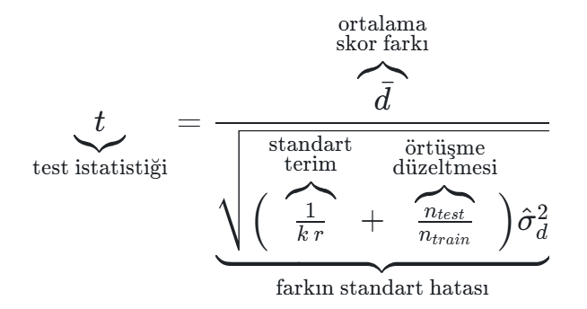

# 24. WEKA Experimenter ve Sonuçların Raporlanması

## 24.1 Rastgelelik, Seed ve Tekrarlanabilirlik

Çapraz doğrulama veya yüzdeye göre bölme yapılırken veri **rastgele** karıştırılır. Bu rastgeleliği kontrol eden sayıya **seed** (tohum; scikit-learn'de `random_state`) denir.
- Seed **sabit tutulursa**, deney farklı bilgisayarlarda ve farklı zamanlarda **aynı bölmelerle** tekrarlanabilir. Bilimsel karşılaştırma için bu şarttır.
- Seed değiştikçe performans ölçütleri de biraz değişir. Tek bir seed ile elde edilen sonuç **şanslı** veya **şanssız** olabilir. Bu yüzden deneyler **farklı seed'lerle defalarca tekrarlanıp** ortalama ve standart sapma raporlanmalıdır. Experimenter tam olarak bunu otomatik yapar.

## 24.2 Gözlenen Fark Gerçek mi?

Explorer'da A algoritması %82.1, B algoritması %80.9 doğruluk verdi. A gerçekten daha mı iyi, yoksa fark rastlantısal mı? Bu soruyu cevaplamak için **istatistiksel test** gerekir.

**Experimenter**, birden çok algoritmayı birden çok veri setinde **aynı bölmelerle**, **tekrarlı** olarak çalıştırır ve sonuçları istatistiksel olarak karşılaştırır.

**Kullanımı:**
1. GUI Chooser → **Experimenter**.
2. **Setup** sekmesi → **New**.
   - *Results Destination:* sonuçların kaydedileceği ARFF/CSV dosyası (isteğe bağlı).
   - *Experiment Type:* `Cross-validation`, `Number of folds = 10`, `Classification`.
   - *Iteration Control:* `Number of repetitions = 10` → 10 farklı seed ile 10 × 10 = **100 çalıştırma**.
   - *Datasets* → **Add new…** → veri setlerini ekleyin.
   - *Algorithms* → **Add new…** → karşılaştırılacak algoritmaları ekleyin (ör. ZeroR, J48, NaiveBayes, RandomForest, SMO).
3. **Run** sekmesi → **Start**.
4. **Analyse** sekmesi → **Experiment** düğmesi (az önceki deneyi yükler).
   - *Comparison field:* `Percent_correct` (doğruluk), `Kappa_statistic`, `Area_under_ROC`, `F_measure`…
   - *Test base:* referans algoritma (ör. J48).
   - *Significance:* 0.05. **Perform test.**

**Çıktının okunması:**

```text
Dataset              (1) trees.J48 | (2) bayes.Nai  (3) trees.Ran
--------------------------------------------------------------------
iris        (100)      94.73       |   95.53          95.33
diabetes    (100)      74.49       |   75.75          76.02 v
--------------------------------------------------------------------
                           (v/ /*) |  (0/2/0)        (1/1/0)
```

- **`v`:** Test base'e göre **istatistiksel olarak anlamlı biçimde daha iyi**.
- **`*`:** Anlamlı biçimde **daha kötü**.
- **Boş:** Anlamlı fark yok.
- `(1/1/0)`: 1 veri setinde daha iyi, 1'inde fark yok, 0'ında daha kötü.
- `(100)`: Her ortalamanın kaç sonuçtan hesaplandığıdır: 10 tekrar × 10 kat = 100. Örnek sayısı **değildir**.

*(Yukarıdaki sayılar okumayı göstermek için verilmiş bir örnektir; kendi deneyinizde değerler farklı olacaktır.)*

> **ZeroR**'u her deneye ekleyin. Her örneğe en sık sınıfı söyleyen bu "hiçbir şey öğrenmeyen" model, **alt sınırdır**. Modeliniz ZeroR'dan anlamlı biçimde iyi değilse işe yarar bir şey öğrendiği gösterilemez.

<details>
<summary><b>Derinleşme (İleri Seviye): Neden "düzeltilmiş" t-testi?</b></summary>

WEKA varsayılan olarak **Paired T-Tester (corrected)** testini (Nadeau & Bengio, 2003) kullanır. Çapraz doğrulamada eğitim setleri büyük ölçüde örtüştüğü için skorlar birbirinden **bağımsız değildir**. Standart t-testi bu durumda varyansı olduğundan küçük tahmin eder ve gerçekte olmayan farkları "anlamlı" bulur. Düzeltilmiş test, varyansa bir düzeltme terimi ekler:

$\displaystyle t = \frac{\bar{d}}{\sqrt{\left(\frac{1}{k\thinspace r} + \frac{n_ {test}}{n_ {train}}\right)\hat{\sigma}_ d^2}}$



**Ne anlatıyor?** Standart eşleştirilmiş t-testinde parantez içinde yalnızca $\frac{1}{kr}$ olurdu. 10 tekrar × 10 katlı CV'de bu $\frac{1}{100} = 0.01$'dir; düzeltmeyle $0.01 + \frac{1}{9} \approx 0.121$ olur. Varyans yaklaşık 12 kat büyür, $t$ küçülür ve "anlamlı fark" bulmak zorlaşır.

| Sembol | Okunuşu | Anlamı |
| :---: | :--- | :--- |
| $\bar{d}$ | "de bar" | İki algoritmanın skor farklarının ortalaması |
| $\hat{\sigma}_d^2$ | "sigma şapka de kare" | Farkların varyansı |
| $k$, $r$ | "ka", "ar" | Kat sayısı ve tekrar sayısı ($k \cdot r$ = toplam çalıştırma) |
| $n_{test}/n_{train}$ | | Test ve eğitim kümesi boyutlarının oranı (10 katlı CV'de 1/9) |

Çok sayıda veri setinde çok sayıda algoritma karşılaştırılırken **Friedman testi** ve ardından **Nemenyi** post-hoc testi önerilir (Demšar, 2006).

</details>

## 24.3 Sonuçların Raporlanması

Akademik bir çalışmada yalnızca "en iyi parametreler şunlardır" demek yeterli değildir. **Hangi aralıkta, hangi doğrulama stratejisiyle, hangi ölçütle** arandığı açıkça yazılmalıdır.

**Örnek ifadeler:**

> "Model performansını artırmak amacıyla öğrenme oranı η ∈ {0.001, 0.01, 0.1} ve düzenlileştirme katsayısı λ ∈ {0, 0.001, 0.01} aralıklarında, doğruluk ölçütü ve beş katlı çapraz doğrulama kullanılarak ızgara araması (grid search) yöntemiyle taranmıştır. En iyi performans η = 0.01 ve λ = 0.001 değerleriyle elde edilmiştir."

> "Hiperparametre seçiminin performans tahminini iyimser yönde etkilememesi için iç içe çapraz doğrulama uygulanmıştır. İç döngüde (5 kat) Grid Search ile en iyi parametreler belirlenmiş, dış döngüde (10 kat) model performansı değerlendirilmiştir. Ortalama doğruluk %76.3 ± 4.2 olarak hesaplanmıştır."

> "Random Forest, Lojistik Regresyon'a kıyasla daha yüksek ortalama doğruluk elde etmiştir (sırasıyla %82.1 ve %76.3). Bu fark, 10 tekrarlı 10 katlı çapraz doğrulama üzerinde uygulanan düzeltilmiş eşleştirilmiş t-testi sonucunda p < 0.05 düzeyinde istatistiksel olarak anlamlı bulunmuştur."

> "İki algoritma arasında gözlenen performans farkı istatistiksel olarak anlamlı bulunmamıştır (p = 0.23)."

**Bir raporda bulunması gerekenler:** veri setinin tanımı (örnek sayısı, öznitelikler, sınıf dağılımı) · ön işleme adımları · kullanılan algoritmalar ve hiperparametreleri · doğrulama stratejisi (kat sayısı, tekrar, seed) · birden fazla uygun performans ölçütü (ortalama ± std) · referans (baseline) model · istatistiksel test ve anlamlılık düzeyi · karışıklık matrisi.

## 24.4 Özet Tablo

| Kavram | Tanım | Pratik çıkarım |
| :--- | :--- | :--- |
| **Genelleme** | Görülmemiş veride tutarlı tahmin yapabilme | Asıl hedef eğitim verisinde değil, yeni veride başarıdır |
| **Aşırı öğrenme** | Eğitim verisini ezberleme | Eğitim hatası düşerken doğrulama hatası yükseliyorsa alarm |
| **Eksik öğrenme** | Ne eğitim ne de test verisinde yeterli başarı gösterememe | Model kapasitesini veya öznitelikleri artırın |
| **Düzenlileştirme (L1/L2)** | Parametre büyüklüğünü cezalandırma | Aşırı öğrenmeyi azaltır; L1 öznitelik seçer |
| **Erken durdurma** | Doğrulama hatası yükselince durma | Daha kısa eğitim, daha iyi genelleme |
| **Öğrenme oranı** | Gradyan inişinde adım büyüklüğü | Çok büyük: ıraksama; çok küçük: yavaş yakınsama |
| **Öznitelik ölçekleme** | Öznitelikleri ortak ölçeğe getirme | Gradyan ve mesafe tabanlı yöntemler için şart |
| **Hiperparametre** | Eğitimden önce belirlenen ayar | Sezgiyle değil, sistematik aramayla seçin |
| **Grid Search** | Tüm kombinasyonları deneme | Kapsamlı ama pahalı |
| **Random Search** | Dağılımlardan rastgele deneme | Geniş uzaylarda daha verimli |
| **Nested CV** | Seçim ve değerlendirmeyi ayırma | Tarafsız performans tahmini |
| **Veri sızıntısı** | Test bilgisinin eğitime karışması | Tüm ön işlemleri Pipeline / FilteredClassifier içine koyun |
| **Düzeltilmiş t-testi** | CV skorları için anlamlılık testi | Farkın rastlantısal olup olmadığını gösterir |

## 24.5 Temel İlkeler ve Sık Yapılan Hatalar

1. **Basitten başlayın:** Önce ZeroR ve basit bir model (lojistik/lineer regresyon, tek ağaç) ile bir referans oluşturun.
2. **Test verisini koruyun:** Test setine yalnızca en sonda, bir kez bakın.
3. **Veriye dayalı karar verin:** Hiperparametreleri sezgiyle değil, aramayla seçin.
4. **İstatistik kullanın:** Tekrarlı CV ve anlamlılık testi yapın.
5. **Şeffaf raporlayın:** Seed'i, parametre aralıklarını, doğrulama stratejisini ve kullanılan testleri raporda açıkça belirtin.

| Yanlış | Doğru |
| :--- | :--- |
| Eğitim verisindeki doğruluğu raporlamak | Test verisinde veya çapraz doğrulamayla raporlamak |
| Ön işlemi tüm veriye uygulayıp sonra CV yapmak | Ön işlemi her katta yalnızca eğitim kısmından öğrenmek (Pipeline) |
| Grid Search'ün `best_score_` değerini nihai sonuç olarak vermek | Nested CV veya ayrı bir test seti kullanmak |
| Dengesiz veride yalnızca doğruluğa bakmak | F1, MCC, Kappa, PR-AUC, maliyet |
| Tek seed ile tek deney | Tekrarlı deney, ortalama ± std |
| Kimlik sütununu (ad, müşteri no) öznitelik olarak kullanmak | Kimlik sütunlarını çıkarmak (`Remove` filtresi) |

> En iyi model, teorik olarak kusursuz olan değil; **eldeki zaman ve kaynaklar içinde en tutarlı ve en genellenebilir sonucu veren** modeldir. Bilimsel bir çalışmada bu tutarlılığı ve tarafsızlığı kanıtlamak, raporun en önemli kısmıdır.

---

[← 23. WEKA KnowledgeFlow](23-weka-knowledgeflow.md) · [İçindekiler](../Ders_Notu.md) · [25. Kapsamlı Uygulama (Proje Ödevi) →](25-proje-odevi.md)
